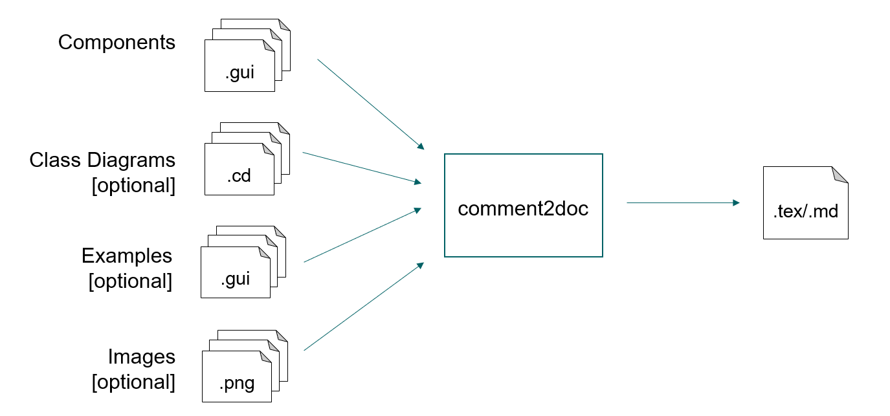

# comment2doc

This tool processes GUI, CD models, images and source code to produce markdown or LaTeX files.

## Context Diagram



For detailed repository structure and key directories, [see here](#repository-structure).

## Prerequisites

- Install the JDK version [11][jdk11] or [17][jdk17]
- [Gradle](https://docs.gradle.org/current/userguide/getting_started_eng.html#gradle_intro)
- (Optional) install Intellij IDEA

[jdk11]: https://www.oracle.com/de/java/technologies/downloads/#java11

[jdk17]: https://www.oracle.com/de/java/technologies/downloads/#java17

## Quick Start

### If you use terminal, console or the shell,

To generate MD files, execute:
```
gradlew md
```

To generate MD files, execute:
```
gradlew latex
```

### If you use Intellij IDEA,

you may open this file and click the green arrows near
the commands above, or use gradle-specific interface.

## Tool Access

[build.gradle](./build.gradle) file specifies the tasks that hint on what gets
executed when you run `gradlew md` or `gradlew LaTeX`. The `$buildDir` is
`build` by default:

### Markdown Task

```groovy
tasks.register('md', JavaExec) {
  mainClass.set('de.monticore.doc.MontigemDocTool')
  classpath = sourceSets.main.runtimeClasspath
  args(
      "-i", "./src/test/resources/lib",
      "--md", "$buildDir/md",
      "--examples", "./src/test/resources/examples",
      "--hwc", "./src/test/resources/hwc",
      "--cd", "./src/test/resources/lib"
  )
}
```
### Latex Task

```groovy
tasks.register('LaTeX', JavaExec) {
  mainClass.set('de.monticore.doc.MontigemDocTool')
  classpath = sourceSets.main.runtimeClasspath
  args(
      "-i", "./src/test/resources/lib",
      "--LaTeX", "$buildDir/LaTeX",
      "--examples", "./src/test/resources/examples",
      "--images", "./src/test/resources/images",
      "--hwc", "./src/test/resources/hwc",
      "--cd", "./src/test/resources/lib",
      "--preproc", "true"
  )
}
```

- -i : input library root for models
- --md / --LaTeX : output folder for the generated document
- --examples : example models used in component sections (optional)
- --hwc : handwritten code snippets (optional)
- --cd : class diagram models (optional)
- --preproc : pretty printer for .gui examples before inserting them (optional)


# LaTeX Generation Feature in comment2doc

## Functionalities

The following is supported:

- **GUI models** (`.gui`)  
- **CD models** (`.cd`)  
- **Source code with comments**  
- **Images** (`.png`, `.jpg`)
  - For naming of the images, please see in [requirements.md](https://git.rwth-aachen.de/se-student/ss25/lectures/sle/projects/comment2doc/-/blob/e09f5b420a894483bdfe6ffe99d5a363187fc9fc/requirements.md#naming) 
- **Support for special characters** (e.g., `%`, `_`, `&`, etc.)  
- **Hyperlinks** and keywords are highlighted  
- **Bullet points** converted from comment lists  
- **Cross-referencing**  
  - Links between class diagrams, tables, listings, and GUI components  
  - Optional references to images  

## Tool Workflow

1. **Input**  
   - `.gui` - GUI components and (optional) their usage examples 
   - `.cd` - Class diagrams (optional)  
   - `.png` - Images (optional)  

2. **AST Processing**  
   - GUI-component file and CD-files are parsed into AST
   - Models and comments are extracted into the intermediate data structure `GuiDocArtifact`. For more information, [see below](#the-role-of-the-class-guidocartifact)
   - If examples are provided, the examples can be preprocessed using the `--preproc` flag. For more information, [see below](#preprocessing-of-examples)

3. **Transformation**  
   - Extracted comments, attributes, and examples are mapped into LaTeX templates
   - Comments are parsed with the help of [CommonMark](https://commonmark.org/)
   - Bullet lists, tables, and references are generated

4. **Templates**  
   - Uses `.ftl` (FreeMarker LaTeX templates) for formatting 
   - Images are path-referenced in the templates
   - These templates act as skeleton that defines both the structure and the formatting of the output files
   - The tool puts the content (e.g., GUI components, class diagrams, code examples) into predefined templates

5. **Output**  
   - Firstly, a single `.tex` file per component is produced to `build/LaTeX/`
   - Then, all `.tex` files for all components are then assembled into one single `main.tex` file   
   - Finally, `main.tex` can be compiled into a PDF file


# Comment Translation

## Overview 

- The tool uses the **CommonMark** library to parse the Markdown comments which are then customly rendered from CommonMark AST to LaTeX content
- The two classes `PrintUtilForLaTex.java` (see more [here](#printutilforlatexjava)) and `CDDocUtilForLaTeX.java` (see more [here](#cddocutilforLaTeXjava)) are the core part designed to translate Markdown comments to LaTeX output 


## Translation

The following table shows the possible translation from Markdown comment to LaTeX and then how it would look like in the rendered PDF.

| In comment (Markdown-style) | Generated LaTeX | Rendered in PDF |
|------------------------------|-----------------|-----------------|
| `**comment**` | `\textbf{comment}` | **comment** |
| `*comment*` | `\textit{comment}` | *comment* |
| `` `code` `` | `\texttt{code}` | `code` |
| `[Link](https://google.com)` | `\href{https://google.com}{Link}` | [Link](https://google.com) |
| `https://google.com` | `\url{https://google.com}` | https://google.com |
| `- comment` | `\begin{itemize}\item comment\end{itemize}` | • comment |
| `1. comment` | `\begin{enumerate}\item comment\end{enumerate}` | 1. comment |
| ```` ```java\nint x;\n``` ```` | `\begin{lstlisting}[language=java]\nint x;\n\end{lstlisting}` | Java code block with syntax highlighting |
| `# Heading` | `\section{Heading}` | Section heading |
| `## Subheading` | `\subsection{Subheading}` | Subsection heading |
| `> quote` | `\begin{quote}quote\end{quote}` | > quote |
| `---` | `\noindent\rule{\textwidth}{0.4pt}` | ―――――― |
| `"param": description` | `\begin{itemize}\item \texttt{param}: description\end{itemize}` | • `param`: description |
| `username: the user’s login` | `\begin{itemize}\item \texttt{username}: the user’s login\end{itemize}` | • `username`: the user’s login |
| `Special Symbols: a_b, %, c$d` | `Special Symbols: a\_b, \%, c\$d` | Special Symbol: a\_b, %, c$d |


## Component Documentation Structure

- **Component Title and Description**  
  - Contains the component name and its top-level documentation comment  

- **Examples**  
  - Code listings showing usage examples of the component (`.gui` files) if provided  
  - Optionally includes an image

- **API Parameters**  
  - Table listing the parameters of the component  
    - Columns:
      - Parameter - the name of the parameter
      - Type
      - Default Value - if not provided, then "-" is displayed
    - Each parameter may include an additional description  

- **Related Types and Components** - introduce class diagrams and components connected to the class diagram  

  - **Class Diagrams**  
    - Subsections for each related type  
    - May include:  
      - A LaTeX code listing of the class diagram model  
      - A paragraph for each class with optional comments  

  - **Class Attributes**  
    - Table listing the attributes of a class  
    - Columns: **Name**, **Type**, **Modifiers**, optional description  
    - If no attribute exist, “This class has no attributes.” is shown 

  - **Class Associations**  
    - Table listing associations between classes  
    - Columns: **Type**, **Target Class**, **Role**, **Cardinality**, optional description  
    - If no associations exist, “This class has no associations.” is shown

  - **Related Components**  
    - Table listing other GUI components used in the implementation of this component if such exist
    - Columns: **Component Name**, **Reference** (cross-referenced in LaTeX) 

## Output File

To view a concrete example of the generated documentation and how the components appear in the final PDF, see [this sample output](docs/output_example.pdf).

The corresponding component models that were used to produce this output can be found in `src/test/resources/lib/mc/fenix`.


## Limitations and Considerations

1. **MD Structure**: The system assumes well-formed Markdown input. Malformed comments are processed as simple strings without formatting
2. **Listings**: The `lstlisting` environment is supported, but should not be used in the comment body directly as the generated table will be too large


## Supporting Information

### The role of the class `GUIDocArtifact`

`GUIDocArtifact` is a helper class that collects and organizes all documentation-related information (ASTs, code, examples, images, class diagrams) for a given GUI component. 
It also cleans and filters these artifacts so they can be correctly used in generated reports. During our work, the artifact was extended to include additional information, 
enabling more complete and accurate documentation. 

A dedicated instance of GUIDocArtifact is created for every GUI component to be documented, which maintains information about:

- the AST (parsed structure) of the main component
- the source code of the component model
- examples (model snippets, code, or images) related to the component
- class diagram types connected to the component and how they should be referenced in the file
- information about related components


### Preprocessing of Examples

When including a usage example of a documented component in the report, we need to ensure it follows specific formatting guidelines so that it can be properly displayed in LaTeX. 
To achieve this, we can use the preproc flag, which activates the pretty-printing feature. In this mode, the examples are not taken directly from the examples directory; instead, 
they are passed through the `GUIDSLExamplePrettyPrinter`, ensuring that the code is presented in a clear and readable way for the reader. 

The pretty printer generally guarantees that:

- Code is consistently formatted with proper indentation and line breaks
- Comments are preserved and displayed alongside the code (if enabled)
- Compact or multiline layouts are applied depending on the structure of the example
- Blocks, components, parameters, and expressions are represented in a standardized style
- The output is clean and suitable for publication in documents such as LaTeX reports

The feature does not fully support more complex cases (e.g., very long variable names, lengthy string literals). 
Therefore, example code should be kept concise and within the supported formatting scope to ensure correct display.

### Repository Structure

The project follows a standard Gradle + Java layout:

```
COMMENT2DOC
├── gradle/wrapper/                  # Gradle wrapper for consistent builds
│   ├── gradle-wrapper.jar
│   └── gradle-wrapper.properties
├── build.gradle                     # Build configuration (Gradle tasks)
├── .gitlab-ci.yml                   # CI pipeline definition
├── src/
│   ├── main/
│   │   ├── java/de/monticore/doc/  # Core implementation
│   │   │   ├── CDDocUtilForLaTeX.java        # LaTeX utilities for Class Diagrams
│   │   │   ├── GUI2LaTeX.java                # Main generator for LaTeX
│   │   │   ├── GUI2MD.java                   # Main generator for Markdown
│   │   │   ├── GUIDocArtifact.java           # Collects and organizes doc artifacts
│   │   │   ├── MontigemDocTool.java          # Entry point for Gradle tasks (md/latex)
│   │   │   ├── PrintUtil.java                # Shared printing/formatting helpers
│   │   │   └── PrintUtilForLaTeX.java        # Markdown - latex renderer
│   │   │                             
│   │   ├── java/de/monticore/guidsl/_prettyprint/
│   │   │   └── GUIDSLExamplePrettyPrinter.java  # pretty printer for GUI examples
│   │   └── resources/
│   │       └── umpldoc/                      # FreeMarker templates
│   │           ├── GUI2MainLaTeX.ftl
│   │           ├── GUI2PartLaTeX.ftl
│   │           └── GUI2MD.ftl
│   └── test/                                 # Unit tests and example input models
```

### Key Directories

- **`src/main/java/de/monticore/doc/`** ´- core logic of the tool  
  - `MontigemDocTool.java` - the Gradle tasks (`md`, `latex`)  
  - `GUI2LaTeX.java` , `GUI2MD.java` - output based on freemaker templates  
  - `GUIDocArtifact.java` -  a single documented component (AST + examples + diagrams)  
  - `PrintUtilForLaTeX.java` , `CDDocUtilForLaTeX.java` - formatting and LaTeX translation  

- **`src/main/java/de/monticore/guidsl/_prettyprint/`** - pretty printer for GUI examples, used when running with the `--preproc` flag  

- **`src/main/resources/umpldoc/`** - freemaker (`.ftl`) templates that define the skeleton of the generated LaTeX and Markdown files  

- **`src/test/`** - examples input models (`.gui`, `.cd`, etc.) and test cases  

- **`gradlew` / `gradlew.bat`** - wrapper scripts  

### Core Components For Comment Translation

#### PrintUtilForLaTex.java

- Base utility class for LaTeX formatting
- Handles various Markdown elements including links, code blocks, lists, emphasis, and special formatting
- The class implements a multi-stage comment processing pipeline:

1. **Comment Type Detection** - Distinguishes between inline comments (`//`) and block comments (`/* */`, `/** */`)
2. **Text Preprocessing** - Handles custom formats and normalizes text before Markdown parsing
3. **CommonMark Parsing** - Uses the CommonMark library to parse Markdown content
4. **Comment Marker Removal**: Intelligent removal of comment delimiters (`//`, `/*`, `*/`, `*`) while preserving intentional asterisks in URLs and formatting.


#### CDDocUtilForLaTeX.java

- This specialized utility class extends the base LaTeX functionality to handle Class Diagram-specific elements, providing methods for processing classes, associations, attributes, and their relationships

#### CD Association
The class provides association handling:

- **Class-Association Mapping**: Creates mappings between classes and their associated relationships for organized documentation generation
- **Association Type Detection**: Identifies different association types (composition, aggregation) and formats them appropriately for LaTeX output
- **Directional Analysis**: Handles bidirectional, unidirectional, and undirected associations with proper side determination
- **Role Inference**: Automatic role name inference from qualified type names with proper capitalization handling

#### CD Attribute
Comprehensive attribute handling includes:

- **Type Formatting**: Proper LaTeX escaping for attribute types
- **Visibility Detection**: Support for private, protected, public, and package visibility
- **Modifier Handling**: Static and final modifier detection and formatting
- **Default Values**: Safe processing and escaping of default values

