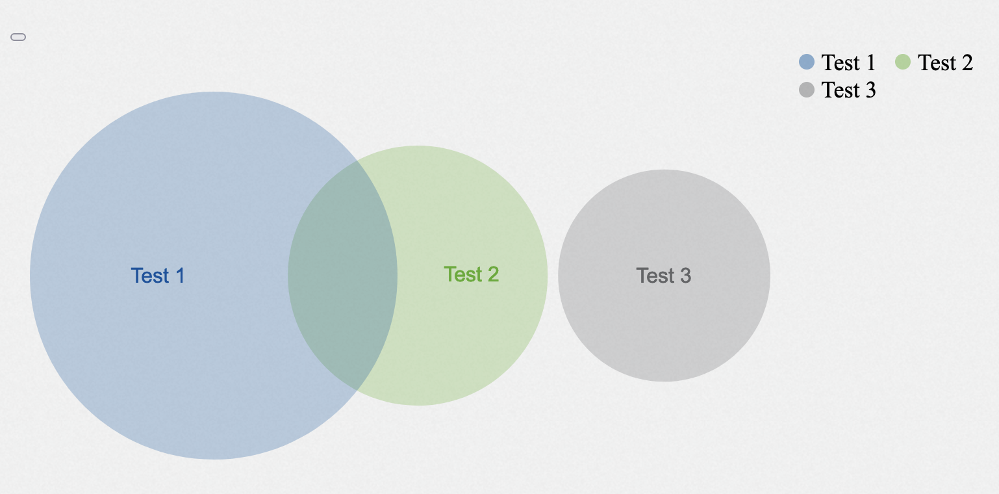

# Table of Contents

- [Table of Contents](#table-of-contents)
  - [A Brief General Explanation](#a-brief-general-explanation)
  - [Basic Components](#basic-components)
    - [Button](#button)
    - [Audio](#audio)
    - [Icon](#icon)
    - [Image](#image)
    - [Link](#link)
    - [Text](#text)
    - [Table](#table)
    - [Video](#video)
  - [Layout Components](#layout-components)
    - [Card](#card)
    - [Column](#column)
    - [Row](#row)
    - [Grid](#grid)
    - [Tree Node](#tree-node)
  - [Input Field Components](#input-field-components)
    - [Text Input](#text-input)
    - [Dropdown Input](#dropdown-input)
    - [Autocomplete Input](#autocomplete-input)
    - [TextArea Input](#textarea-input)
    - [CheckBox Input](#checkbox-input)
    - [Radio Input](#radio-input)
    - [Range Input](#range-input)
  - [Chart Components](#chart-components)
    - [Bar Chart](#bar-chart)
    - [Bullet Chart](#bullet-chart)
    - [Candlestick Chart](#candlestick-chart)
    - [Gauge Chart](#gauge-chart)
    - [Heatmap Chart](#heatmap-chart)
    - [Line Chart](#line-chart)
    - [Pie Chart](#pie-chart)
    - [Sunburst Chart](#sunburst-chart)
    - [Venn Diagram](#venn-diagram)
    - [Network Graph](#network-graph)
    - [Scatter Plot](#scatter-plot)

## A Brief General Explanation

**GUI Components** are the atomic elements of GUI web pages.
Here comes a library of provided core components and  
aggregation mechanisms to define more complex GUI components.

This list explains:
* How to include a GUI component in a webpage (the *signature*)
* The *parameters* to customize that GUIDSL component
* The *defaults* of these parameters

Please also note that besides this core set of GUI components
there is the possibility of composing more complex GUI components
from these core elements. For this purpose, in particular, the layout 
components are helpful because they allow aggregation of other 
GUI components in columns, rows, or other forms of grids.

Please note that the two human roles mentioned here are:
The *developer* who designs the webpage (i.e., the GUI model)
and thus includes GUI components and defines the parameters.
The *user* interacts with the running webpage, e.g. by clicking
a button, reading or writing text, etc.

## Basic Components

### [Button](../frontend_rte/basic/GemButton/GemButton)

A button enables user interaction through simple clicks or taps, triggering actions or tasks.

---

### [Audio](../frontend_rte/basic/GemAudio/GemAudio)

The audio component embeds sound content on a page.

---

### [Icon](../frontend_rte/basic/GemIcon/GemIcon)

Displays an icon on a web page.

---

### [Image](../frontend_rte/basic/GemImage/GemImage)

The Image web component displays images on a webpage. It needs the **_source_** attribute to set the image path. You can use the optional **_alt_** attribute for a text description if the image doesn't load. 

---

### [Link](../frontend_rte/basic/GemLink/GemLink)

The link element is used to create a hyperlink to another web page or to a specific section within a page. The _**source**_ attribute specifies the destination of the link. The _**text**_ attribute specifies the text to be displayed for the link

---

### [Text](../frontend_rte/basic/GemText/GemText)

The text component is used to display text on a webpage. It needs the **_value_** attribute to set the text. You can use the optional **_style_** attribute for a style to be applied to the text.

---

### [Table](../frontend_rte/table/GemTable/GemTable)

A table organizes and displays text or other view elements in rows and columns. A header gives information about what to expect in each column of the body.

A visualization of a table can be seen in the following Figure.

---

<!--
### [Table](../frontend_rte/table/GemTable/GemTable)

A table organizes and displays data in rows and columns. Data tables allow users to input, edit, and manipulate data easily, perform calculations and analyses, sort and filter data.
A visualization of a table can be seen in the following Figure.

---
-->

### [Video](../frontend_rte/basic/GemVideo/GemVideo)

The component shows a video on a web page. 

## Layout Components

### [Card](../frontend_rte/arrange/GemCard/GemCard)

Card is a simple container which consists of a header and a body. Body may contain any elements, such as button, inputs, charts, etc.

---

### [Column](../frontend_rte/arrange/GemColumn/GemColumn)

GemColumn is a container which arranges any number of input elements vertically

---

### [Row](../frontend_rte/arrange/GemRow/GemRow)

GemRow is a container which arranges any number of input elements horizontally.

---

### [Grid](../frontend_rte/arrange/GemGrid/GemGrid)

GemGrid is a container which arranges input elements in a grid pattern.

---

### [Tree Node](../frontend_rte/arrange/GemTreeNode/GemTreeNode)

Combine multiple tree nodes to a tree. A tree displays hierarchical data. It provides a visual representation of parent-child relationships, allowing users to navigate and interact with a hierarchical dataset.

---

## Input Field Components

### [Text Input](../frontend_rte/input/GemTextInput/GemTextInput)

The component is an input field with an optional label. It is used whenever a
user input is required, e.g. to create/update objects, provide a search field,
etc.

---

### [Dropdown Input](../frontend_rte/input/GemDropdownInput/GemDropdownInput)

The component is a dropdown with an optional label. When clicking on the input, it will open a list of options to select from. It is used whenever a user is required, to choose between different predefined options.

---
### [Autocomplete Input](../frontend_rte/input/GemAutocompleteInput/GemAutocompleteInput)

The component is an autocomplete input with an optional label. When clicking on the input, it suggests options in a list, almost like a dropdown. However, the user can still type any input. The list of options is filtered depending on the input characters. It is not mandatory to select one of the options. It is used whenever a user input is required and the user should be assisted with suggestions.

---

### [TextArea Input](../frontend_rte/input/GemTextareaInput/GemTextareaInput)

This component represents a text area with an optional label. It is designed to
be used in forms or other contexts where multi-line user text input is required.

---

### [CheckBox Input](../frontend_rte/input/GemCheckBoxInput/GemCheckBoxInput)

The component is a checkbox with a label. It is used whenever an input for a
binary choice is required, e.g., agreeing to terms and conditions or opting in
to a newsletter.

---

### [Radio Input](../frontend_rte/input/GemRadioInput/GemRadioInput)

This component represents a radio button with a label. It is intended for use in forms or other scenarios where users must choose one of several options.

---

### [Range Input](../frontend_rte/input/GemRangeInput/GemRangeInput)

This component displays a label with a slider that allows users to select a value within a specified range. This component can be used in forms and other interactive interfaces to allow users to select a range of values easily.

## Chart Components

### [Bar Chart](../frontend_rte/charts/GemBarChart/GemBarChart)

A Bar-Chart present a set of two dimensional data with a number of rectangular bars that can go _horizontally_ or _vertically_, with their values being proportional to what they represent.
The chart itself visualizes categories (given as Strings) on one axis and a discrete integer value on the other as height or size. Additionally, the bars can be _stacked_ or _aligned_ to visualizes multiple sub-categories of a second data dimension.

---

### [Bullet Chart](../frontend_rte/charts/GemBulletChart/GemBulletChart)

Bullet chart is the variation of the bar chart, it features a single, primary measure, compares that measure to one or more other measures to enrich its meaning (for example, compared to a target), and displays it in the context of qualitative ranges of performance, such as poor, satisfactory, and good. It is developed to overcome the fundamental issues of gauges and meters, they display too little information but required too much space.

---

### [Candlestick Chart](../frontend_rte/charts/GemCandlestickChart/GemCandlestickChart)

A Candlestick chart displays a few important datapoints for a (short) period of time. It is often used to display how stock prices changed over said short periods.

---

### [Gauge Chart](../frontend_rte/charts/GemGaugeChart/GemGaugeChart)

Gauge charts are also known as dial charts or speedometer charts. Normally they consist of a dial and a pointer, use the pointer to read the information. There are several different types of gauge charts, such as Speedometer, Linear Gauge Charts and Angular Gauge Charts. Gauge charts are very helpful to visualize and compare single data value with a quantitative context. 

---

### [Heatmap Chart](../frontend_rte/charts/GemHeatmapChart/GemHeatmapChart)

Heatmap-charts visualize different kinds of data, for instance temperature, in a tabular-like format. They are helpful for finding patterns, relationships between data or other kind of information.

---

### [Line Chart](../frontend_rte/charts/GemLineChart/GemLineChart)

Line chart is a graphical representation to describe the data changes over a given period. It is connected by straight line segments. The horizontal axis is usually a time scale; for example, minutes, hours, days, months, or years, while the vertical axis would have the values.

---

### [Pie Chart](../frontend_rte/charts/GemPieChart/GemPieChart)

Pie chart is also called circle chart. It looks like a circle, which is divided to slices to visualize information. Different categories of data could be indicated by different colors. It is helpful to observe the numerical proportion of data.

---

### [Sunburst Chart](../frontend_rte/charts/GemSunburstChart/GemSunburstChart)

Sunburst-charts look like pie-charts with multiple layers. Each of them refine the information of the previous layer and give information about the distribution of the parent layer in percent. The sunburst-chart can also be represented by a tree-like structure with parent nodes and subnodes which contain the refined information about the parent nodes.

---

### [Venn Diagram](../frontend_rte/charts/GemVennDiagram/GemVennDiagram)

A Venn diagram is a diagram style that shows the logical relation between sets. It is used to teach elementary set theory, and to illustrate simple set relationships in probability, logic, statistics, linguistics and computer science.

---
### [Network Graph](../frontend_rte/charts/GemNetworkGraph/GemNetworkGraph)

NetworkGraph is a graphical representation of a network. It is composed of nodes and edges. Nodes are the entities of the network, and edges are the relationships between the nodes.

---

### [Scatter Plot](../frontend_rte/charts/GemScatterPlot/GemScatterPlot)

A scatter plot displays a relation between data in a two-dimensional plot and is often used to identify clusters or 
outliers

