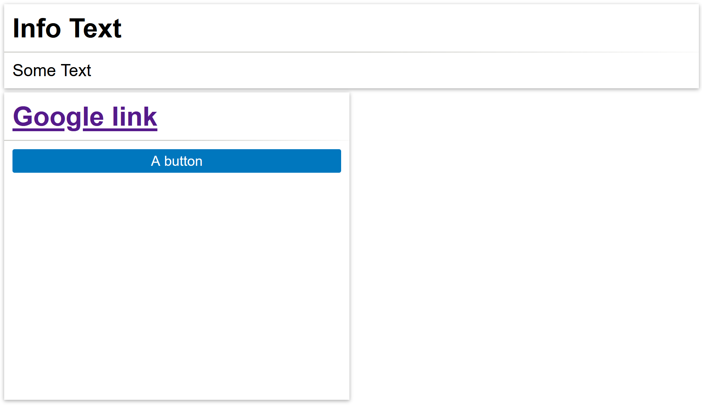

---
hide:
  - navigation
---

Card is a container with a header and a body. Both header and body may contain
any elements, such as button, inputs, charts, etc.

## Usage example

```ts
/* (c) https://github.com/MontiCore/monticore */
package example_arrange;

import mc.fenix.arrange.GemCard;
import mc.fenix.basic.GemText;
import mc.fenix.basic.GemButton;
import mc.fenix.basic.GemLink;

page GemCardExample() {
  @GemCard(
    title = "Info Text",
    component = @GemText(value = "Some Text")
  );

  @GemCard(
    width = "50%",
    height = "300px",
    titleComponent = @GemLink(url = "https://www.google.com/", text = "Google link"),
    component = @GemButton(label = "A button")
  );
}
```



## GUI Model

`GemCard.gui` ([open](https://git.rwth-aachen.de/monticore/umlp/-/blob/dev/umlp-rte/client/models/mc/fenix/arrange/GemCard.gui))

```java
package mc.fenix.arrange;

component GemCard(
  String height = "auto",
  String width = "auto",
  String title = "",
  GUIViewElement titleComponent,
  GUIViewElement component
)
```

| Name | Type  |  Description |  Default value 
| ----- | ----- |  ----- | ---- |  
| `height` | `String` | Height of the component in `px`, `%`, `vh`, etc. | `"auto"` (collapses to a minimal possible height with respect to content) |
| `width`  | `String` | Width of the component in `px`, `%`, `vh`, etc. | `"auto"` (collapses to a minimal possible width with respect to content) |
| `title` | `String` | **Deprecated.** Text displayed at the top of the card. | `""` 
| `titleComponent` | `GUIViewElement` | A component displayed at the top of the card. If `titleComponent` and `title` are both set, the `titleComponent` will be used. | `null` (no element is shown) 
| `component` | `GUIViewElement` | Component displayed in body of the card. | `null` (no element is shown)
