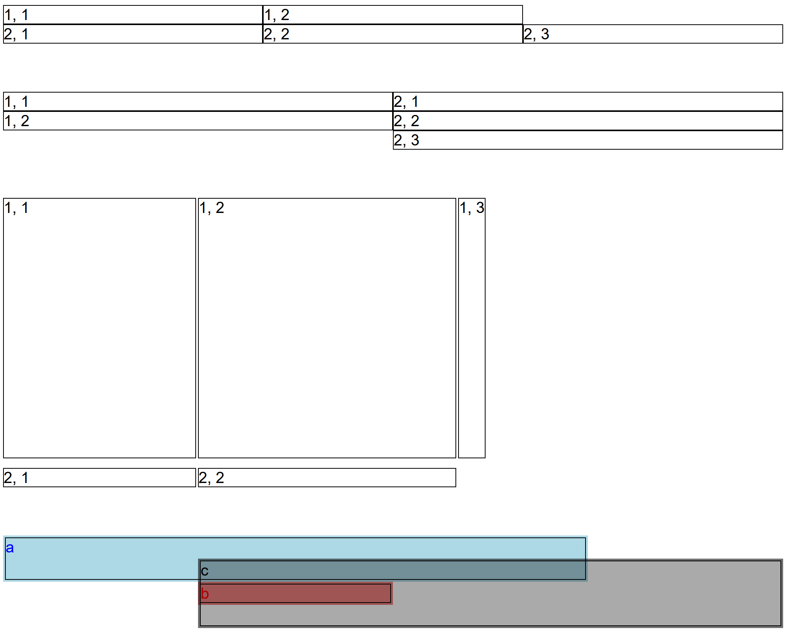

---
hide:
  - navigation
---

GemGrid is a container which arranges input elements in a grid pattern.

## Usage example

Following example shows 4 grids.

Grid 1 and 2 show simple cases. If a row contains less items than a maximum
length row, the row is filled with empty cells to match the longest row.

Grid 3 (`fixedGrid`) defines fixed width and height for the entire grid.
Additionally, property `x` is set to specify widths of columns and implicetly
defines how many columns (3) there are in the grid:
- First column is `200px` wide.
- Second column is `1fr` wide, i.e. `1 / amout_of_columns * grid_width` (1/3).
- Third column has an automatic width (takes available space).

Property `y` defines the rows of the grid accordingly.

Grid 4 (`spanningGrid`) defines grid dimensions via properties `x` and `y`.
The grid specifies cells using `GemGridCell` component that specifies start
and end coordinates of the cell rectangle in the grid.

```ts
package example_arrange;

import mc.fenix.arrange.GemGrid;
import mc.fenix.arrange.GemGridCell;
import mc.fenix.basic.GemText;

page GemGridExample() {
  @GemGrid(
    rows = [
      [@GemText(value = "1, 1"), @GemText(value = "1, 2")],
      [@GemText(value = "2, 1"), @GemText(value = "2, 2"), @GemText(value = "2, 3")]
    ]
  );

  @GemGrid(
    cols = [
      [@GemText(value = "1, 1"), @GemText(value = "1, 2")],
      [@GemText(value = "2, 1"), @GemText(value = "2, 2"), @GemText(value = "2, 3")]
    ]
  );

  fixedGrid@GemGrid(
    width = "500px",
    height = "300px",
    x = ["200px", "1fr", "auto"],
    y = ["auto", "20px"],
    rowGap = "10px",
    colGap = "2px",
    rows = [
      [@GemText(value = "1, 1"), @GemText(value = "1, 2"), @GemText(value = "1, 3")],
      [@GemText(value = "2, 1"), @GemText(value = "2, 2")]
    ]
  );

  spanningGrid@GemGrid(
    // 4x4
    x = ["1fr", "1fr", "1fr", "1fr"],
    y = ["1fr", "1fr", "1fr", "1fr"],
    cells = [
      cell1@GemGridCell(a = [1, 1], b = [3, 2], content = @GemText(width = "100%", height = "100%", value = "a", color = "blue")),
      cell2@GemGridCell(a = [2, 3], content = @GemText(width = "100%", height = "100%", value = "b", color = "red")),
      cell3@GemGridCell(a = [2, 2], b = [4, 4], content = @GemText(width = "100%", height = "100%", value = "c", color = "black"))
    ]
  );
}
```


Additional SCSS styles:
```scss
:host {
  gem-text {
    border: 1px solid black;
  }

  row-gap: 50px;
  display: flex;
  flex-direction: column;
}

.cell1 {
  background-color: lightblue;
  border: 2px solid lightblue;
}

.cell2 {
  background-color: lightcoral;
  border: 2px solid lightcoral;
}

.cell3 {
  background-color: #00000055;
  border: 2px solid #00000055;
}
```

## GUI Model

`GemRow.gui`
([open](https://git.rwth-aachen.de/monticore/umlp/-/blob/dev/umlp-rte/frontend/models/mc/fenix/arrange/GemRow.gui))

```java
package mc.fenix.arrange;

component GemGrid(
  String height = "auto",
  String width = "auto",
  String hAlign = "stretch",
  String vAlign = "stretch",
  String rowGap = "0",
  String colGap = "0",
  List<String> x,
  List<String> y,
  List<List<GUIViewElement>> rows,
  List<List<GUIViewElement>> cols,
  List<GUIViewElement> cells
)
```

| Name | Type  |  Description |  Default value |
| ---- | ---- | ----- | ----- | 
| `height` | `String` | Height of the component in `px`, `%`, `vh`, etc. | `"auto"` (collapses to a minimal possible height with respect to content) |
| `width`  | `String` | Width of the component in `px`, `%`, `vh`, etc. | `"auto"` (collapses to a minimal possible width with respect to content) |
| `hAlign`  | `String` (restricted set) | Horizontal alignment of the embedded components. Invalid values are ignored. | `"left"` |
||`"left"`, `"center"`, `"right"` | Set position of the elements inside the container. ||
||`"stretch"`| Stretch elements proportionally to fill space if the elements' size is not specified. ||
||`"space-between"`| Distribute empty space equally between the elements. ||
||`"space-around"`| Distribute empty space around each element equally. ||
||`"space-evenly"`| Distribute empty space around the elements and make those gaps equal size. ||
| `vAlign` | `String` (restricted set) | Vertical alignment of the embedded components. Invalid values are ignored. | `"top"` |
||`"top"`, `"center"`, `"bottom"`| Set position of the elements inside the container. ||
||`"stretch"`| Stretch elements proportionally to fill space if the elements' size is not specified. ||
||`"space-between"`| Distribute empty space equally between the elements. ||
||`"space-around"`| Distribute empty space around the elements equally. ||
||`"space-evenly"`| Distribute empty space around the elements and make those gaps equal size. ||
| `rowGap` | `String` | Gap between rows of elements in the container in `px`, `%`, `vh`, etc. Relevant when `wrap` is set to `"wrap"` or `"wrap-reverse"`. | `"0"` |
| `colGap` | `String` | Gap between columns of elements in the container in `px`, `%`, `vh`, etc. | `"0"` |
| `x` | `List<String>` | Specifies widths of grid columns. The amount of columns is equal to the length of the list. | `null` (the widths are defined automatically) |
| `y` | `List<String>` | Specifies heights of grid rows. The amount of rows is equal to the length of the list. | `null` (the heights are defined automatically) |
| `rows` | `List<List<GUIViewElement>>` | Rows of a grid. The length of the longest row defines the amount of columns, unless `x` is specified. If `rows` and `cols` are defined, `rows` are used. | `null` (no content if `rows`, `cols` or `cells` are defined) |
| `cols` | `List<List<GUIViewElement>>` | Columns of a grid. The length of the longest column defines the amount of rows, unless `y` is specified. | `null` (no content if `rows`, `cols` or `cells` are defined) |
| `cells` | `List<GUIViewElement>` | Cells of a grid. Normally set to a list of `GemGridCell` component that can specify the space occupied by a cell. The cells may overlap.  If `cells`, `rows` and `cols` are defined, `cells` are used. | `null` (no content if `rows`, `cols` or `cells` are defined) |
