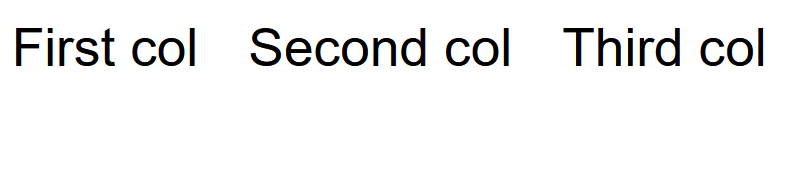
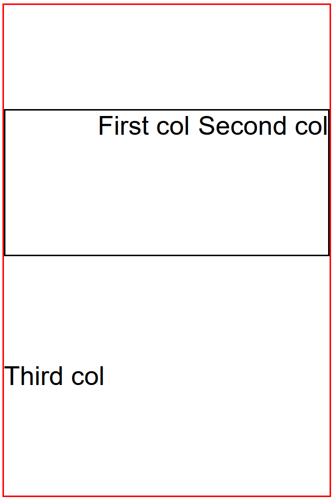

---
hide:
  - navigation
---

GemRow is a container which arranges input elements horizontally.

## Usage example

```ts
package example_arrange;

import mc.fenix.arrange.GemRow;
import mc.fenix.basic.GemText;

page GemRowExample() {
  @GemRow(
    colGap = "15px",
    components = [
      @GemText(value = "First col"),
      @GemText(value = "Second col"),
      @GemText(value = "Third col")
    ]
  );
}
```


---

Following example shows a `200 x 300` row. The vertical alignment of
elements is set to evenly distribute extra space to the top of the inner
row, between the inner row and the "Third col", and to the bottom of the
"Third col". The outer row is set to wrap elements that cannot fit into the
container. Since the inner row has width of `100%`, the "Third col" is
forced to wrap. The inner row sets horizontal align to `"right"` which forces
"First col" and "Second col" to the right of the container. The `colGap` is set
to `"5px"` which creates a gap between the "First col" and "Second col".
```ts
package example_arrange;

import mc.fenix.arrange.GemRow;
import mc.fenix.basic.GemText;

page GemRowExample2() {
  outer@GemRow(
    width = "200px",
    height = "300px",
    vAlign = "space-evenly",
    wrap = "wrap",
    components = [
      inner@GemRow(
        width = "100%",
        height = "30%",
        hAlign = "right",
        colGap = "5px",
        components = [
          @GemText(value = "First col"),
          @GemText(value = "Second col")
        ]
      ),
      @GemText(value = "Third col")
    ]
  );
}
```
Additional SCSS styles:
```scss
.outer { border: 1px solid red; }
.inner { border: 1px solid black; }
```



## GUI Model

`GemRow.gui`
([open](https://git.rwth-aachen.de/monticore/umlp/-/blob/dev/umlp-rte/frontend/models/mc/fenix/arrange/GemRow.gui))

```java
package mc.fenix.arrange;

component GemRow(
  String height = "100%",
  String width = "100%",
  String hAlign = "stretch",
  String vAlign = "stretch",
  String rowGap = "0",
  String colGap = "0",
  String wrap = "nowrap",
  List<GUIViewElement> components,
  GUIViewElement component
)
```

| Name | Type  |  Description |  Default value |
| ---- | ---- | ----- | ----- | 
| `height` | `String`  | Height of the component in `px`, `%`, `vh`, etc. | `"100%"` (takes 100% of its parent height) |
| `width`  | `String` | Width of the component in `px`, `%`, `vh`, etc. | `"100%"` (takes 100% of its parent width) |
| `hAlign`  | `String` (restricted set) | Horizontal alignment of the embedded components. Invalid values are ignored. | `"left"` |
||`"left"`, `"center"`, `"right"` | Set position of the elements inside the container. ||
||`"stretch"`| Stretch elements proportionally to fill space if the elements' size is not specified. ||
||`"space-between"`| Distribute empty space equally between the elements. ||
||`"space-around"`| Distribute empty space around each element equally. ||
||`"space-evenly"`| Distribute empty space around the elements and make those gaps equal size. ||
| `vAlign` | `String` (restricted set) | Vertical alignment of the embedded components. Invalid values are ignored. | `"top"` |
||`"top"`, `"center"`, `"bottom"`| Set position of the elements inside the container. ||
||`"stretch"`| Stretch elements proportionally to fill space if the elements' size is not specified. ||
||`"space-between"`| Distribute empty space equally between the elements. ||
||`"space-around"`| Distribute empty space around the elements equally. ||
||`"space-evenly"`| Distribute empty space around the elements and make those gaps equal size. ||
| `rowGap` | `String` | Gap between rows of elements in the container in `px`, `%`, `vh`, etc. Relevant when `wrap` is set to `"wrap"` or `"wrap-reverse"`. | `"0"` |
| `colGap` | `String` | Gap between columns of elements in the container in `px`, `%`, `vh`, etc. | `"0"` |
| `wrap` | `String` (restricted set) | Set behavior for element wrapping. Invalid values are ignored. | `"nowrap"` |
||`"nowrap"`| Elements are never wrapped. If elements do not into the container, a scrollbar appears. ||
||`"wrap"`| Elements that do not fit into the container are wrapped, i.e. a new column is created to the right. ||
||`"wrap-reverse"`| Similar to `"wrap"`, but a new column is created to the left. ||
| `components` | `List<GUIViewElement>` | Components to display inside a column. | `null` (no elements) |
| `component` | `GUIViewElement` | **Deprecated.** Shortcut for `components` property for the case when only one component has to be displayed. If both `component` and `components` are defined, `component` is shown first. | `null` (no element) |
