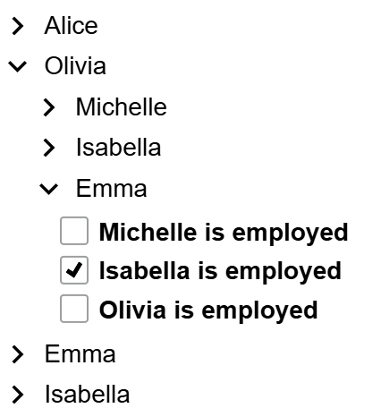
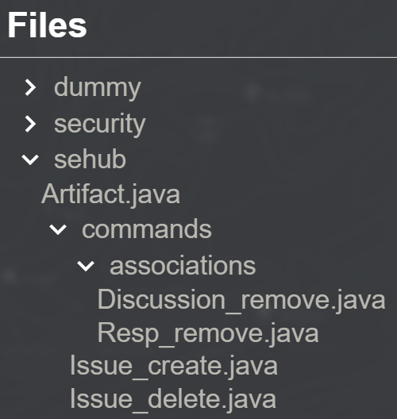

Combine multiple tree nodes to a tree. A tree displays hierarchical data. It provides a visual representation of parent-child relationships, allowing users to navigate and interact with a hierarchical dataset. By default, an icon is shown for parent nodes that have children to indicate that the node can be expanded. It changes direction depending if the children subtree is expanded or collapsed.

## Usage examples

### Tree with nested loops
```gui
package example_arrange;

import Domain.Person;

import mc.fenix.arrange.GemTreeNode;
import mc.fenix.basic.GemText;
import mc.fenix.input.GemCheckBoxInput;

page GemTreeNodeExample(List<Person> persons) {
  @GemTreeNode(children = [
    @iterate(Person p : persons) {
      @GemTreeNode(
        content = @GemText(value = p.name),
        children = [
          @iterate(Person f : p.friends) {
            @GemTreeNode(
              content = @GemText(value = f.name),
              children = [
                @iterate(Person ff : f.friends) {
                  @GemCheckBoxInput(
                    labelText = ff.name + " is employed",
                    checked = ff.employed
                  );
                }
              ]
            );
          }
        ],
        onClick = sayHello(p.name)
      );
    }
  ]);
}
```



### Recursive tree structure

Create component that recursively references itself. `@guard` can be used to define a termination condition for the recursion.
```gui
package gui;

import mc.fenix.arrange.GemTreeNode;
import mc.fenix.basic.GemText;

import Sehub.Artifact;

component DirNode(Artifact artifact) {
  @guard(isDirectory()) {
    @GemTreeNode(
      content = @GemText(value = artifact.name),
      children = [
        @iterate(Artifact childArt : getChildren(artifact)) {
          @DirNode(artifact = childArt);
        }
      ]
    );
  }
  else {
    @GemTreeNode(
      content = @GemText(value = artifact.name)
    );
  }
}
```

Use recursive component to build a tree.
```gui
package gui;
import mc.fenix.arrange.GemCard;
import mc.fenix.arrange.GemTreeNode;
import gui.DirNode;

import Sehub.Directory;
import Sehub.Artifact;

page ProjectPage(Directory project) {
  @GemCard(
    title = "Files",
    component = @GemTreeNode(children = [
      @iterate(Artifact art : project.contains) {
        @DirNode(artifact = art);
      }
    ])
  );
}
```




## GUI Model

`GemTreeNode.gui` ([open](https://git.rwth-aachen.de/monticore/umlp/-/blob/dev/umlp-rte/client/models/mc/fenix/arrange/GemTreeNode.gui))

```
package mc.fenix.arrange;

component GemTreeNode(
  boolean isExpanded = false,
  GUIViewElement content,
  List<GUIViewElement> children,
  Event<Void> onClick,
  Event<boolean> onToggle
)
```

| Name | Type | Description | Default value |
|---|---|---|---|
| `isExpanded` | `boolean` | Whether subtree of this node is expanded. | `false` (collapsed) |
| `content` | `GUIViewElement` | Content of node. If not set, the node is expected to be the root of the tree. | `null` |
| `children` | `List<GUIViewElement>` | Tree nodes. Each node defines a root of a subtree, respectively a parent for their children. Normally set to a list of `GemTreeNode`. If not set or empty, the node is expected to be a leaf of the tree. | `null` |
| `onClick` | `Event<Void>` | Callback that is executed when the node is clicked. | `null` (no action) |
| `onToggle` | `Event<boolean>` | Callback that is executed when the expand/collapse icon is clicked. Returns `true` if the subtree is expanded, otherwise `false`. | `null` (no action) |
