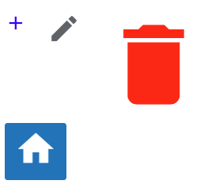

Displays an icon on a web page.

## Usage example:

```gui
package example_basic;

import mc.fenix.basic.GemIcon;
import mc.fenix.basic.GemButton;
import mc.fenix.arrange.GemRow;

page GemIconExample() {
  @GemRow(
    colGap = "15px",
    components = [
      @GemIcon(name = "add", color = "blue", size = "1rem"),
      @GemIcon(name = "edit", color = "rgb(95,99,104)", size = "24px"),
      @GemIcon(name = "delete", color = "#ff0000", size = "2cm")
    ]
  );
  @GemButton(
    width = "fit-content",
    content = [
      @GemIcon(name = "home", color = "white", size = "30px")
    ]
  );
}

```


## GUI Model

`GemIcon.gui` ([open](https://git.rwth-aachen.de/monticore/umlp/-/blob/dev/umlp-rte/client/models/mc/fenix/basic/GemIcon.gui))

```
package mc.fenix.basic;

component GemIcon(
  String name,
  String color,
  String size,
)
```

| Name | Type  | Description | Default value |
|---|---|---|---|
| `name` | `String` | Name of the icon from [Material Icons](https://fonts.google.com/icons?icon.set=Material+Icons) | `""` (shows no icon) |
| `color` | `String` | Color of the icon in predefined color names, hexadecimal, RGB, etc. | `""` (default color `black`) |
| `size` | `String` | Font size of the icon in `px`, `rem`, `cm`, etc. | `""` (default size `24px`) |
