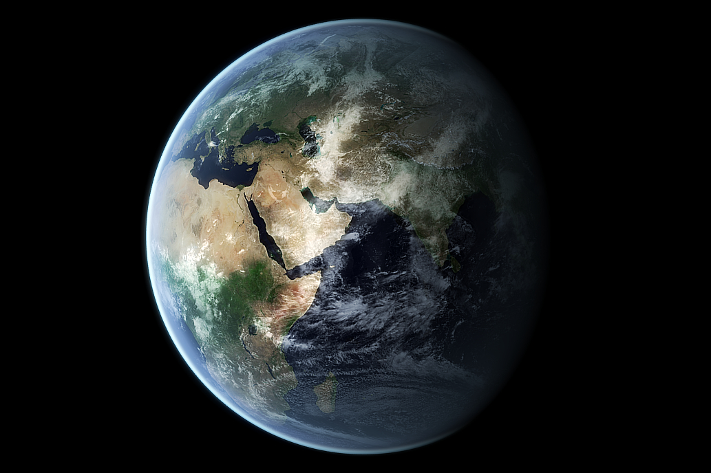

The image component embeds image on a page.

## Usage example:

```gui
package example_basic;

import mc.fenix.basic.GemImage;

page GemImageExample() {
  @GemImage(
    height = "300px",
    source = "assets/images/World.png",
    alt = "Image of the Earth"
  );
}
```


## GUI Model

`GemImage.gui` ([open](https://git.rwth-aachen.de/monticore/umlp/-/blob/dev/umlp-rte/client/models/mc/fenix/basic/GemImage.gui))

```
package mc.fenix.basic;

component GemImage(
  String height = "auto",
  String width = "auto",
  String source,
  String alt = ""
)
```

| Name | Type  | Description | Default value |
|---|---|---|---|
| `height` | `String` | Height of the component in `px`, `%`, `vh`. | `"auto"` (takes up all available space while preserving aspect ratio) |
| `width` | `String` | Width of the component in `px`, `%`, `vh`. | `"auto"` (takes up all available space while preserving aspect ratio) |
| `source` | `String` | The path to the image file. It can be a URL or a relative path. The relative path starts from the root folder (typically `src/`). | `null` (no source) |
| `alt` | `String` | The text that is shown if image could not be loaded. | `""` |