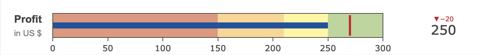

---
hide:
  - navigation
---

Bullet chart is the variation of the bar chart, it features a single, primary measure, compares that measure to one or more other measures to enrich its meaning (for example, compared to a target), and displays it in the context of qualitative ranges of performance, such as poor, satisfactory, and good. 

## usage example

`RowsTester` utilizes `GemRows` as a container and takes `GemBulletChart` in its body.
```ts
package example;
import mc.fenix.charts.GemBulletChart;
page RowsTester(
  Integer value,
  Integer reference,
  Integer thresholdvalue,
  String title,
  String subtitle,
  List<Integer> range,
  List<Integer> steps
) {
  @GemBulletChart(
    value = value,
    reference = reference,
    thresholdvalue = thresholdvalue,
    title = title,
    subtitle = subtitle,
    range = range,
    steps = steps
  );
}

```


## GUI Model

`GemBulletChart.gui` ([open](https://git.rwth-aachen.de/monticore/umlp/-/blob/dev/umlp-rte/frontend/models/mc/fenix/charts/GemBulletChart.gui))

```java
package mc.fenix.charts;

import java.util.List;

component GemBulletChart(
   Integer value,
   Integer reference,
   Integer thresholdvalue,
   String title,
   String subtitle,
   List<Integer> range,
   List<Integer> steps

)
```

| Name | Type | Description | Default value |
|---|---|---|---|
| value | `Integer` | the actual value of the data|`null`|
| reference | `Integer` |target or benchmark value that is used for comparison|`null`|
| thresholdvalue | `Integer` | serves as a clear reference point for the target or expected performance level|`null`|
| title | `String` |title of the chart with bold font|`null`|
| subtitle | `String` |subtitle of the chart with the light font, normal it is used to represents the unit of the value|`null`|
| range | `List<Integer>` |the whole range of the data|`null`|
| steps | `List<Integer>` | specific increment or division on the chart's vertical scale|`null`|

### Data Model Example

```html
  <gem-bullet-chart
    [value]="200"
    [reference]="270"
    [thresholdvalue]="270"
    [title]="'Profit'"
    [subtitle]="'in US $'"
    [range]="[0, 300]"
    [steps]="[0, 150, 210, 250]"
  ></gem-bullet-chart>
```
