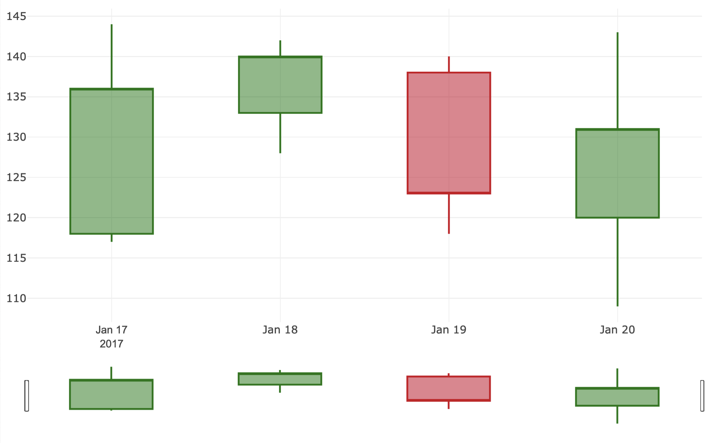

---
hide:
  - navigation
---

A Candlestick chart displays a few important datapoints for a (short) period of time. It is often used to display how stock prices changed over said short periods.

The data of a candlestick is displayed by its horizontal position (time), vertical position of: **start** and **end** of the **bar** _and_ **start** and **end** of the **line** that crosses through the bar (price of stock). The **color** of the candlestick indicates if the price got higher (green) or lower (red), which is an important information because it dictates if the upper bar end shows the first price traded during that time period (if the price got lower) or the last price traded (if the price got higher). and the other way around for the bottom end position of the bar.

## Usage example

`RowsTester` takes `GemCandlestickChart` in its body.

```ts
package example;
import mc.fenix.charts.GemCandlestickChart;
import mc.fenix.charts.GemCandlestickChartTypes.GemData2CandlestickChart;
page RowsTester(
  GemData2CandlestickChart data,
) {
  @GemCandlestickChart(
    data = data
  );
}
```




## GUI Model

`GemCandlestickChart.gui` ([open](https://git.rwth-aachen.de/monticore/umlp/-/blob/dev/umlp-rte/frontend/models/mc/fenix/charts/GemCandlestickChart.gui))

```java
package mc.fenix.charts;

import mc.fenix.charts.GemCandlestickChartTypes.GemData2CandlestickChart;

component GemCandlestickChart(
  List<GemData2CandlestickChart> data
)

```

| Name | Type | Description | Default value |
|---|---|---|---|
| data | `List<GemData2CandlestickChart>`  | the data to be displayed(`GemData2CandlestickChart` is a complex data type, data type is described in following) |`null` (no text is set)|

### GemCandlestickChartTypes

`GemCandlestickChartTypes.cd` ([open](https://git.rwth-aachen.de/monticore/umlp/-/blob/dev/umlp-rte/frontend/models/mc/fenix/charts/GemCandlestickChartTypes.cd))

```java
package mc.fenix.charts;

import java.util.List;

classdiagram GemCandlestickChartTypes {
  class GemData2CandlestickChart {
    String label;
    List<Integer> value;
  }
}
```
- `GemData2CandlestickChart` - is the data structure that contains `label` and `value`


### Data Model Example

```java
import mc.fenix.charts.gemcandlestickcharttypes.GemData2CandlestickChart;
import umlp.jsweet.extension.annotation.Component;

import java.util.ArrayList;
import java.util.Arrays;
import java.util.List;

@Component
public class GemData2CandlestickChartExample extends GemData2CandlestickChartExampleTOP{
  @Override
  public GemData2CandlestickChart getGemdata2candlestickchart() {

    List<String> labels = Arrays.asList("2017-01-17", "2017-01-18", "2017-01-19", "2017-01-20");

    List<Integer> values = new ArrayList<>();

    values.add(Arrays.asList(118, 144, 117, 136));
    values.add(Arrays.asList(133, 142, 128, 140));
    values.add(Arrays.asList(138, 140, 118, 123));
    values.add(Arrays.asList(120, 143, 109, 131));

    return new GemData2CandlestickChart(labels, values);
  }
}
```

