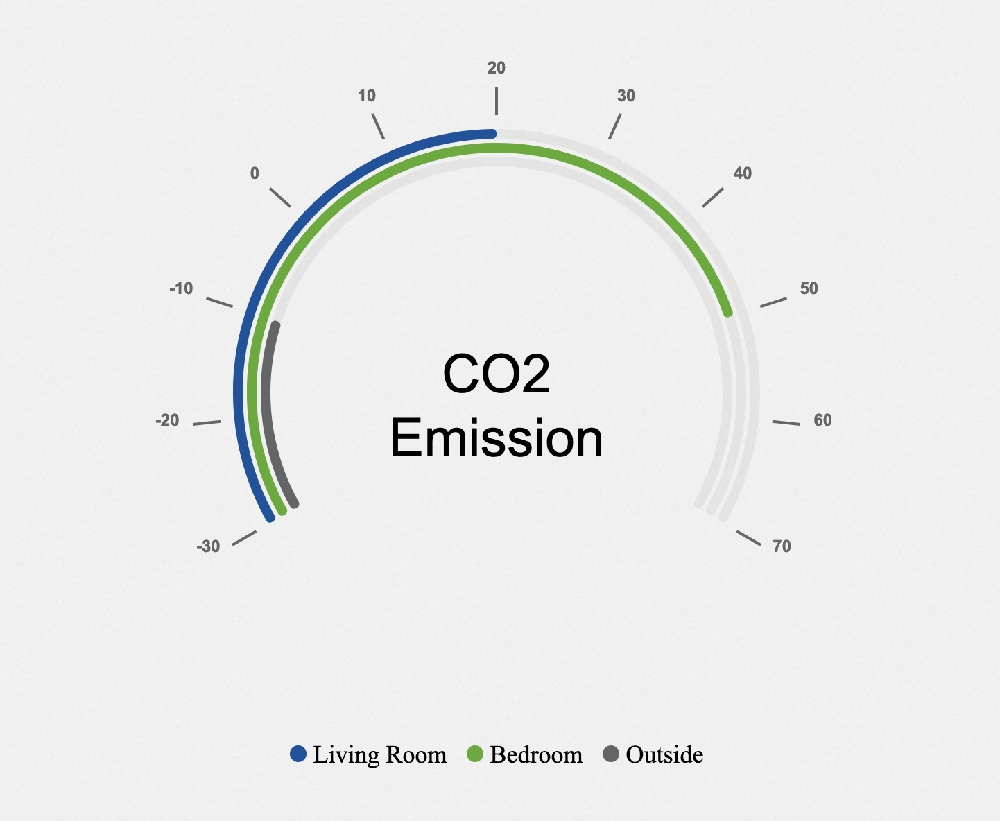

---
hide:
  - navigation
---

Gauge charts are also known as dial charts or speedometer charts. Normally they consist of a dial and a pointer, use the pointer to read the information. There are several different types of gauge charts, such as Speedometer, Linear Gauge Charts and Angular Gauge Charts. Gauge charts are very helpful to visualize and compare single data value with a quantitative context.

## Usage example

`RowsTester` takes `GemGaugeChart` in its body

```ts
package example;
import mc.fenix.charts.GemGaugeChart;
import mc.fenix.charts.GemGaugeChartTypes.GemGaugeChartData;
import mc.fenix.charts.GemGaugeChartTypes.GemGaugeChartEntry;
page RowsTester(
  GemGaugeChartData data,
  GemGaugeChartEntry entry,
) {
  @GemGaugeChart(
    data = data,
    entry = entry
  );
}
```



## GUI Model

`GemGaugeChart.gui` ([open](https://git.rwth-aachen.de/monticore/umlp/-/blob/dev/umlp-rte/frontend/models/mc/fenix/charts/GemGaugeChart.gui))

```java
package mc.fenix.charts;

import mc.fenix.charts.GemGaugeChartTypes.GemGaugeChartData;

component GemGaugeChart (
  GemGaugeChartData data,
  Integer min,
  Integer max,
  String unit,
  String textValue
)
```

| Name | Type | Description | Default value |
|---|---|---|---|
| data | `GemGaugeChartData`  | the data to be displayed(`GemData2CandlestickChart` is a complex data type, data type is described in following) |`null` (no value is set)|
|min|`Integer`|the minimum value of graph|`null` (no value is set)|
|max|`Integer`|the maximum range of graph|`null` (no value is set)|
|unit|`String`|the unit of the value, it will display in the middle of the chart|`null` (no element is set)|
|textValue|`String`|the content of the data, it will display in the middle of the chart|`null` (no element is set)|


### GemGaugeChartTypes

`GemGaugeChartTypes.cd` ([open](https://git.rwth-aachen.de/monticore/umlp/-/blob/dev/umlp-rte/frontend/models/mc/fenix/charts/GemGaugeChartTypes.cd))

```java
package mc.fenix.charts;

import java.util.List;

classdiagram GemGaugeChartTypes {
  class GemGaugeChartData {
    List<GemGaugeChartEntry> entries;
  }
  class GemGaugeChartEntry {
    String type;
    String name;
    Integer value;
  }
}
```

- `GemGaugeChartData` - is the data type of `data` in `GemGaugeChart`. It contains a list of `GemGaugeChartEntry` which is the data type of `entries` in `GemGaugeChartData`
- `GemGaugeChartEntry` - contains `type`, `name` and `value`. `type` is the type of the entry, `name` is the name of the entry and `value` is the value of the entry.

### Data Model Example

```java
import mc.fenix.charts.GemGaugeChartTypes.GemGaugeChartData;
import mc.fenix.charts.GemGaugeChartTypes.GemGaugeChartEntry;

import java.util.ArrayList;

@Component
public class GaugeChartExample extends GaugeChartExampleTOP {
  @Override
  public GemGaugeChartData getGaugechartData() {

    List<GemGaugeChartEntry> entries = new ArrayList<>();
    
    entries.add(new GemGaugeChartEntryBuilder()
            .setName("Living Room")
            .setValue(20)
            .setType("CO2")
            .build().get());

    entries.add(new GemGaugeChartEntryBuilder()
            .setName("Bedroom")
            .setValue(50)
            .setType("CO2")
            .build().get());

    entries.add(new GemGaugeChartEntryBuilder()
            .setName("Outside")
            .setValue(-10)
            .setType("CO2")
            .build().get());

    return new GemGaugeChartData(entries);
  }
}
```
