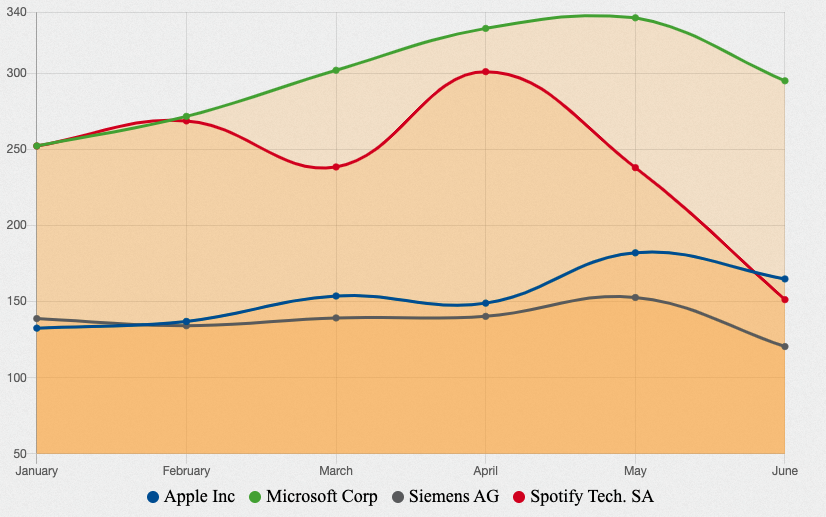

---
hide:
  - navigation
---

Line chart is a graphical representation to describe the data changes over a given period. It is connected by straight line segments. The horizontal axis is usually a time scale; for example, minutes, hours, days, months, or years, while the vertical axis would have the values.

## Usage example

`RowsTester` takes `GemLineChart` in its body

```ts
package example;
import mc.fenix.charts.GemLineChart;
page RowsTester(
  GemLineChartData data,
  GemLineChartEntry entry,
) {
  @GemLineChart(
    data = data,
    entry = entry
  );
}
```



## GUI Model

`GemLineChart.gui` ([open](https://git.rwth-aachen.de/monticore/umlp/-/blob/dev/umlp-rte/frontend/models/mc/fenix/charts/GemLineChart.gui))

```java
package mc.fenix.charts;

import mc.fenix.charts.GemLineChartTypes.GemLineChartData;

component GemLineChart(
  GemLineChartData data,
  Object displayValue,
  Boolean enableBackgroundColor,
  Integer maxValue,
  Integer minValue,
  boolean showConfig = true
)
```

| Name | Type | Description | Default value |
|---|---|---|---|
| data | `GemLineChartData` | is in form of GemLineChartData, it contains all information that will be used to plot the line chart |`null`|
| displayValue | `Object` |is the value to be displayed |`null`|
| enableBackgroundColor | `Boolean` | is to decide whether the background color is rendered |`null`|
| maxValue | `Integer` |defines the label for the max value|`null`|
| minValue | `Integer` |defines the label for the min value|`null`|
| showConfig | `boolean` | whether the chart's configuration panel is shown | `true` |

### GemLineChartTypes

`GemLineChartTypes.cd` ([open](https://git.rwth-aachen.de/monticore/umlp/-/blob/dev/umlp-rte/frontend/models/mc/fenix/charts/GemLineChartTypes.cd))

```java
package mc.fenix.charts;

import java.util.List;

classdiagram GemLineChartTypes {
  class GemLineChartData {
    List<GemLineChartEntry> entries;
    List<String> labels;
  }
  class GemLineChartEntry {
    String label;
    List<Integer> data;
    String borderColor;
    String backgroundColor;
    String pointBackgroundColor;
  }

}
```

-`GemLineChartData` - is the data structure that contains `entries` and `labels` that will be used to plot the line chart
-`GemLineChartEntry` - is the data structure that contains `label`, `data`, `borderColor`, `backgroundColor` and `pointBackgroundColor` that will be used to plot the line chart

### Data Model Example

```java
import mc.fenix.charts.gemlinecharttypes.GemLineChartData;
import mc.fenix.charts.gemlinecharttypes.GemLineChartEntry;
import mc.fenix.charts.gemlinecharttypes.GemLineChartEntryBuilder;
import umlp.jsweet.extension.annotation.Component;

import java.util.ArrayList;
import java.util.Arrays;
import java.util.List;
import java.util.Optional;

@Component
public class CustomGemLineChartExample extends CustomGemLineChartExampleTOP{
  @Override
  public GemLineChartData getLinechartData() {

    List<String> labels = Arrays.asList("Apple Inc", "Microsoft Corp", "Siemens AG", "Spotify Tech. SA");

    List<GemLineChartEntry> entries = new ArrayList<>();

    entries.add(new GemLineChartEntryBuilder()
            .label(Optional.of("Apple Inc"))
            .data(Arrays.asList(132.54, 136.96, 153.65, 148.96, 182.01, 164.85))
            .build().get());

    entries.add(new GemLineChartEntryBuilder()
            .label(Optional.of("Microsoft Corp"))
            .data(Arrays.asList(252.18, 271.60, 301.88, 329.37, 336.32, 294.95))
            .build().get());

    entries.add(new GemLineChartEntryBuilder()
            .label(Optional.of("Siemens AG"))
            .data(Arrays.asList(138.82, 134.14, 139.24, 140.28, 152.68, 120.46))
            .build().get());

    entries.add(new GemLineChartEntryBuilder()
            .label(Optional.of("Spotify Tech. SA"))
            .data(Arrays.asList(252.12, 268.63, 238.38, 300.95, 237.92, 151.25))
            .build().get());

    return new GemLineChartData(entries, labels);
  }
}
```
