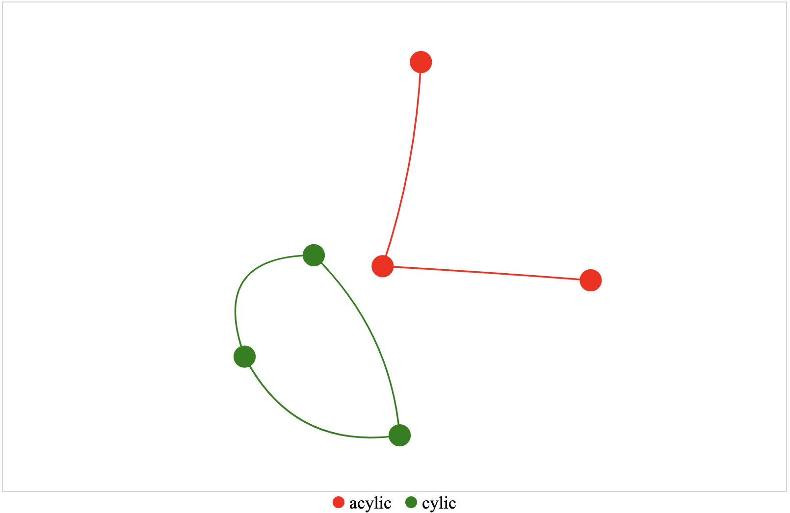

---
hide:
  - navigation
---

NetworkGraph is a graphical representation of a network. It is composed of nodes and edges. Nodes are the entities of the network, and edges are the relationships between the nodes.

## Usage example

`RowsTester` takes `GemNetworkGraph` in its body.

```ts
package example;
import mc.fenix.charts.GemNetworkGraph;
page RowsTester( GemNetworkData data) {
  @GemNetworkGraph(
    data = data,
  );
}
```


 

## GUI Model

`GemNetworkGraph.gui` ([open](https://git.rwth-aachen.de/monticore/umlp/-/blob/dev/umlp-rte/frontend/models/mc/fenix/networkgraph/GemGraph.gui))

```java
package mc.fenix.charts;

import mc.fenix.charts.GemNetworkGraphTypes.GemNetworkData;

component GemNetworkGraph(
  GemNetworkData data,
  boolean improvedLayout = true
)
```

| Name | Type | Description | Default value |
|---|---|---|---|
| data | `GemNetworkData` | is in form of GemNetworkData, it contains all information that will be used to plot the line chart|`null`|
| improvedLayout | `boolean` | enables an improved layout for the network graph | `true` |   

### GemNetworkGraphTypes

GemNetworkGraphTypes.cd ([open](https://git.rwth-aachen.de/monticore/umlp/-/blob/dev/umlp-rte/frontend/models/mc/fenix/networkgraph/NetworkGraphTypes.cd))

```java
package mc.fenix.charts;

import java.util.List;

classdiagram GemNetworkGraphTypes {

  public class GemNetworkData {
    List<GemNetworkNode> nodes;
    List<GemNetworkEdge> edges;
  }

  public class GemNetworkNode {
    String id;
    Integer value;
    String label;
    Integer mass;
    String color;
    String group;
    String year;
  }

  public class GemNetworkEdge {
    String from;
    String to;
    Integer length;
  }

}
```

-`GemNetworkData` - is the data structure that contains `nodes` and `edges` that will be used to plot the network graph
-`GemNetworkNode` - is the data structure that contains the information of a node
-`GemNetworkEdge` - is the data structure that contains the information of an edge


### Data Model Example

```java
import mc.fenix.charts.gemnetworkgraphtypes.GemNetworkData;
import mc.fenix.charts.gemnetworkgraphtypes.GemNetworkEdge;
import mc.fenix.charts.gemnetworkgraphtypes.GemNetworkEdgeBuilder;
import mc.fenix.charts.gemnetworkgraphtypes.GemNetworkNode;
import mc.fenix.charts.gemnetworkgraphtypes.GemNetworkNodeBuilder;
import umlp.jsweet.extension.annotation.Component;

import java.util.ArrayList;

@Component
public class GemNetworkGraphExample extends GemNetworkGraphExampleTOP {
  @Override
  public GemNetworkData getNetworkgraphData() {
        
    List<GemNetworkNode> nodes = new ArrayList<>();
    List<GemNetworkEdge> edges = new ArrayList<>();

    nodes.add(new GemNetworkNodeBuilder()
            .id("1")
            .color("Red")
            .build().get());

    nodes.add(new GemNetworkNodeBuilder()
            .id("2")
            .color("Red")
            .build().get());

    nodes.add(new GemNetworkNodeBuilder()
            .id("3")
            .color("Red")
            .build().get());

    nodes.add(new GemNetworkNodeBuilder()
            .id("4")
            .color("Green")
            .build().get());

    nodes.add(new GemNetworkNodeBuilder()
            .id("5")
            .color("Green")
            .build().get());

    nodes.add(new GemNetworkNodeBuilder()
            .id("6")
            .color("Green")
            .build().get());

    nodes.add(new GemNetworkEdgeBuilder()
            .from("1")
            .to("2")
            .length(250)
            .build().get());

    nodes.add(new GemNetworkEdgeBuilder()
            .from("1")
            .to("3")
            .length(250)
            .build().get());

    nodes.add(new GemNetworkEdgeBuilder()
            .from("4")
            .to("5")
            .length(250)
            .build().get());

    nodes.add(new GemNetworkEdgeBuilder()
            .from("5")
            .to("6")
            .length(250)
            .build().get());

    nodes.add(new GemNetworkEdgeBuilder()
            .from("6")
            .to("4")
            .length(250)
            .build().get());

    return new GemNetworkData(nodes, edges);
  }
}
```
