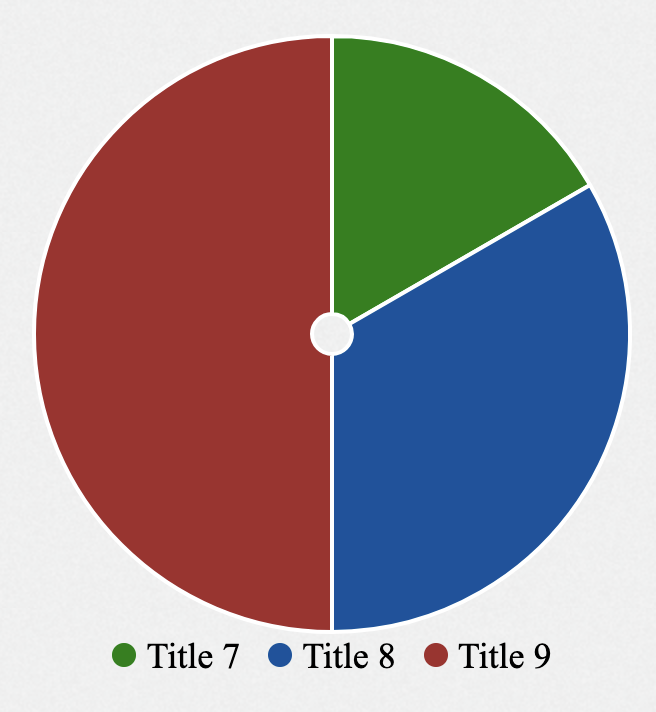

# GemPieChart

Pie chart is also called circle chart. It looks like a circle, which is divided to slices to visualize information. Different categories of data could be indicated by different colors. It is helpful to observe the numerical proportion of data.

## Usage example

`RowsTester` takes `GemPieChart` in its body

```md
package example;
import mc.fenix.charts.GemPieChart;
page RowsTester(
  GemPieChartData data,
  GemPieChartEntry entry,
) {
  @GemPieChart(
    data = data,
    entry = entry,
  );
}
```



## GUI Model

`GemPieChart.gui` ([open](https://git.rwth-aachen.de/monticore/umlp/-/blob/dev/umlp-rte/client/models/mc/fenix/charts/GemPieChart.gui))

```
package mc.fenix.charts;

import mc.fenix.charts.GemPieChartTypes.GemPieChartData;

component GemPieChart(
    GemPieChartData data,
    Integer innerRadius
)
```
| Name | Type | Description | Default value |
|---|---|---|---|
| data | GemPieChartData | is in form of GemNetworkData, it contains all information that will be used to plot the line chart|`null`|
| innerRadius | Integer | is the radius of the inner circle of the pie chart|`null`|


### GemPieChartTypes

`GemPieChartTypes.cd` ([open](https://git.rwth-aachen.de/monticore/umlp/-/blob/dev/umlp-rte/client/models/mc/fenix/charts/GemPieChartTypes.cd))

```
package mc.fenix.charts;

import java.util.List;
import java.util.Optional;

classdiagram GemPieChartTypes {
  public class GemPieChartData {
    List<GemPieChartEntry> entries;
  }
  public class GemPieChartEntry {
    Integer value;
    String label;
    String backgroundColor;
  }
}
```

-`GemPieChartData` - is the data structure that contains the information of the pie chart

-`GemPieChartEntry` - is the data structure that contains the information of each entry of the pie chart

### Data Model Example

```java
import mc.fenix.charts.gempiecharttypes.GemPieChartData;
import mc.fenix.charts.gempiecharttypes.GemPieChartEntry;
import mc.fenix.charts.gempiecharttypes.GemPieChartEntryBuilder;
import umlp.jsweet.extension.annotation.Component;

import java.util.ArrayList;
import java.util.List;
import java.util.Optional;

@Component
public class GemPieChartExample extends GemPieChartExampleTOP {
  @Override
  public GemPieChartData getPiechartData() {

    List<GemPieChartEntry> entries = new ArrayList<>();

    entries.add(new GemBarChartEntryBuilder()
            .label(Optional.of("Clothing"))
            .value(100)
            .build().get());

    entries.add(new GemBarChartEntryBuilder()
            .label(Optional.of("Essen"))
            .value(200)
            .build().get());

    entries.add(new GemBarChartEntryBuilder()
            .label(Optional.of("Miete"))
            .value(350)
            .build().get());

    return new GemPieChartData(entries);
  }
}
```
