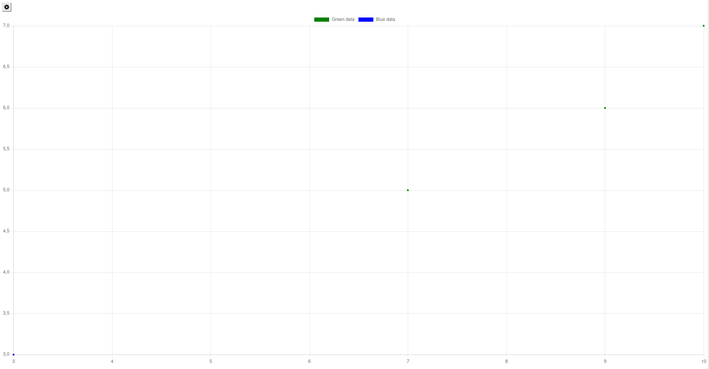

---
hide:
  - navigation
---

A scatter plot visualizes data points on a 2D plot, establishing a relation between values plotted on the x-axis and the
y-axis.

## Usage example

Given gui model:

```ts
package example;

import Domain.Person;
import mc.fenix.charts.GemScatterPlot;
import mc.fenix.charts.GemScatterPlotAxis;

page GemScatterPlotExample(List<Person> persons) {
  simple@GemScatterPlot(
    data = null,
    xAxis = null,
    yAxis = null
  );
}
```

With the underlying code:
<details>
  <summary>Code</summary>

  ```java
  package example_charts;

  import com.google.common.collect.Lists;
  import mc.fenix.charts.gemscatterplottypes.GemScatterPlotData;
  import mc.fenix.charts.gemscatterplottypes.GemScatterPlotDataBuilder;
  import mc.fenix.charts.gemscatterplottypes.GemScatterPlotPoint;
  import mc.fenix.charts.gemscatterplottypes.GemScatterPlotPointBuilder;
  import mc.fenix.charts.gemscatterplottypes.GemScatterPlotSet;
  import mc.fenix.charts.gemscatterplottypes.GemScatterPlotSetBuilder;
  import umlp.jsweet.extension.annotation.Component;
    
  import java.util.ArrayList;
  import java.util.List;
  import java.util.Optional;
    
  @Component
  public class GemScatterPlotExample extends GemScatterPlotExampleTOP {
    public GemScatterPlotData getSimpleData() {
    
      List<GemScatterPlotSet> entries = new ArrayList<>();
      List<GemScatterPlotPoint> points = Lists.newArrayList(
              new GemScatterPlotPointBuilder().x(7.0).y(5.0).label("").build().get(),
              new GemScatterPlotPointBuilder().x(9.0).y(6.0).label("").build().get(),
              new GemScatterPlotPointBuilder().x(10.0).y(7.0).label("").build().get());
      Optional<GemScatterPlotSet> greenSet = new GemScatterPlotSetBuilder().label("Green data")
                .color(Optional.of("green")).points(points).build();
      greenSet.ifPresent(e -> entries.add(e));
    
      points = Lists.newArrayList(new GemScatterPlotPoint(3.0, 3.0, "", Optional.empty()));
      Optional<GemScatterPlotSet> blueSet = new GemScatterPlotSetBuilder().label("Blue data")
              .color(Optional.of("blue")).points(points).build();
      blueSet.ifPresent(e -> entries.add(e));
    
      return new GemScatterPlotDataBuilder().sets(entries).build().get();
    }
  }
  ```

</details>

Results in:



## GUI Model

`GemScatterPlot.gui`([open](https://git.rwth-aachen.de/monticore/umlp/-/blob/dev/umlp-rte/client/models/mc/fenix/charts/GemScatterPlot.gui))

```ts
package mc.fenix.charts;

import mc.fenix.charts.GemScatterPlotTypes.GemScatterPlotData;
import mc.fenix.charts.GemScatterPlotTypes.GemScatterPlotAxis;

component GemScatterPlot(
  GemScatterPlotData data,
  GemScatterPlotAxis xAxis,
  GemScatterPlotAxis yAxis
)
```

| Name  | Type               | Description                             | DefaultValue                                |
|-------|--------------------|-----------------------------------------|---------------------------------------------|
| data  | `GemScatterPlotData` | A collection of data point sets to show | `null` (no data)                            |
| xAxis | `GemScatterPlotAxis` | Configuration for the x axis            | `null` (dynamically scaled, unlabeled axis) |
| yAxis | `GemScatterPlotAxis` | Configuration for the y axis            | `null` (dynamically scaled, unlabeled axis) | 

### Scatter Plot Types

`GemScatterPlotTypes.cd` ([open](https://git.rwth-aachen.de/monticore/umlp/-/blob/dev/umlp-rte/client/models/mc/fenix/charts/GemScatterPlotTypes.cd))

```java
package mc.fenix.charts;
import java.util.List;
import java.util.Optional;

classdiagram GemScatterPlotTypes {

  public class GemScatterPlotData {
    List<GemScatterPlotSet> sets;
  }

  public class GemScatterPlotAxis {
    Optional<String> label;
    Optional<Double> minValue;
    Optional<Double> maxValue;
    Optional<Double> stepWidth;
  }

  public class GemScatterPlotSet {
    String label;
    Optional<GemScatterPlotShape> shape;
    List<GemScatterPlotPoint> points;
    Optional<String> color;
    Optional<String> hoverColor;
  }

  public class GemScatterPlotPoint {
    double x;
    double y;
    String label;
    Optional<Integer> pointRadius;
  }

  public enum GemScatterPlotShape {
    CIRCLE,
    SQUARE,
    ROUNDED_SQUARE,
    ROTATED_SQUARE,
    CROSS,
    ROTATED_CROSS,
    DASH,
    LINE,
    STAR,
    TRIANGLE;
  }
}
```

#### GemScatterPlotData

| Name | Type                        | Description               | DefaultValue     |
|------|-----------------------------|---------------------------|------------------|
| sets | `List<GemScatterPlotSet>` | All data sets to be shown | `null` (no data) |

#### GemScatterPlotAxis

| Name      | Type             | Description                            | DefaultValue                                 |
|-----------|------------------|----------------------------------------|----------------------------------------------|
| label     | `Optional<String>` | The name of the axis                   | `null` (no label)                            |
| minValue  | `Optional<Double>` | The minimum value the axis can display | `null` (lowest value which appears in data)  |
| maxValue  | `Optional<Double>` | The maximum value the axis can display | `null` (highest value which appears in data) |
| stepWidth | `Optional<Double>` | The step width between two axis marks  | `null` (dynamically determined)              |

#### GemScatterPlotSet

| Name       | Type                       | Description                            | DefaultValue             |
|------------|----------------------------|----------------------------------------|--------------------------|
| label      | `String`                     | Display name of the set                | `null` (no display name) |
| shape      | `Optional<GemScatterPlotShape>` | Shape of the data points               | `null` (CIRCLE)          |
| points     | `List<GemScatterPlotPoint>`  | List of data points to display         | `null` (no data)         |
| color      | `Optional<String>`           | Color of the data points               | `null` (random)          |
| hoverColor | `Optional<String>`           | Color of a data point when hovering it | `null` (random)          |

#### GemScatterPlotPoint

| Name        | Type              | Description                               | DefaultValue         |
|-------------|-------------------|-------------------------------------------|----------------------|
| x           | `double`            | x coordinate of the data point            | -                    |
| y           | `double`            | y coordinate of the data point            | -                    |
| label       | `String`            | Label to be shown when hovering the point | `null` ("undefined") |
| pointRadius | `Optional<Integer>` | Radius of the point in pixels             | `null` (3)           |


 
