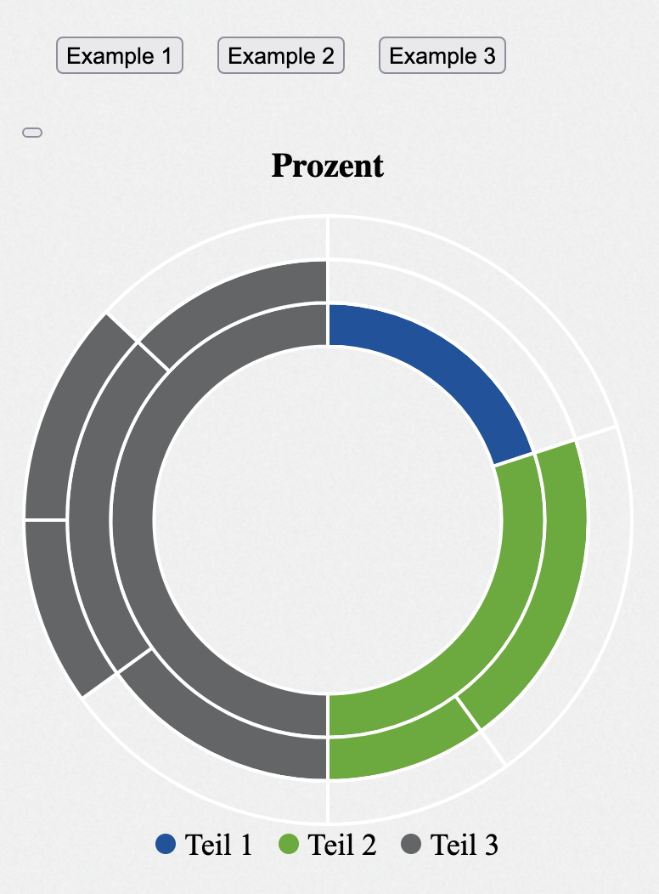

---
hide:
  - navigation
---

Sunburst-charts look like pie-charts with multiple layers. Each of them refine the information of the previous layer and give information about the distribution of the parent layer in percent. The sunburst-chart can also be represented by a tree-like structure with parent nodes and subnodes which contain the refined information about the parent nodes.

## Usage example

`RowsTester` takes `GemSunburstChart` in its body

```ts
package example;
import mc.fenix.charts.GemSunburstChart.GemSunburstChart;
import mc.fenix.charts.GemSunburstChart.GemSunburstChartTypes.GemSunburstData;
import mc.fenix.charts.GemSunburstChart.GemSunburstChartTypes.GemSunburstEntry;

page RowsTester(
  GemSunburstData data,
  GemSunburstEntry entry) {
  @GemSunburstChart(
    data = data,
    entry = entry);
}
```




## GUI Model

`GemSunburstChart.gui` ([open](https://git.rwth-aachen.de/monticore/umlp/-/blob/dev/umlp-rte/frontend/models/mc/fenix/charts/GemSunburstChart.gui))

```java
package mc.fenix.charts;

import mc.fenix.charts.GemSunburstChartTypes.GemSunburstData;

component GemSunburstChart (
  GemSunburstData data,
  List<String> colors,
  Boolean ignoreError
)
```

| Name | Type | Description | Default value |
|---|---|---|---|
| data | `GemSunburstData` | is in the form of `SunburstDataNode`, it contains all information that will be used to plot the sunburst chart|`null`|
| colors | `List<String>` |  is in form of _array of hex-codes of colors_, it is used to specify the colors of the chart and legend manually, if this input option is left empty 20 default colors will be used. The colors have to be in Hex-code format inside of an array|`null`|
| ignoreError | `Boolean` | is checked inside of the sunburst-chart component and it is thrown an error if this is violated. But there are use cases where the sum of some sub-nodes is less than the sum up to the parent node and it is still a plausible sunburst-chart. For this case it is possible to ignore the upcoming error and try to calculate the chart regardless|`null`|


### GemSunburstChartTypes

`GemSunburstChartTypes.cd` ([open](https://git.rwth-aachen.de/monticore/umlp/-/blob/dev/umlp-rte/frontend/models/mc/fenix/charts/GemSunburstChartTypes.cd))

```java
package mc.fenix.charts;
import java.util.List;

classdiagram GemSunburstChartTypes {
  public class GemSunburstData {
    GemSunburstEntry entry;
    List<GemSunburstData> subEntries;
  }

  public class GemSunburstDataHelper {
    GemSunburstEntry entry;
    List<GemSunburstData> subEntries;
    String color;
  }

  public class GemSunburstEntry {
    String label;
    Integer value;
  }

}
```

- `GemSunburstData` - is the data structure that contains `entry`,`List<GemSunburstData> ` and `subEntries`
- `GemSunburstEntry` - is the data structure that contains `label` and `value`


### Data Model Example

```java
import com.google.common.collect.Lists;
import domain.Person;
import mc.fenix.charts.gemsunburstcharttypes.GemSunburstData;
import mc.fenix.charts.gemsunburstcharttypes.GemSunburstDataBuilder;
import mc.fenix.charts.gemsunburstcharttypes.GemSunburstEntry;
import umlp.jsweet.extension.annotation.Component;

import java.util.ArrayList;

@Component
public class GemSunburstChartExample extends GemSunburstChartExampleTOP {
  @Override
  public GemSunburstData getGemSunburstChart2Data() {
    GemSunburstData data = new GemSunburstDataBuilder()
            .entry(new GemSunburstEntry("Prozent", 100))
            .subEntries(Lists.newArrayList(
                    new GemSunburstDataBuilder()
                    .entry(new GemSunburstEntry("Teil 1", 20))
                    .subEntries(new ArrayList<>())
                    .build()
                    .get(), 
                    new GemSunburstDataBuilder()
                    .entry(new GemSunburstEntry("Teil 2", 30))
                    .subEntries(Lists.newArrayList(
                            new GemSunburstDataBuilder()
                                    .entry(new GemSunburstEntry("Teil 2.1", 20))
                            .subEntries(new ArrayList<>())
                            .build()
                            .get(),
                        new GemSunburstDataBuilder()
                            .entry(new GemSunburstEntry("Teil 2.2", 10))
                            .subEntries(new ArrayList<>())
                            .build()
                            .get()
                    ))
                    .build()
                    .get()
            ))
            .build()
            .get();
        
    return data;
  }
}
```
