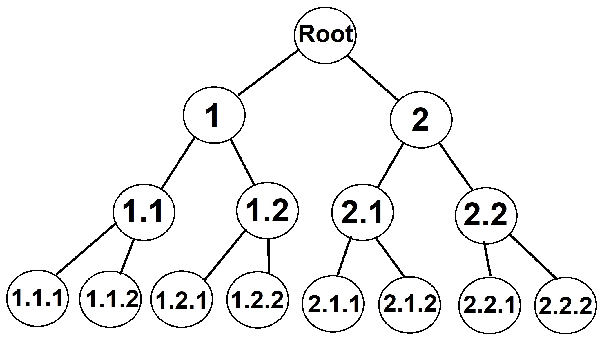

# Sunburst-Chart

----------------------------------------------------------------------

## Goal

The goal of this project was to implement and test a new Angular library which contains a chart, in
this case a sunburst-chart, using the ng2-charts library. The chart should be customizable using multiple inputs and different data structures. The functions used in the component were tested with unit-tests.

----------------------------------------------------------------------

## Overview

- [Goal](#goal)
- [Overview](#overview)
- [Sunburst-Charts](#sunburst-charts)
- [Data Structure](#data-structure)
- [Implementation](#implementation)
- [How to use the Chart and Inputs](#how-to-use-the-chart-and-inputs)
- [References](#references)

----------------------------------------------------------------------

## Sunburst-Charts

Sunburst-charts look like pie-charts with multiple layers. Each of them refine the information of the previous layer and give information about the distribution of the parent layer in percent. The sunburst-chart can also be represented by a tree-like structure with parent nodes and subnodes which contain the refined information about the parent nodes. An example of this can be seen in following figure and detailed information can be found in [1].

_On the left two sunburst-charts and on the right a sunburst-chart with corresponding tree structure. Source: [1]_

----------------------------------------------------------------------

## Data Structure

The data structure is defined in _sunburst-chart.types.ts_. The regular used data structure is SunburstDataNode, but there is also a short form of this called SDNshort.

### SunburstDataNode

SunburstDataNode consists of a container for the data of this node _content_ (of type SunburstDataValue) and an (optional) parameter _subNodes_ which is an array of SunburstDataNodes. The _content_ consists of a String _label_ which represents the label of the current node and of a number _value_ which represents the value of the current node.

The root nodes _content_ determines the title of the chart (_label_ of _content_) and the checksum of the chart. This means, that the _value_ of the root node has to be equal to the sum of the values of all sub-nodes.

The SunburstDataNode can have multiple sub-nodes each of them are an element in the subNodes array. If the node has no sub-nodes the array can be left empty or it can be left out.

An example of a definition of a SunburstDataNode can be found in following listing 4.1:

<pre lang="Javascript">
public data : SunburstDataNode = {
  content: {
    label: "Root Node",
    value: 100,
  },
  subNodes: [
    {
      content: {
        label: "Node",
        value: 50,
      },
      subNodes: [ 
        {
          content: {
            label: "Leaf Node",
            value: 16.6,
          },
          subNodes: [ ],
        },
        {
          content: {
            label: "Leaf Node",
            value: 16.7,
          },
          subNodes: [ ],
        },
        {
          content: {
            label: "Leaf Node",
            value: 16.7,
          },
          subNodes: [ ],
        },
      ],
    },
    {
      content: {
        label: "Node",
        value: 50,
      },
      subNodes: [ 
        {
          content: {
            label: "Leaf Node",
            value: 25,
          },
          subNodes: [ ],
        },
        {
          content: {
            label: "Leaf Node",
            value: 25,
          },
          subNodes: [ ],
        },
      ],
    }
  ],
};
</pre>
_Listing 4.1: Example of a SunburstDataNode._

### SDNshort

SDNshort has the same structure as SunburstDataNode and is only a short notation. The _content_-container is an array with name _c_ which has to consist of exactly two elements. The first element has to be a string that represents the label and the second element of the array has to be a number that represents the _value_. If otherwise there will be an error. The subNodes array is renamed to _sN_ in SDNshort notation and is defined as in SunburstDataNode as an optional array, but it consists of SDNshort-nodes.

An example of a definition of the SDNshort notation can be found in following listing 4.2:

<pre lang="Javascript">
public data : SDNshort= {
  c: ['Root Node', 100],
  sN: [
    {
      c: ['Node', 50],
      sN: [ 
        {c: ['Leaf Node', 16.6]},
        {c: ['Leaf Node', 16.7]},
        {c: ['Leaf Node', 16.7]},
      ],
    },
    {
      c: ['Node', 50],
      sN: [ 
        {c: ['Leaf Node', 25]},
        {c: ['Leaf Node', 25]},
      ],
    }
  ],
};
</pre>
_Listing 4.2: Example of the SDNshort notation._

----------------------------------------------------------------------

## Implementation

In this section implementation details are described, how the data is processed and transformed.

### Type Conversion

The type conversion between SunburstDataNode and SDNshort is located in the _sunburst-chart.types.ts_ file. The function _instanceOfSDNshort_ gets an object as input and returns true, if this input object is of type SDNshort (more precise: if the object has a 'c' parameter which is the case for SDNshort but not for SunburstDataNode). The second function is sdnShortToSDN which gets a SDNshort node as input and creates a SunburstDataNode with the exact same structure and contents and returns this new object. This type conversion is used in _sunburst-chart.component.ts_ in the data input.

### Transformation to ng2-charts doughnut

In the _sunburst-chart-component.html_ file a canvas with a doughnut-chart of ng2-charts is used to display the sunburst-chart. The _[data]_, _[labels]_, _[options]_ and _[colors]_ are adjusted accordingly, that the resulting chart looks like a sunburst-chart.

Every time an input gets updated, the updateData() function inside _sunburst-chart.component.ts_ is called. This function checks if the data sums up to the checksum correctly (if _ignoreError_ is false), then checks if the data is overall of correct syntax by calling the _check_ function. Next if the data is in correct format the depth of the data-tree is calculated as a help for later functions, the _options_ are set, _makeLegend_ is called (which sets some parameters to fit the legend with colors and title, etc.) and the _dataNodesToChart_ function is called.

#### dataNodesToChart

This function is the core of the transformation between the sunburst-data and the doughnut chart. The data is transformed into an array-structure in which at first the content of all sub-nodes of the root-node is followed by the content of the sub-nodes of the first sub-node of the root-node, followed by the content of the second sub-node and so on. A binary tree which splits up into two nodes each step with depth 4 (just like in the following figure) would result in the following array:

    [1] [2] [1.1] [1.2] [2.1] [2.2] [1.1.1] [1.1.2] [1.2.1] [1.2.2] [2.1.1] [2.1.2] [2.2.1] [2.2.2]

With this structure and multiple arrays there are multiple doughnut charts created, each of them have one layer of the sunburst-chart. The arrays are transformed so that the first layer only consists of depth 2 nodes, the second layer of depth 3 nodes and so on. (Since the root-node has no own layer there is one layer less than the depth of the tree.) If ignoreError is set to true which results in the possibility to have "gaps" in the nodes, empty nodes are filled in to represent this.

At the end of the function the functions _changeDataNodesForLabels_ and _refineColors_ are called. The first function adjusts the labels of the doughnut-layers so that they correspond to the right nodes. This is necessary, because the labels have a different structure than the data, when using multiple doughnuts as different layers. In the second method the colors are adjusted, so that the possible gaps are left out and don't take the colors for the other nodes. Also in this function every sub-tree of the root-node gets one color, so every node has the same color as their parent-node except for the subNodes of the root-node.

----------------------------------------------------------------------

## How to use the Chart and Inputs

Note that it is highly recommended to put the whole montigem-sunburst-chart into a div-element, because the default width of the sunburst-chart element is calculated in respect to the parent div’s width.

Next the possible inputs will be explained in detail and examples for these inputs are given. An example on how to define a sunburst-chart can be seen in the next subsection.

### Data

Data in the form of _SunburstDataNode_ or _SDNshort_. 

Data is the most important input as through this the tree-like structure from the data is given to the sunburst-chart component and the sunburst chart is calculated from this data. When leaving a chart without data input the corresponding montigem-chart will be empty.

    

      <montigem-sunburst-chart [data]="data"> </montigem-sunburst-chart>
    

_Listing 6.1: Example for data input, when data is defined as in the Data Structure section._

### Width

Width in form of _px_.

If the montigem-sunburst-chart is a child of a div element, the width of the chart is calculated accordingly to the width of the div. But with this option the width of the diagram can be set in pixels manually if it is needed. 

**Note that it is not recommended to combine the Width and Scale inputs since that would make no sense and can lead to unexpected behavior of the component.**

    

      <montigem-sunburst-chart [data]="data" [width]= '500'> </montigem-sunburst-chart>
    

_Listing 6.2: Example for width input, when data is defined as in the Data Structure section._

### Scale

Scale in form of _numeric value_.

If the montigem-sunburst-chart is a child of a div element, the width of the chart is calculated accordingly to the width of the div. But with this option the width of the diagram can be scaled manually by a factor. If the user wants the chart to be slightly larger or slightly smaller with this option the user can manipulate the width of the diagram easily without having to know the exact width in pixels like with the width input.

**Note that it is not recommended to combine the Width and Scale inputs since that would make no sense and can lead to unexpected behaviour of the component.**

    

      <montigem-sunburst-chart [data]="data" [scale]= 1.2> </montigem-sunburst-chart>
    

_Listing 6.3: Example for scale input, when data is defined as in the Data Structure section._

### Legend

Legend in form of _boolean value_.

With this option that is default set to true it is determined whether the legend component of the chart should be visible or not. If the legend is not needed and only the chart should be visible, set this input to false.

    

      <montigem-sunburst-chart [data]="data" [legend]= false> </montigem-sunburst-chart>
    

_Listing 6.4: Example for legend input, when data is defined as in the Data Structure section._

### IgnoreError

IgnoreError in form of _boolean value_.

In a sunburst chart the sum of all values of the sub-nodes of one node have to equal the value in the parent node. This results in a regular structure of the diagram. This is checked inside of the sunburst-chart component and it is thrown an error if this is violated. But there are use cases where the sum of some sub-nodes is less than the sum up to the parent node and it is still a plausible sunburst-chart. For this case it is possible to ignore the upcoming error and try to calculate the chart regardless. This is done by having this input set to true.

This input option is false in default. 

    

      <montigem-sunburst-chart [data]="data" [ignoreError]= true> </montigem-sunburst-chart>
    

_Listing 6.5: Example for ignoreError input, when data is defined as in the Data Structure section._

### Colors

Colors in form of _array of hex-codes of colors_.

This option is used to specify the colors of the chart and legend manually. If this input option is left empty 20 default colors will be used. The colors have to be in Hex-code format inside of an array.

    

      <montigem-sunburst-chart [data]="data" [colors]= colors> </montigem-sunburst-chart>
    

_Listing 6.6: Example for colors input, when colors is defined in the typescript file as in Listing 6.7 and data is defined as in the Data Structure section._

<pre lang="Javascript">
public colors = ["#c22c21", "#bfbd22"];
</pre>
_Listing 6.7: Example for colors array in typescript file._

----------------------------------------------------------------------
## References

[1] _The Data Visualisation Catalogue - Sunburst Diagram._ https://datavizcatalogue.com/methods/sunburst_diagram.html. Accessed: 2021-01-04.
