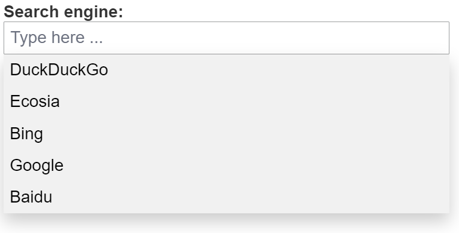
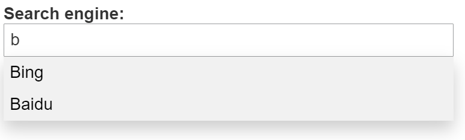

---
hide:
  - navigation
---

The component is an autocomplete input with an optional label. When clicking on the input, it suggests options in a list, almost like a dropdown. However, the user can still type any input. The list of options is filtered depending on the input characters. It is not mandatory to select one of the options. It is used whenever a user input is required and the user should be assisted with suggestions.

## Usage example

```ts
/* (c) https://github.com/MontiCore/monticore */
package example_input;

import mc.fenix.input.GemAutocompleteInput;
import mc.fenix.input.GemDropdownInputTypes.Option;

page GemAutocompleteInputExample() {
  @GemAutocompleteInput(
    id = "searchEngines",
    width = "50%",
    labelText = "Search engine:",
    placeholder = "Type here ...",
    options = [
      Option("DuckDuckGo"),
      Option("Ecosia"),
      Option("Bing"),
      Option("Google"),
      Option("Baidu")
    ]
  )
}

```



Suggestions filtered by input  


## GUI Model

`GemAutocompleteInput.gui` ([open](https://git.rwth-aachen.de/monticore/umlp/-/blob/dev/umlp-rte/frontend/models/mc/fenix/input/GemAutocompleteInput.gui))

```java
package mc.fenix.input;

import mc.fenix.input.GemDropdownInputTypes.Option;
import mc.fenix.input.GemTextInputTypes.GemTextInputValidity;

component GemAutocompleteInput(
  String id,
  String labelText = "",
  List<Option> options,
  ?String entry,
  boolean disabled = false,
  String width = "100%",
  String height = "100%",
  Event<Object> keyRelease,
  Event<Object> keyPress,
  GemTextInputValidity validity,
  String placeholder = ""
)
```

| Name | Type | Description | Default value |
|---|---|---|---|
| `id` | `String` | Can be set to ensure the list of options is specific to the input field. | `null` (no id) |
| `labelText` | `String` | Text describing the input field. | `""` (empty placeholder) |
| `options` | `List<Option>` (see [GemDropdownInputTypes](../GemDropdownInput/GemDropdownInput#gemdropdowninputtypes)) | A list of options to be suggested in the input. | `null` (no options) |
| `entry` | `?String` | The input field's value. If it is linked to a variable, the value of the variable will change when the user enters a new value. | `null` (no value) |
| `disabled` | `boolean` | Whether the input field is disabled. | `false` (input is enabled) |
| `width` | `String` | Width of the input field. | `"100%"` |
| `height` | `String` | Height of the input field. | `"100%"` |
| `keyRelease` | `Event` | Callback that is executed when a key is released. | `null` (no action) |
| `keyPress` | `Event` | Callback that is executed when a key is pressed. | `null` (no action) |
| `validity` | `GemTextInputValidity` (see [GemTextInputTypes](../GemTextInput/GemTextInput#gemtextinputtypes)) | An object representing the validation status of the field. | `null` (input is always valid) |
| `placeholder` | `String` | Text displayed when the field is empty. | `""` (no text) |
