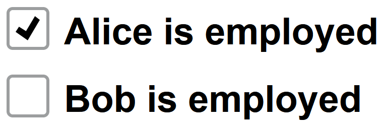

---
hide:
  - navigation
---

The component is a checkbox with a label. It is used whenever an input for a
binary choice is required, e.g., agreeing to terms and conditions or opting in
to a newsletter.

## Usage example

```ts
package example_input;

import Domain.Person;
import mc.fenix.input.GemCheckBoxInput;

page GemCheckBoxInputExample(List<Person> persons) {
  @iterate(Person p : persons) {
    @GemCheckBoxInput(
      labelText = p.name + " is employed",
      checked = p.employed
    );
  }
}
```



## GUI Model

`GemCheckBoxInput.gui`
([open](https://git.rwth-aachen.de/monticore/umlp/-/blob/dev/umlp-rte/client/models/mc/fenix/input/GemCheckBoxInput.gui))

```java
package mc.fenix.input;

component GemCheckBoxInput(
  String id,
  String labelPosition,
  String labelText,
  boolean disabled = false,
  ?boolean checked
)
```

| Name  | Type | Description | Default value |
|---|---|---|---|
| `id` | `String` | A unique id ensures proper screen reader functionality for the checkbox description. | `null` (id is automatically generated) |
| `labelPosition`  | `String` | The position of the label, can be `"left"` or `"right"`. |`"right"` |
| `labelText` | `String` | The text of the checkbox label. | `""` |
| `disabled` | `boolean` | Whether the input field is disabled. | `false` (input is enabled) |
| `checked`  | `?boolean` | Indicates if the checkbox is checked (`true`) or not (`false`). | `null` (unchecked) |
