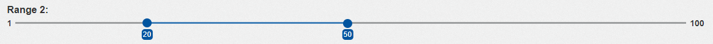

---
hide:
  - navigation
---

This component displays a label with two slider thumbs that allows users to select a range within a specified slider track. This component can be used in forms and other interactive interfaces to allow users to select a range of values easily

## usage example
  
`RowsTester` displays `GemDualRangeInput` in its body.

```ts
package example;
import mc.fenix.input.src.lib.gemdualrangeinput.GemDualRangeInput;
page RowsTester() {
  @GemDualRangeInput(
    labelText = "Range 2: ",
    vertical = "false",
    sliderBehavior = "through"
    step = "1",
    minValue = "1",
    maxValue = "100",
    startValue = "20",
    endValue = "50"
  )
}
```



## GUI Model

`GemDualRangeInput.gui` ([open](../GemDualRangeInput.gui))

```java
package example;
component GemDualRangeInput(
  String id,
  String labelText,
  String sliderBehavior,
  Boolean vertical,
  Integer step,
  Integer minValue,
  Integer maxValue,
  ?Integer startValue,
  ?Integer endValue
)
```
| Name | Type  | Description | Default value |
|---|---|---|---|
| id | String | The component's id; used to configure the styles |`null` (no id is set)|
| labelText | String  | Label of the range input | |
| sliderBehavior | String(rescricted set) | This input determines the behavior in situations where the two handles of the slider have the same value or when the start value exceeds the end value. There are three available behaviors: "push," "stop," and "through".|`null` (no behavior is set)|
|  | push | <br> * The "push" behavior causes the start handle to push the end handle by the one step whenever the start value reaches the end value. This ensures that there is always a range with at least the value of the step, and the start value will not surpass the end value.   | |
|  |stop| <br> * The "stop" behavior prevents the start value from advancing to the end value by stopping it one step before reaching the end value. This guarantees a range with at least the value of the step, and the start value remains lower than or equal to the end value. ||
||through|<br> * The "through" behavior allows the start handle to freely pass through the end handle and even have a higher value than the end handle. There are no restrictions on the relationship between the start and end values in this case. ||
| Boolean | vertical | This boolean input allows you to specify whether the slider should be displayed vertically or horizontally, with the default appearance being horizontal. It is advisable to omit this input entirely rather than setting it to false when you desire a horizontal appearance. <br> Note: Setting "vertical" to _true_ would also require some changes in the styles in order to make it look appropriate. |`false` (the slider display horizontally)|
| step  | Integer | Allows to specify a fixed increment for selecting values in the range slider. |`null` (no step is set)|
| minValue  | Integer | The slider's minimum value. |`null` (no minimum value is set)|
| maxValue | Integer | The slider's maximum value. |`null` (no maximum value is set)|
| startValue | ?Integer | The minimum of the selected range. It is recommended that you bind it to a number variable so that the variable displays the value. |`null` (no start value is set)|
| endValue  | ?Integer | The maximum value of the selected range. It is recommended that you bind it to a number variable so that the variable displays the value. |`null` (no end value is set)|


