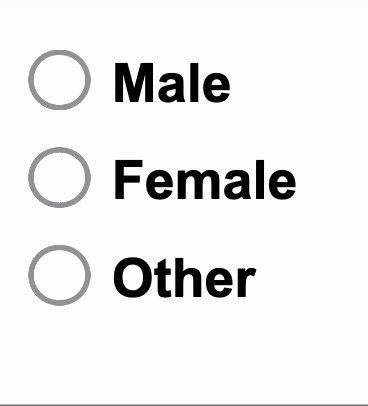

---
hide:
  - navigation
---

This component represents a radio button with a label. It is intended for use in forms or other scenarios where users must choose one of several options.

## Usage example

`RowsTester` displays `GemRadioInput` in its body

```ts
package example;
import mc.fenix.input.src.lib.gemradioinput.GemRadioInput;
page RowsTester() {
  @GemRadioInput(
    id = "genderMale",
    labelText = "Male",
    value = "male"
  )
  @GemRadioInput(
    id = "genderFemale",
    labelText = "Female",
    value = "female"
  )
  @GemRadioInput(
    id = "genderOther",
    labelText = "Other",
    value = "other"
  )
}
```


## GUI Model

`GemRadioInput.gui` ([open](https://git.rwth-aachen.de/monticore/umlp/-/blob/dev/umlp-rte/frontend/models/mc/fenix/input/GemRadioInput.gui))
```java
package mc.fenix.input.src.lib.gemradioinput;
component GemRadioInput(
  String id,
  String labelText,
  String value,
  ?String selectedValue,
  String group
)
```

| Name           | Type     | Description                                                                                                     | Default value                             |
|----------------|----------|-----------------------------------------------------------------------------------------------------------------|-------------------------------------------|
| `id`           | `String` | Defines the id of the radio button.                                                                             | `null` (no id is set)                     |
| `labelText`    | `String` | The text label of the option of radio input group.                                                              | `null` (no label is set)                  |
| `value`        | `String` | The value assigned to this specific radio option.                                                               | `null` (no value is set)                  |
| `selectedValue`| `?String`| When using more than one radio button, this is the currently selected value of the radio group. It is suggested to bind it to a function. | `null` (radio button is not activated) |
| `group`        | `String` | The name of the radio group this button belongs to. Radio buttons with the same group belong together logically. | `null` (no group assigned)                |
