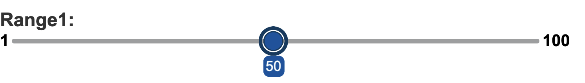

# GemRangeInput

This component displays a label with a slider that allows users to select a value within a specified range. This component can be used in forms and other interactive interfaces to allow users to select a range of values easily.

## usage example

`RowsTester` displays `GemRangeInput` in its body.

```
package example;
import mc.fenix.input.GemRangeInput;
page RowsTester(string someIntegerVariable) {
  @GemRangeInput(
    id = "rangeInput5",
    labelText = "Range1: ",
    vertical = false,
    step = 1,
    minValue = 1,
    maxValue = 100,
    value = someIntegerVariable,
  )
}
```



```
package example;
import mc.fenix.input.GemRangeInput;
page RowsTester(string someIntegerVariable) {
  @GemRangeInput(
    id = "rangeInput",
    labelText = "Range: ",
    vertical = true,
    step = 1,
    minValue = 1,
    maxValue = 100,
    value = someIntegerVariable,
  )
}
```


## GUI Model

`GemRangeInput.gui` ([open](../GemRangeInput.gui))

```
package example;
component GemRangeInput(
  String id,
  String labelText,
  Boolean vertical,
  Integer step,
  Integer minValue,
  Integer maxValue,
  ?Integer value
)
```
| Name | Type | Description | Default value |
|---|---|---|---|
| id  | String | The component's id; used to configure the styles |`null` (no id is set)|
| labelText  | String | Label of the range input |`null` (no text is set)|
| vertical | Boolean | This boolean input allows you to specify whether the slider should be displayed vertically or horizontally, with the default appearance being horizontal. It is advisable to omit this input entirely rather than setting it to false when you desire a horizontal appearance. <br> Note: Setting "vertical" to _true_ would also require some changes in the styles in order to make it look appropriate. |`false` (the slider display horizontally)|
| step  | Integer | Allows to specify a fixed increment for selecting values in the range slider. |`null` (no step is set)|
| minValue  | Integer | The slider's minimum value. |`null` (no minimum value is set)|
|maxValue  | Integer | The slider's maximum value. |`null` (no maximum value is set)|
| value | ?Integer  | The slider's current number value. It is recommended that you bind it to a number variable so that the variable displays the current slider value. |`null` (no value is set)|

