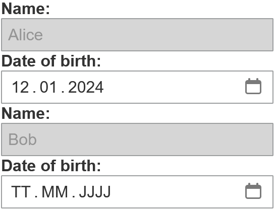

<!-- (c) https://github.com/MontiCore/monticore -->

 The component is an input field with an optional label. It is used whenever a user input is required, e.g. to create/update objects, provide a search field, etc. 

## Usage Example

```gui
package example_input;

import Domain.Person;

import mc.fenix.input.GemTextInput;
import mc.fenix.input.GemTextInputTypes.GemTextInputValidity;

page GemTextInputExample(List<Person> persons) {
  @iterate(Person p : persons) {
    @GemTextInput(
      id = "name",
      labelText = "Name:",
      entry = p.name
    );
    @GemTextInput(
      inputType = "date",
      labelText = "Date of birth:",
      entry = p.birthday
    );
  }
}
```



## GUI Model ([open](https://git.rwth-aachen.de/monticore/umlp/-/blob/dev/umlp-rte/client/models/mc/fenix/input/GemTextInput.gui))

```gui
component GemTextInput(
  String id,
  String labelText = "",
  String inputType = "text",
  ?String entry,
  boolean disabled = false,
  String placeholder = "",
  String width = "100%",
  String height = "100%",
  GemTextInputValidity validity,
  Event<Object> keyRelease,
  Event<Object> keyPress
)
```

| Name | Type | Description | Default value |
| --- | --- | --- | --- |
| `id` | `String`|  The component's id; used to configure the styles.  |  |
| `labelText` | `String`|  Text describing the input field.  | `""` |
| `inputType` | `String`|  Type of the input field. The possible types (https://developer.mozilla.org/en-US/docs/Web/HTML/Element/input#input_types) are defined by the browser/platform implementing the input fields. Commonly used types: `"text"`: Accept any input string. `"number"`: Accept numbers. `"date"`: Date input with a calender selection. `"password"`: Field hiding the input string.  | `"text"` |
| `entry` | `?String`|  The input field's value. If it is linked to a variable, the value of the variable will change when the user enters a new value.  |  |
| `disabled` | `boolean`|  Whether the input field is disabled.  | `false` |
| `placeholder` | `String`|  Text displayed when the field is empty.  | `""` |
| `width` | `String`|  Width of the input field.  | `"100%"` |
| `height` | `String`|  Height of the input field.  | `"100%"` |
| `validity` | `GemTextInputValidity`|  An object representing the validation status of the field.  |  |
| `keyRelease` | `Event<Object>`|  Callback that is executed when a key is released.  |  |
| `keyPress` | `Event<Object>`|  Callback that is executed when a key is pressed.  |  |

## Types

### `GemTextInputTypes` ([open](https://git.rwth-aachen.de/monticore/umlp/-/blob/dev/umlp-rte/client/models/mc/fenix/input/GemTextInputTypes.cd))

```cd
package mc.fenix.input;

classdiagram GemTextInputTypes {

  public class GemTextInputValidity {
    String status;
    String message;
  }

}
```

#### `GemTextInputValidity`
| Name | Type | Description | Default value |
| --- | --- | --- | --- |
| `status` | `String` |  The validation status. Possible values: `"Error"`: There is a problem or issue that needs attention. `"Unchecked"`: The input has not been inspected. `"Success"`: Positive validation result. `"Warning"`: There is a potential issue that should be noted.  |  |
| `message` | `String` |  A message to be displayed as a tooltip with the status  |  |
