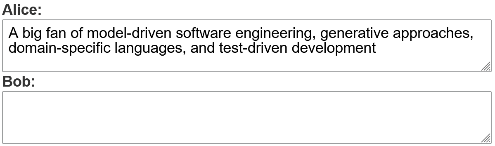

---
hide:
  - navigation
---

The component is a text area with an optional label. It is used whenever a
multi-line user text input is required, e.g. for comment fields, feedback, etc.

## Usage example

```ts
package example_input;

import Domain.Person;

import mc.fenix.input.GemTextareaInput;

page GemTextareaInputExample(List<Person> persons) {
  @iterate(Person p : persons) {
    @GemTextareaInput(
      id = "name",
      labelText = p.name + ":",
      entry = p.aboutMe
    );
  }
}
```



## GUI Model

`GemTextareaInput.gui` ([open](https://git.rwth-aachen.de/monticore/umlp/-/blob/dev/umlp-rte/client/models/mc/fenix/input/GemTextareaInput.gui))

```java
package mc.fenix.input;

component GemTextareaInput(
  String labelText,
  ?String entry,
  boolean disabled = false,
  String placeholder = "",
  String width = "100%",
  String height = "100%",
  GemTextareaInputValidity validity,
  Event keyRelease,
  Event keyPress,
  String resize = "auto"
)
```

| Name           | Type                    | Description                                                                                      | Default value                |
|----------------|-------------------------|--------------------------------------------------------------------------------------------------|------------------------------|
| `labelText`    | `String`                | Text describing the input field.                                                                 | `""` (empty placeholder)     |
| `entry`        | `?String`               | The input field's value. If it is linked to a variable, the value of the variable will change when the user enters a new value. | `null` (no value)            |
| `disabled`     | `boolean`               | Whether the input field is disabled.                                                             | `false` (input is enabled)   |
| `placeholder`  | `String`                | Text displayed when the field is empty.                                                          | `""` (no text)               |
| `width`        | `String`                | Width of the input field.                                                                        | `"100%"`                     |
| `height`       | `String`                | Height of the input field.                                                                       | `"100%"`                     |
| `validity`     | `GemTextInputValidity`  | An object representing the validation status of the field.                                       | `null` (input is always valid) |
| `keyRelease`   | `Event`                 | Callback that is executed when a key is released.                                                | `null` (no action)           |
| `keyPress`     | `Event`                 | Callback that is executed when a key is pressed.                                                 | `null` (no action)           |
| `resize`       | `String`                | Option how to let the user resize the input area. Possible values: `none`, `both`, `horizontal`, `vertical`, `initial`, `inherit`. | `"auto"`                     |

### `GemTextareaInputTypes`

`GemTextareaInputTypes.gui` ([open](https://git.rwth-aachen.de/monticore/umlp/-/blob/dev/umlp-rte/client/models/mc/fenix/input/GemTextareaInputTypes.cd))

```java
package mc.fenix.input;

classdiagram GemTextareaInputTypes {
  public class GemTextareaInputValidity {
    String status;
    String message;
  }
}
```

**`GemTextInputValidity`**

| Name | Type | Description | Default value |
|---|---|---|---|
| `status` | `String` (restricted set) | The validation status. | `null` (no status) |
|| `Error` | There is a problem or issue that needs attention. ||
|| `Unchecked`| The input has not been inspected. ||
|| `Success` | Positive validation result. ||
|| `Warning` | There is a potential issue that should be noted. ||
| `message` | `String` | A message to be displayed as a tooltip with the status | `null` (no message) |
