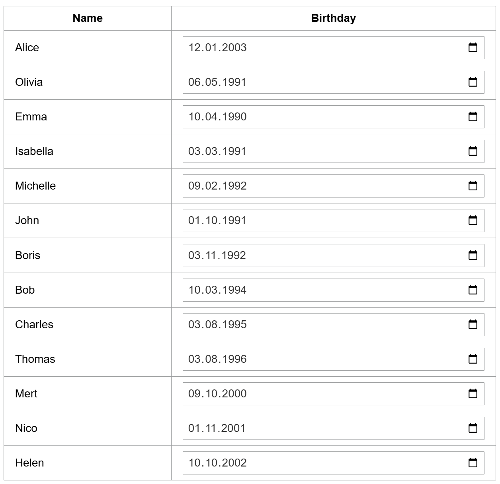
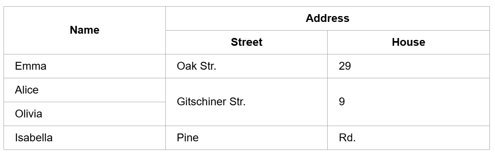

---
hide:
  - navigation
---

A table organizes and displays text or other view elements in rows and columns. A header gives information about what to expect in each column of the body.

## Usage example

Given domain model:
```java
classdiagram Domain {
  class Person {
    java.time.LocalDate birthday;
    String name;
  }
}
```
Table with `GemTextInput` as content in column *Birthday*
```ts
package example_table;

import mc.fenix.table.GemTable;
import mc.fenix.table.GemTableHeader;
import mc.fenix.table.GemTableRow;
import mc.fenix.basic.GemText;
import mc.fenix.input.GemTextInput;
import Domain.Person;

page GemTableExample(List<Person> persons) {
  @GemTable(
    headers = [
      @GemTableHeader(cols = ["Name", "Birthday"])
    ],
    body = [
      @iterate(Person p : persons) {
        @GemTableRow(cols = [
          @GemText(value = p.name),
          @GemTextInput(
            inputType = "date",
            entry = p.birthday
          )
        ]);
      }
    ]
  );
}
```

</br>


Table with header and row cells spanned over multiple rows and columns
```ts
package example_table;

import mc.fenix.table.GemTable;
import mc.fenix.table.GemTableHeader;
import mc.fenix.table.GemTableHeaderCell;
import mc.fenix.table.GemTableRow;
import mc.fenix.table.GemTableRowCell;
import mc.fenix.basic.GemText;

page GemTableExample() {
  @GemTable(
    layout = "fixed",
    headers = [
      @GemTableHeader(cells = [
        @GemTableHeaderCell(rowSpan = 2, content = @GemText(value = "Name")),
        @GemTableHeaderCell(colSpan = 2, content = @GemText(value = "Address"))
      ]),
      @GemTableHeader(cols = ["Street", "House"])
    ],
    body = [
      @GemTableRow(cells = [
        @GemTableRowCell(content = @GemText(value = "Emma")),
        // ...
      ]),
      @GemTableRow(cells = [
        @GemTableRowCell(content = @GemText(value = "Alice")),
        @GemTableRowCell(rowSpan = 2, content = @GemText(value = "Gitschiner Str.")),
        @GemTableRowCell(rowSpan = 2, content = @GemText(value = "9"))
      ]),
      @GemTableRow(cells = [
        @GemTableRowCell(content = @GemText(value = "Olivia"))
      ]),
      // ...
    ]
  )
}
```



## GUI Models

`GemTable.gui`([open](https://git.rwth-aachen.de/monticore/umlp/-/blob/dev/umlp-rte/frontend/models/mc/fenix/table/GemTable.gui))

```java
package mc.fenix.table;

component GemTable(
  String width = "auto",
  String height = "auto",
  String layout = "auto",
  List<GUIViewElement> headers,
  List<GUIViewElement> body
)
```

| Name | Type | Description | Default value |
|---|---|---|---|
| `width` | `String` | Width of the component in `px`, `%`, `vh`. By default collapses to a minimal possible height with respect to content. | `"auto"` |
| `height` | `String` | Height of the component in `px`, `%`, `vh`. By default collapses to a minimal possible height with respect to content. | `"auto"` |
| `layout` | `String` | Table layout. Commonly used types are listed below. | `"auto"` |
|| `"auto"` | The width of the columns is adjusted to fit its content. ||
|| `"fixed"` | The width of the columns is evenly spread. ||
| `headers` | `List<GUIViewElement>` | Header(s) of a table. Normally set to a list of `GemTableHeader`. | `null` (No headers will show) |
| `body` | `List<GUIViewElement>` | Body of a table. Normally set to a list of `GemTableRow`. | `null` (Body will not show) |

`GemTableHeader.gui`([open](https://git.rwth-aachen.de/monticore/umlp/-/blob/dev/umlp-rte/frontend/models/mc/fenix/table/GemTableHeader.gui))

A table row that identifies the head of the table, adds some styling to text content by default.

```java
package mc.fenix.table;

component GemTableHeader(
  List<String> cols,
  List<GUIViewElement> cells
)
```

| Name | Type | Description | Default value |
|---|---|---|---|
| `cols` | `List<String>` | Columns of a table header row. | `null` |
| `cells` | `List<GUIViewElement>` | Cells of a table header. Normally set to a list of `GemTableHeaderCell`. If `cells` and `cols` are defined, `cells` are used. | `null` |

`GemTableHeaderCell.gui`([open](https://git.rwth-aachen.de/monticore/umlp/-/blob/dev/umlp-rte/frontend/models/mc/fenix/table/GemTableHeaderCell.gui))

Controls dimensions that content should occupy within a table's header.

```java
package mc.fenix.table;

component GemTableHeaderCell(
  int colSpan = 1,
  int rowSpan = 1,
  GUIViewElement content
)
```

| Name | Type | Description | Default value |
|---|---|---|---|
| `colSpan` | `List<String>` | Number of columns a cell should cover | `1` |
| `rowSpan` | `List<GUIViewElement>` | Number of rows a cell should cover | `1` |
| `content` | `List<GUIViewElement>` | A cells content, can be any `GUIViewElement`. | `null` |

`GemTableRow.gui`([open](https://git.rwth-aachen.de/monticore/umlp/-/blob/dev/umlp-rte/frontend/models/mc/fenix/table/GemTableRow.gui))

A table row that is part of the body of the table.

```java
package mc.fenix.table;

component GemTableRow(
  List<GUIViewElement> cols,
  List<GUIViewElement> cells
)
```

| Name | Type | Description | Default value |
|---|---|---|---|
| `cols` | `List<String>` | Columns of a table row. | `null` |
| `cells` | `List<GUIViewElement>` | Cells of a table row. Normally set to a list of `GemTableRowCell`. If `cells` and `cols` are defined, `cells` are used. | `null` |

`GemTableRowCell.gui`([open](https://git.rwth-aachen.de/monticore/umlp/-/blob/dev/umlp-rte/frontend/models/mc/fenix/table/GemTableRowCell.gui))

Controls dimensions that content should occupy within a table's body.

```java
package mc.fenix.table;

component GemTableRowCell(
  int colSpan = 1,
  int rowSpan = 1,
  GUIViewElement content
)
```

| Name | Type | Description | Default value |
|---|---|---|---|
| `colSpan` | `List<String>` | Number of columns a cell should cover | `1` |
| `rowSpan` | `List<GUIViewElement>` | Number of rows a cell should cover | `1` |
| `content` | `List<GUIViewElement>` | A cells content, can be any `GUIViewElement`. | `null` |
