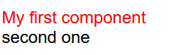
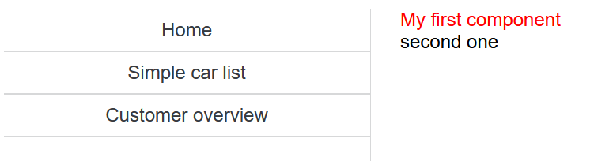
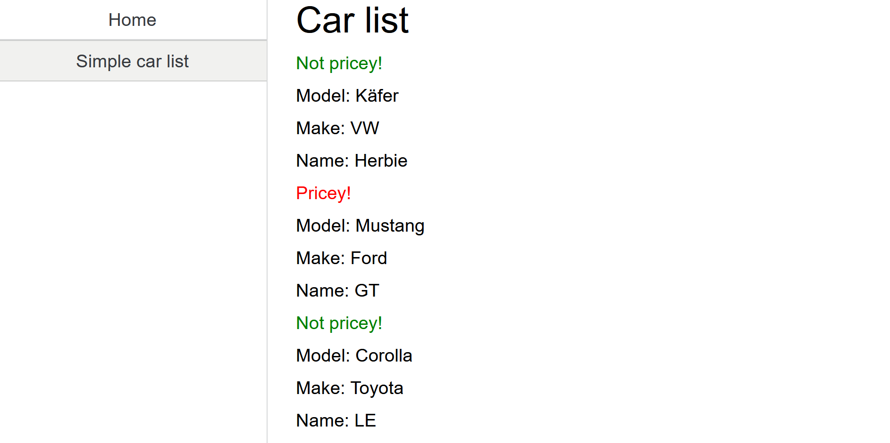

# Creating a basic GUI 

The source for graphical user interface (GUI) of MontiGem apps are GUI DSL
(Domain-Specific Language for GUIs) models.
The most basic concepts include:

- GUI component (or simply component)
- Control statements

!!! note 
    A complete list will be discussed later, you may also take a look at the 
    [GUI DSL project](https://git.rwth-aachen.de/monticore/languages/gui-dsl) (only available via GitLab invite)

## GUI Component

Each web page or a reusable part of a page is described using a GUI model. Rough
structure of a component:

```java
package mypackage.name;

import external.Component;
import some.external.Classdiagram.TypeName;
import maybe.java.TypeName2;

component ComponentName(TypeName paramName, TypeName2 paramName2) {
  /* component usages, control statements, etc. */
}
```

It contains

- a single package declaration
- an optional list of imports
- a single component declaration with a keyword `component` or `page`. A `page`
  is a `component` that has own URL address and can be navigated to.
  
!!! note 
    Since `page` is a `component` it can also be used as a component, see the component usages further below.

- optional contents of the component, e.g. component usages, control statements,
  etc.

!!! note
    Optional contents mean that you can omit curly braces and everything in between. 
    This is used for more advanced cases which will be discussed later.

!!! info
    You will often see terms *component declaration* and *component usage*:

    - A *declaration* means that you create a template for a specific component. It is
      similar to declaring a class in Java.
    - A *usage* means that you create an instance of a specific component. It is
      similar to class instantiation (calling a constructor) in Java.

Car rental example of the `Start.gui` model:
```ts title="frontend/src/main/gui/gui/Start.gui"
package gui;

// imports

page Start() {
  /* component usages, control statements, etc. */
}
```

!!! note 
    Following information about generated files is useful for understanding
    of the app and when you want to override the default behavior.

A GUI model defines an Angular component. The generated files can be found in
`frontend/build/gui2java2ts`. Following structures are
generated from a component declaration:

* Java file: `Start.java` with main component logic, such as loading and
  sending data, subscribing to changes in the data, and data conversions for
  presentation in GUI.
* TypeScript file: `StartComponent.ts` that connects Angular-specific
  features with the logic from `Start.java`. `StartComponent` extends `Start`.
  * The file also includes a `config` constant that specifies default
    Angular-specific configuration for the component.
* HTML template of the component: `Start.html` whose contents are defined by the
  contents of the component: component usages, control statements, etc. If there
  are no contents, the file is empty.
* Although not directly generated from models, each `page` contributes to the
  routing information file. `page Start` is in `package gui` which results in a
  `GuiGemRouting.ts` file specifying that URL path `gui/Start` navigates to the
  `page Start`.

## GUI component contents

A GUI component without contents doesn't show anything. To create a proper
web-page with contents you should import and use other components. This is the
basic idea of any web-framework for building GUIs: define some basic components,
use them in other components to build new components, and repeat until you have
an entire page.

Rough component usage structure:

```ts
instanceName@ComponentName(paramName1 = arg1, paramName2 = arg2);
``` 

It contains:

- optional instance name (variable holding the component instance)
- `@` sign followed by the component name
- a list of arguments, where parameter assignment is done via parameter name

!!! note
    This is similar to parameter assignment in Python or R. The assignment via
    order (e.g., `@ComponentName(arg1, arg2)`) is not allowed.

Try it yourself. Adjust the `Start` page of the car rental example:
```ts title="frontend/src/main/gui/gui/Start.gui"
package gui;

import mc.fenix.basic.GemText;
// more imports

page Start() {
  @GemText(color = "red", value = "My first component");
  @GemText(value = "second one");
}
```

The result is a web page with text:



The `GemText` is a library component. The library components can be found in the
[documentation for library components](../gendoc_components/Frontend-RTE.md).

Showing text is a good start but it is not enough. In practice one of the first
steps is to create a navigation bar. Create a new file called `NavContainer.gui`
in the `frontend/src/main/gui/gui/navigation` directory with the following
content:

```ts title="frontend/src/main/gui/gui/navigation/NavContainer.gui"
package gui.navigation;

import mc.fenix.arrange.GemRow;
import mc.fenix.arrange.GemColumn;

import mc.fenix.navigation.GemNavItem;
import mc.fenix.navigation.GemNavList;

component NavContainer(List<GUIViewElement> content) {
  // row of components, from left to right: navigation bar, main content.
  @GemRow(colGap = "25px", components = [
    // navigation bar
    @GemNavList(width = "40ch", height = "100vh", components = [
      @GemNavItem(title = "Home", target = "/gui/Start"),
      @GemNavItem(title = "Simple car list", target = "/gui/SimpleCarList"),
      @GemNavItem(title = "Customer overview", target = "/gui/CustomerOverview")
    ]),
    // main content
    @GemColumn(hAlign = "center", components = content)
  ]);
}
```

The `NavContainer` defines a template for a web page that has a navigation bar.
It consists of other library components and declares a list of `GUIViewElement`
objects as a parameter named `content`. A `GUIViewElement` type represents any
GUI component. Here the list of components gets passed to the `GemRow` component
that renders passed content from left to right. The definition of the `GemRow`
`components` parameter is similar to `content`:

```ts
package mc.fenix.arrange;

component GemRow(
  List<GUIViewElement> components /*, other parameters */
)
```

The `GemNavList` and `GemNavItem` are library components for build a navigation
bar. `GemNavList` is a layout container; the `GemNavItem` is a button that
redirects a user to a part of the application via URL specified by the `target`
argument. A URL is constructed from a fully qualified name of a page, compare:
```
gui.Start
gui.SimpleCarList
gui.CustomerOverview
```
and
```
/gui/Start
/gui/SimpleCarList
/gui/CustomerOverview
```
Whenever you add a page, you can add corresponding navigation item (or
`GemLink`) to enable navigation to the new page. More advanced cases will be
discussed later.

!!! note
    The `/gui/SimpleCarList` does not currently navigate to any existing page.
    We will add one later.

Let's adjust the `Start` page and use the `NavContainer`. We pass a list with
previously created `GemText` components to the `content` parameter:

```ts title="frontend/src/main/gui/gui/Start.gui"
package gui;

import mc.fenix.basic.GemText;

import gui.navigation.NavContainer;

page Start() {
  @NavContainer(content = [
    @GemText(color = "red", value = "My first component"),
    @GemText(value = "second one")
  ]);
}
```

The result is a web page with a navigation bar and text:



The `NavContainer` demonstrated usage of a `GUIViewElement` type. There are
several notable types that are used as GUI component parameter types:

* A subset of [commonly used Java types](https://docs.oracle.com/javase/tutorial/java/nutsandbolts/datatypes.html)

    * `int`, `Integer`
    * `long`, `Long`
    * `float`, `Float`
    * `double`, `Double`
    * `void`, `Void`
    * `String`
    * `List<T>`
    * `Object`

* Types describing concepts of user interfaces

    * `Event<T>`
    * `GUIViewElement`

* Types imported from Java or class diagrams

The arguments you supply to the components must be compatible with the parameter
type. We omit some types for now and only use most common ones:

* The commonly used types are self-explanatory, for example, `value` parameter
  of `GemText` is a `String`: 
  ```ts
  component GemText(String value = "" /*, other params */)
  ```
* A `List` of objects are created using square brackets (an OCL-like syntax).
  From the example earlier:
  ```ts
  @NavContainer(content = [
    @GemText(value = "Welcome! Use the navigation on the left side to see some examples.")
  ]);
  ```
  Depending on the type, the content is different, e.g., a `List<Integer>`: `[1,
  2, 3]`.
* You can import types from class diagrams. Here we discuss only ones imported
  from a domain class diagram (the one that defines the data structure of the
  app). We will call those "domain types". Domain types are handled separately
  by the MontiGem tool, since for objects of these types MontiGem generates
  multiple features, such as automatic updates of the objects in the GUI across
  different app users, saving the objects in the database, caching, etc.

  Create a simple `Car` class in the domain class diagram (`Carrental.umlp`).
  You don't have to add attributes yet.
  
  For example, we would like to have a page showing the list of cars. For this
  create the following GUI model:
  ```ts title="frontend/src/main/gui/gui/SimpleCarList.gui"
  package gui;

  // data class
  import Carrental.Car;

  page SimpleCarList(List<Car> cars) {
    /* ... */
  }
  ```
  
  Here we import the `Car` class from the domain class diagram. Whenever an
  input parameter of type from a class diagram is used, the MontiGem will
  generate logic to automatically load the object if possible. Specifically
  here we use `List<Car>` which will load all objects of type `Car`.

  !!! note 
      There is also logic for loading a single `Car` which will be discussed later.

  !!! info
      The types are imported using the so-called *fully qualified names*. 
      The fully qualified name concept is [general for programming languages](https://en.wikipedia.org/wiki/Fully_qualified_name) - 
      it's a name that uniquely identifies a type, method, variable, etc., 
      which is used by a compiler (interperter, generator) to be able to identify an entity.

  In Java and GUI DSL a fully qualified name of a type or component consists
  of a package name (if present) and the type or component name respectively,
  e.g., `java.util.List`, `gui.navigation.NavContainer`. In CD4A (class
  diagram language) the fully qualified name of a type consists of package
  name (if present), class diagram name, and the type name, e.g.,
  `somepackage.Carrental.Car`.

## Control statements

Now that we want to display a list of cars, we need to be able to go over the
list and show the details. Update the `SimpleCarList` page:
```ts
package gui;

import mc.fenix.basic.GemText;
import mc.fenix.arrange.GemColumn;

import gui.navigation.NavContainer;

// data class
import Carrental.Car;

page SimpleCarList(List<Car> cars) {
  @NavContainer(content = [
    @GemColumn(rowGap = "10px", components = [

      @GemText(value = "Car list", size = "2rem"),
      // iterate (loop) through cars and show their info
      @iterate(Car c : cars) {
        // if it's Ford then show that it costs more
        @guard(c.make.equals("Ford")) {
          @GemText(value = "Pricey!", color = "red");
        }
        else {
          @GemText(value = "Not pricey!", color = "green");
        }
        @GemText(value = "Model: " + c.model);
        @GemText(value = "Make: " + c.make);
        @GemText(value = "Name: " + c.name);
      }

    ])
  ]);
}
```

!!! warning
    You need to add some attributes to the `Car` class for this model to
    work. Inspect the GUI model and add attributes to the class. Additionally,
    try to create some dummy data in `CarrentalServerApplication` in the
    `initEntities()` method as explained in section
    [Class](./01_ClassDiagramBasics.md#class) with the `Customer` example.

Besides usual compontents we have `iterate` and `guard..else` constructs.

- `iterate` is similar to `for` loop - you can go through a list of elements and
  for each element create an instance of a component.
- `guard..else` is similar to `if..else` - you can specify if one or several
  components should be shown depending on the condition. `else` block is
  optional.

Depending on dummy data, the simple car list page could look like this: 



!!! question "Why are they called `iterate` and `guard` instead of `for` and `if`?"
    Those constructs work a bit differently. Unlike in a normal program, these are
    evaluated "continuously", i.e. whenever some source of data changes, e.g., new
    cars are added or name of a car gets changed, the changes are propagated at
    application runtime as soon as possible and are reflected in the GUI. This
    also applies to the components.
