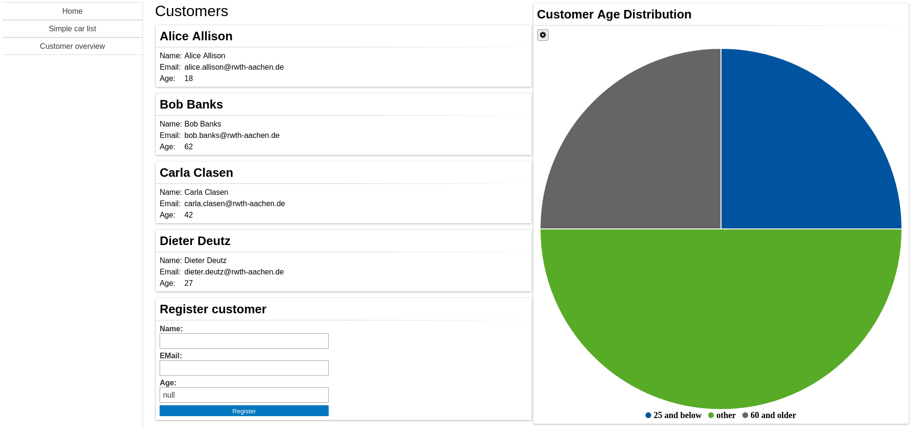

# E2E Testing using Simulated GUI

Since testing is a crucial part of software development, we now want to create an end-to-end (E2E) test for our website.

In MontiGem we can do that using **simulated GUIs**. 
Those provide a way to simulate user interactions with the generated components. 
The resulting state changes in the underlying objects can then be verified across different contexts.   

In essence this means:

- MontiGem generates components and representing Java classes from the GUI models.
- Those Java classes provide methods to simulate user interaction, e.g. clicking a button (`registerLeftClick`) or 
  entering text (`set...Entry`).
- Normal JUnit tests can be used to verify resulting state changes in the underlying objects (backend and frontend) and 
  in the simulated GUI (`get...Entry`).

For a detailed explanation see the [testing documentation](../unstructured/Testing.md).

## Adding the customer overview page

In the following we want to test the customer overview page. 
You will probably have noticed, that the gui models for that page are already present, but have not been used yet.
So first of all, add that page to `NavContainer.gui`:

```typescript
// navigation bar
@GemNavList(width = "40ch", height = "100vh", components = [
  //...
  @GemNavItem(title = "Customer overview", target = "/gui/CustomerOverview")
]),
```

If you've done it right, you should now see something like the following after starting your application and navigating
to the customer overview page:



Here we can see all customers which we created in the `initEntities()` method of our `CarrentalServerApplication`.
Also, customers which have been registered later will show up in that list. 

New customers can be registered in the card at the bottom of the list.

To the right, we can see a pie chart showing the age distribution of all customers, divided into three categories:

- Customers which are 25 years old, or younger
- Customers which are older than 25 but younger than 60 (labeled as `other`) 
- Customers which are 60 years and older

The chart will automatically update when you create a new customer.
Feel free to try that out. 

## Creating an E2E test

An E2E test is in essence just a JUnit test like any other.
In `frontend/src/test/java/gui` you will find the skeleton for a `CustomerOverviewGUITest`.

```java
class CustomerOverviewGUITest extends CarrentalMockTestSetup {

  public CustomerOverviewGUITest() {
    super(ClientSetup.of(1));
  }
  
  //...
}
```

Note, that the java class extends `CarrentalMockTestSetup`. 
This testsetup has been generated and should be used when a databank is not required (e.g. an E2E test).  
As a result of that extension you need to specify a `ClientSetup.of(1)` in the super-constructor.
This essentially tells the setup, that you want one client which observes the GUI components. 

You will also find that this skeleton has a `initEntites()` method, which provides you with some test data.

### Getting data from a GUI

As a first simple E2E test, we want to validate that our GUI component shows all customers that have been created in the `initEntities()` method.
Take a look at the already existing `testOverview()` method:

```java
@Test
void testOverview() {
  getClients(0).activate();
  
  /* ADD YOUR IMPLEMENTATION HERE:
   * - instantiate a CustomerOverview (don't forget to call init() on it!)
   * - assert that it shows all customers which are defined in initEntities()
   */
}
```

!!! note
    `getClients(0).activate()` tells the test runtime, that you want to interact with the generated classes from the 
    perspective of the first client (and not the backend).
    You effectively perform a context switch.

In order to implement that method, we firstly want to instantiate our `CustomerOverview` page, which represents the 
GUI component generated from `CustomerOverview.gui`.

```java
var overview = new CustomerOverview();
```

After instantiating a component, do not forget to call its `init()` method in order to initialize it!

```java
overview.init();
```

Done! Now you can query data from the component by just calling its methods. 
In order to get all shown customers, you can just call the `getCustomers()` method:

```java
List<Customer> customers = overview.getCustomers();
```

So if we want to verify that all four customers are shown, we can just use the usual junit methods:

```java
assertEquals(4, customers.size());
```

We can even go one step further and verify, that the data shown is correct.
If, for example, we wanted to verify that the name of the first defined customer, Alice, is really shown as 
`Alice Allison`, we could do something like this:

```java
Customer alice = customers.get(0);
assertEquals("Alice Allison", overview.getNameValue(alice));
```

This is possible, because in `CustomerOverview.gui` the `@GemText` component which displays the name has been labeled 
with `name`.

!!! note
    The customers on this page are shown in order of creation, so `customers.get(0)` will always return the first 
    customer.

### Getting data from a chart

In a similar fashion to how we validate data shown in a GUI, we can also validate data shown in a chart.

On the `CustomerOverview` page you will have noticed the pie chart "Customer Age Distribution". 
In order to access the charts' data, you, again, will need to instantiate a `CustomerOverview` and initialize it (!!).
You can use the existing method `testAgeDistribution()` to write that test case.

```java
@Test
void testAgeDistribution() {
  getClients(0).activate();

  /* ADD YOUR SOLUTION HERE:
   * - Instantiate a new CustomerOverview (don't forget to call init() on it!)
   * - Fetch the data of the ageDistribution chart
   * - Assert that the data matches what you would expect from the test data
   */
}
```

The data itself contains only the entries, so you can directly extract those:

```java
GemPieChartData data = overview.getAgeDistribtionData();
List<GemPieChartEntry> entries = data.getEntriesList();
```

!!! note
    The entries are in the order, in which they are shown in the chart. 
    So '18 and below' is first, then 'other' and finally '60 and older'.

You can then perform assertions on the entries' values and even labels:
```java
//make sure that there are two customers in the 'other' category
GemPieChartEntry other = entires.get(1);
assertEquals(2, other.getValue());
```

### Interacting with a GUI

So far we've only validated a GUI components contents, but we have not interacted with it yet. 
We want to change that, by using the GUI to register (in other words, create) a customer. 
For that task, a `testRegister()` method skeleton has been prepared for you.  

```java
@Test
void testRegister() {
  getClients(0).activate();
  
  /* ADD YOUR SOLUTION HERE:
  * - Instantiate a new CustomerCreate (don't forget to call init() on it!)
  * - Create a new customer with it
  * - Switch to the backend context (getBackend().activate())
  * - Assert that your customer can be found in CarrentalManager.getCustomerList()
  */
}
```

As you've learned previously, customer creation is handled by a separate GUI component, in our case `CustomerCreate`. 
Just as above, instantiate and initialize that components' Java representation.

The customer we want to create for this example is 'Eugene Engel'.

```java
var name = "Eugene Engel";
var email = "eugene.engel@rwth-aachen.de";
var age = 32;
```

Set the entries for `name`, `email` and `age` on the component. 
In the GUI model, those input fields have been labeled, so in order to set the name, 
one can just use the `setNameEntry()` method.

```java
customerCreate.setNameEntry(name);
```

Don't forget to set the other entries for `email` and `age` as well.

!!! note
    Entries have to be set as String value. 
    In order to set the `age` entry, you have to use `String.valueOf(age)`.

Now you can left-click the `register` button.

```java
customerCreate.registerLeftClick(null);
```

The customer should have been created in the backend!
We can validate that by switching to the backend context and retrieving all created customers.
Afterward, we check if the created user exists in that list.
They should have the exact same values, that we 'entered' in our GUI.
We can just write some simple checks for that:

```java
//switch to backend context
getBackend().activate();

//check the newly created user exists
var foundNewUser = false;
for (Customer customer : CarrentalManager.getCustomerList()) {
  if (name.equals(customer.getName()) && 
    email.equals(customer.getEmail()) && 
    age == customer.getAge()) {
      foundNewUser = true;
  }
}

assertTrue(foundNewUser, "Can not find new user!");
```

The age distribution should've also been updated automatically, which could be checked in a similar manner to `testAgeDistribution`.
