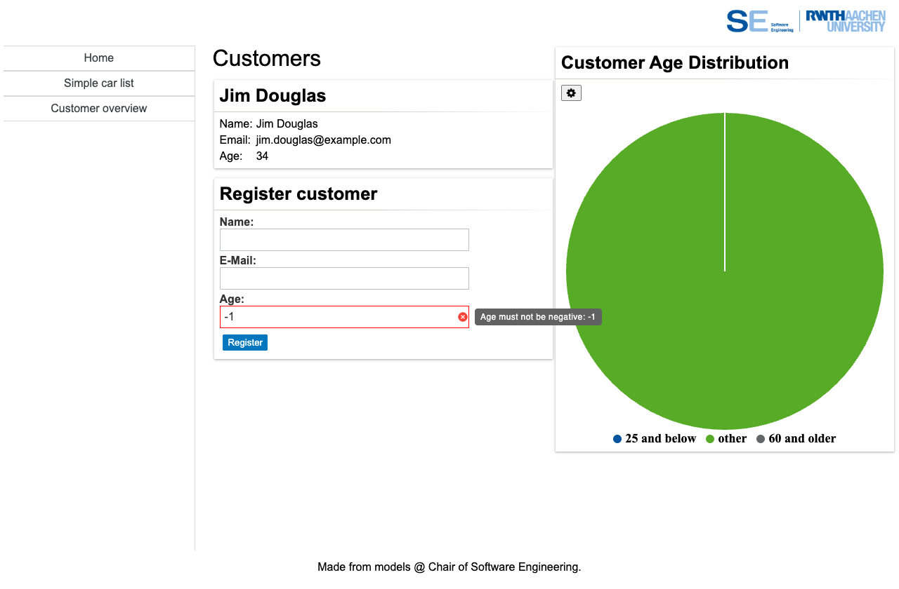
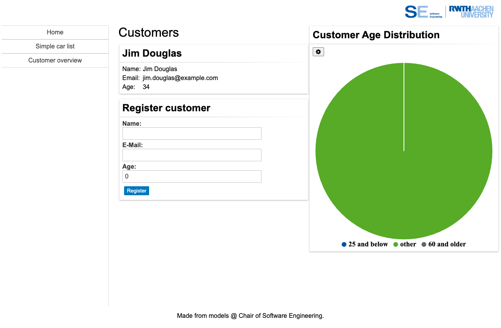

# OCL Constraints for GUI Validity Checking

MontiGem can use OCL invariants to validate values that application users enter
in GUI components. This is useful for domain rules that should be kept
close to the data model, but should still be visible directly in a form.

In this chapter we add a validation rule for customer registration:

- the customer age must not be negative
- the `Age` input in `CustomerCreate` should be marked invalid when the value
  violates that rule
- the tooltip should show an application-specific error message

The important part for application developers is that the GUI model does not
need custom validation code. If a `GemTextInput` is bound to an attribute via
`entry = customer.age`, MontiGem can connect OCL constraint violations on that
attribute to the input component.

## Adding an OCL model

Create a new folder `models/ocl` and add the following file:

```java title="models/ocl/CustomerValidity.ocl"
package validity;

import Carrental.*;

ocl CustomerValidity {
  context Customer customer inv:
    customer.age >= 0;
    shortError: "Age must not be negative: " + customer.age;
    error: "The customer age must be zero or greater, but is " + customer.age;
}
```

The file has the usual structure:

- `context Customer customer inv:` declares that the following expression
  validates a `Customer`.
- `customer.age >= 0` is the actual rule.
- `shortError` is the message shown close to the invalid GUI input, for example
  in the tooltip.
- `error` is the longer message used for the full constraint violation.

The short error should be concise and specific enough for a user to fix the
input without reading technical details.

## Connecting the rule to a GUI input

The existing `CustomerCreate` component already binds the input fields to the
`Customer` attributes:

```ts title="frontend/src/main/gui/gui/CustomerCreate.gui"
component CustomerCreate(Customer customer) {
  @GemCard(title = "Register customer", component = @GemColumn(width = "40ch", rowGap = "5px", components = [
    name@GemTextInput(labelText = "Name: ", entry = customer.name),
    email@GemTextInput(labelText = "E-Mail: ", entry = customer.email),
    age@GemTextInput(labelText = "Age: ", entry = customer.age),
    register@GemButton(label = "Register", leftClick = createCustomer(customer))
  ]));
}
```

The relevant line is:

```ts
age@GemTextInput(labelText = "Age: ", entry = customer.age)
```

The `entry` binding is enough for the generated GUI validity handling to relate
the input to `Customer.age`.
If the validity parameter is set on a `GemTextInput`, the automatic validation via ocl is no longer executed.

## Trying it out

After starting the application, navigate to `Customer overview`, enter `-1` in the customer registration `Age`
field. The input should be marked as invalid and on hover show:

```
Age must not be negative: -1
```



Change the value back to `0` or a positive number. The validity error should disappear.


