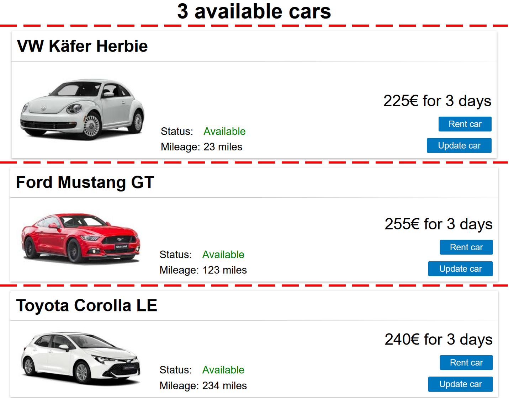
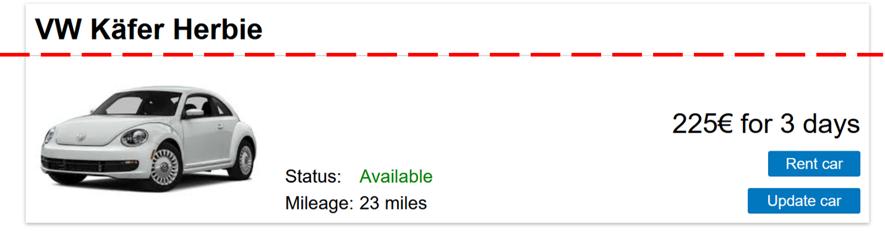
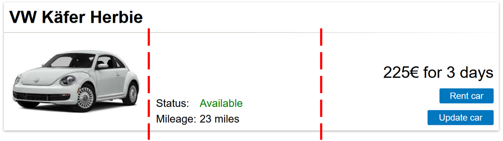
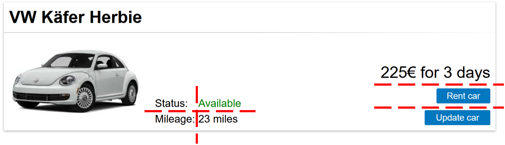
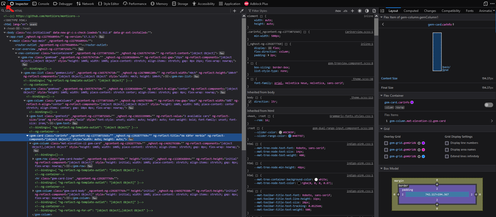
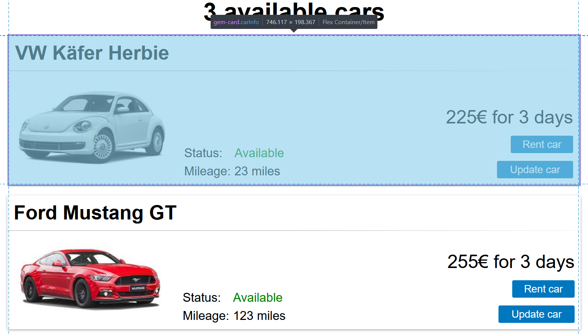
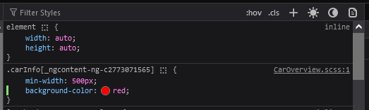
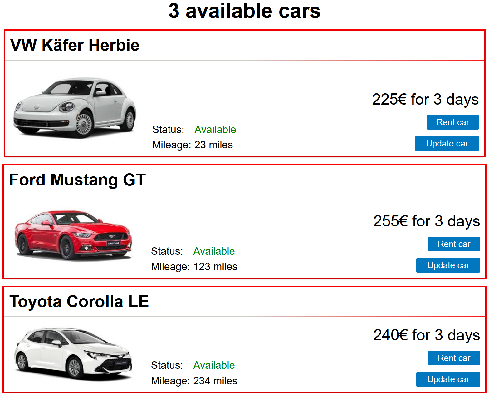
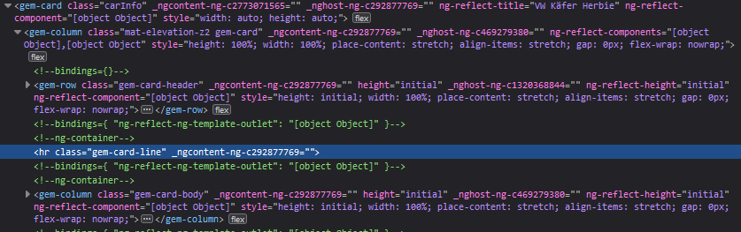
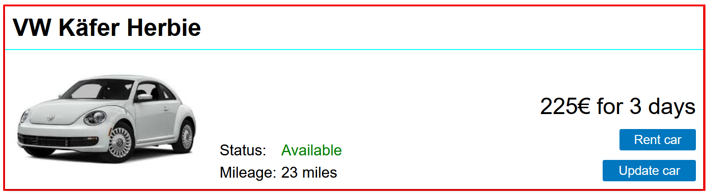

---
hide:
  - navigation
---

# GUI layout

A typical layout of a component consists of a combination of columns, rows and
grids. The `mc.fenix.arrange` package contains corresponding components
`GemColumn`, `GemRow`, and `GemGrid`.

> Note: these components are based on the [flexbox
> layout](https://developer.mozilla.org/en-US/docs/Web/CSS/CSS_flexible_box_layout/Basic_concepts_of_flexbox)
> and [grid
> layout](https://developer.mozilla.org/en-US/docs/Web/CSS/CSS_grid_layout/Basic_concepts_of_grid_layout).

The `CarOverview` so far had simple layout. Now, we update it to an extended layout
configuraton:

```ts
package gui;

import mc.fenix.basic.GemText;
import mc.fenix.basic.GemImage;
import mc.fenix.basic.GemButton;
import mc.fenix.arrange.GemColumn;
import mc.fenix.arrange.GemRow;
import mc.fenix.arrange.GemGrid;
import mc.fenix.arrange.GemCard;
import gui.navigation.NavContainer;

import Carrental.Car;

page CarOverview(List<Car> cars) {
  @NavContainer(content = [
    @GemColumn(rowGap = "10px", width = "50%", hAlign = "center", components = [

      @GemText(value = getAvailableCarsTitle(), size = "2rem", weight = "bold"),
      @iterate(Car c : cars) {
        carInfo@GemCard(
          title = c.make + " " + c.model + " " + c.name,
          component = @GemRow(colGap = "20px", vAlign = "bottom", hAlign = "space-between",
            components = [
              @GemImage(width = "200px", source = "assets/images/" + c.make + ".jpg"),
              @GemGrid(width = "auto", colGap = "5px", rowGap = "5px", rows = [
                [
                  @GemText(value = "Status:"),
                  @GemText(
                    value = c.rentableStatus,
                    color = c.rentableStatus == RentableStatus.AVAILABLE ? "green" : "red"
                  )
                ],
                [
                  @GemText(value = "Mileage:"),
                  @GemText(value = c.mileage + " miles")
                ]
              ]),
              @GemColumn(width = "40ch", rowGap = "10px", hAlign = "right", components = [
                @GemText(value = (c.costPerDay * 3) + "€ for 3 days", size = "1.5rem"),
                @GemButton(width = "calc(8ch + 10px)", label = "Rent car", leftClick = rentCar(c)),
                @GemButton(width = "calc(10ch + 10px)", label = "Update car", leftClick = updateCar(c))
              ])
            ]
          )
        );
      }

    ])
  ]);
}
```
The result:


> Note: The default root of images, set in the `source` parameter of `GemImage`, is `frontend/config/src/`.

The styling process is normally iterative with following steps:
1. Draw (or imagine) a sketch of the component with all of the parts layed out.
2. Split the components with horizontal and vertical lines. 
3. Draft the layout in the model according to the lines:
    - Components between horizontal lines are put into `GemColumn`.
    - Components between vertical lines are put into `GemRow`.
    - Components that are arranged in a grid pattern are put into `GemGrid`.
4. Repeat steps 2 and 3 if necessary
5. Fine-tune the layout using properties of `GemColumn`, `GemRow` and `GemGrid`.

> Besides 3 main layout componets, you may consider using other components, such
> as `GemCard`. You should also build your own layout components if you notice
> the same layout pattern.

The steps applied for layouting the overview page (we start with step 2 for
simplicity):

2.  The first split is done with horizontal lines:

    
3.  This means the first container to add is `GemColumn`:
    ```ts
    @GemColumn(components = [
      @GemText(value = getAvailableCarsTitle(), size = "2rem", weight = "bold"),
      @iterate(Car c : cars) {
        /* Image, text, buttons */
      }
    ])
    ```

2)  The text component is in the right place, we have to arrange the content
    inside `iterate`. Since the content for each car is arranged the same, we
    take first example of the content. At this point, we could split the content
    like this:

    
3)  We could use `GemColumn` again, but a better way is to use `GemCard`, which
    is a fancier looking `GemColumn` suitable for grouping information:
    ```ts
    @iterate(Car c : cars) {
      @GemCard(
        title = c.make + " " + c.model + " " + c.name
        /* Image, text, buttons */
      )
    }
    ```

2.  The next split is done for contents of the card:
    
    
3.  This time the split is horizontal, so we use `GemRow`:
    ```ts
    @GemCard(
      title = c.make + " " + c.model + " " + c.name,
      component = @GemRow(
        components = [
          @GemImage(width = "200px", source = getImageUrl(c.make)),
          /* text */
          /* text and buttons */
        ]
      )
    );
    ```

2)  The image is in place, the last splits:

    
3)  The status and mileage information is aligned in a grid pattern. The price
    and buttons are split vertically:
    ```ts
    @GemRow(
      components = [
        @GemImage(width = "200px", source = getImageUrl(c.make)),
        @GemGrid(rows = [
          [
            @GemText(value = "Status:"),
            @GemText(
              value = c.rentableStatus,
              color = c.rentableStatus == RentableStatus.AVAILABLE ? "green" : "red"
            )
          ],
          [
            @GemText(value = "Mileage:"),
            @GemText(value = c.mileage + " miles")
          ]
        ]),
        @GemColumn(components = [
          @GemText(value = (c.costPerDay * 3) + "€ for 3 days", size = "1.5rem"),
          @GemButton(width = "calc(8ch + 10px)", label = "Rent car", leftClick = rentCar(c)),
          @GemButton(width = "calc(10ch + 10px)", label = "Update car", leftClick = updateCar(c))
        ])
      ]
    )
    ```
    `GemGrid` allows you to define `rows`, `columns`, or for special cases
    `cells`. You can get the same result using either of those, we use `rows` in
    this case, because it is more intuitive to group a description of a
    characteristic and its value into rows (otherwise you would have columns
    `["Status:", "Mileage:"]` and `["Available", "23 miles"]`).
    > Note: you could do what grid does with a columns and rows, but it's more
    > difficult to make sure that gaps and spaces are correctly aligned.
    
5.  The last step is to fine tune the layout. For example, the column with the
    buttons:
    - the column is 40 characters wide
    - there must be a 10 pixel gap between buttons and text
    - the column should be right aligned

    ```ts
    @GemColumn(width = "40ch", rowGap = "10px", hAlign = "right", components = [
      @GemText(/*...*/),
      @GemButton(/*...*/),
      @GemButton(/*...*/)
    ])
    ```


## Styling

Further styling requires manual handling and slightly differs from case to case.
There is a similar process in all of the cases though:
* find the right style
* define the found style in the right SCSS file

One of the efficient ways of finding the right style is to use the [browser
inspector](https://developer.mozilla.org/en-US/docs/Learn/Common_questions/Tools_and_setup/What_are_browser_developer_tools)
and search for an element that needs to be modified.

You can either explore the HTML nodes of your page in the "Inspector" tab
directly or use a selection tool (marked on the image), example of the inspector
in Firefox:



Selected node:



In the inspector you can find a bunch of information, including styles.
Typically you would want to modify a CSS class of the HTML node. In the given
example we want to add a red background for each card (we actually don't want
that, it's easy to see though). We can experiment with the styles directly in
the inspector by adding a style to an element or one of its classes (typically
you should prefer classes), here a class `carInfo` (dot before the name
means that it is a CSS class):



The result:



The first step of finding out what changes of CSS properties we need is done.
Next is to decide where to put the changes.

If you want the changes to be specific to some component instance, you can
specify the id (name) of the component in the model, e.g.:
```ts
carInfo@GemCard(
  /*...*/
)
```
The `carInfo` id will also be used as the name of a CSS class in the generated
code code. After that you should specify the style in the SCSS file of the
component (see [TOP-mechanism](./TOPMechanism.md)). For example, if the `carInfo`
component inside `CarOverview` should have the style, create a 
`CarOverview.scss` file in your handwritten frontend sources 
(using the correct package as introduced for the TOP mechanism)
and add the corresponding style to it:
```scss
.carInfo {
  min-width: 500px;
  background-color: red;
}
```

It gets a bit tricky if you need to change the style of an internal part of the
component. For example, if we want to change the color of the line separating
the card title and the card body, we would again find the right element:



but since the element is inside of the `GemCard`, which is a component that is
outside of the app, the normal modification rule will not work. Instead, we have to add `:host
::ng-deep` before the rule:
```scss
:host ::ng-deep .gem-card-line {
  background: aqua;
}
```



The additional `:host ::ng-deep` part of the style makes sure the style is
applied to the card line but only for the current page (`CarOverview`). 

The styles you apply can target any elements and you can use [different
selectors](https://developer.mozilla.org/en-US/docs/Web/CSS/CSS_Selectors) to
specify what exact elements should be targeted. If, for example, an element
doesn't have a class, but is inside of an element with a class you can use this
information. For example, a different way to target the card line:
```scss
:host ::ng-deep .carInfo hr {
  background: aqua;
}
```
Here we select a child with tag `hr` inside an element with class `.carInfo`

If you want the changes to be global, e.g., change the line color for every card
on every page, put the style into `styles.scss` file of your application (create
the file if it doesn't exist). The location is
`frontend/config/src/styles.scss`:
```scss
/* You can add global styles to this file, and also import other style files */
@import "../node_modules/@umlp/theme/theme";

// make sure the default styles are included
@include montigem-theme();

// override one of the default styles
.gem-card-line {
  background: aqua;
}
```

[Next page](./GUIAdvanced4.md)

[Previous page](./GUIAdvanced2.md)
