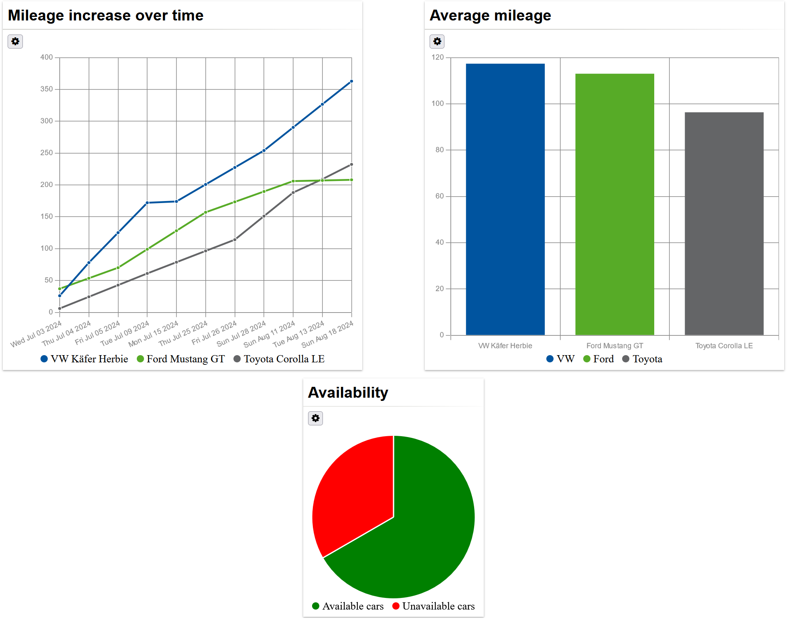

---
hide:
  - navigation
---

# Charts

Here we create a page with a bunch of charts. The process is no different from
creating a normal page, but we often have to use hand-written functions.
First, we create the following page GUI model:

```ts
package gui;

import mc.fenix.arrange.GemRow;
import mc.fenix.arrange.GemCard;
import mc.fenix.charts.GemLineChart;

import gui.navigation.NavContainer;

// data class
import Carrental.Car;

page Dashboard(List<Car> cars) {
  @NavContainer(content = [
    @GemRow(wrap = "wrap", rowGap = "10px", hAlign = "space-evenly", components = [

        @GemCard(
          width = "40%",
          title = "Mileage increase over time",
          component = @GemLineChart(data = getMileageIncrease(cars))
        )

    ])
  ]);
}
```
The charts typically have an input with a complex structure. For example,
`GemLineChart` expects an object of type `GemLineChartData` with following
definition (This definition is already internally provided. Don't add it to
your class diagram):
```java
classdiagram GemLineChartTypes {

  public class GemLineChartData {
    List<GemLineChartEntry> entries;
    List<String> labels;
  }

  public class GemLineChartEntry {
    String label;
    List<Integer> data;
    String borderColor;
    String backgroundColor;
    String pointBackgroundColor;
  }

}
```
- `labels` of `GemLineChartData` represent points on x axis from left to right.
- `entries` of `GemLineChartData` represent statistics for each single item, in this example for each
  different car.
- `label` of `GemLineChartEntry` represent the name of the item, such as name of
  a car.
- `data` of `GemLineChartEntry` are y axis values that correspond to x axis
  points. The size of data should be equal to `labels` size and must be ordered
  according to the x axis points.

Next, we implement the function `getMileageIncrease` using TOP-mechanism for the Java  
class `Dashboard.java`, which was automatically generated for us by MontiGem:

```java
import java.time.LocalDateTime;
import java.util.ArrayList;
/*import*/

@umlp.jsweet.extension.annotation.Component
public class Dashboard extends DashboardTOP {

  public GemLineChartData getMileageIncrease(List<Car> cars) {
    // if data is not present return nothing
    if (cars == null) {
      return null;
    }
    // create an array of dates to use them as x axis points later
    List<LocalDateTime> dates = new ArrayList<>();

    for (Car c : cars) {
      for (MileageDataPoint mileage : c.getMileageDataPointList()) {
        dates.add(mileage.getRecordDate());
      }
    }
    // sort dates
    dates.sort((l, r) -> l.compareTo(r));

    List<String> labels = new ArrayList<>();
    for (LocalDateTime date : dates) {
      String xAxisPoint = date.toString();
        if (!labels.contains(xAxisPoint)) {
          // use string representation of (non-repeating) dates as x axis points
          labels.add(xAxisPoint);
        }
    }

    List<GemLineChartEntry> entries = new ArrayList<>();
    for (Car c : cars) {
      // create an entry for each car:
      // label (1st arg) is the name of the car, data (2nd arg) are the mileage data for each date
      GemLineChartEntry entry = new GemLineChartEntryBuilder().label(
              c.getMake() + " " + c.getModel() + " " + c.getName()).data(Arrays.asList(labels.size())).build().get();
      entries.add(entry);
      for (MileageDataPoint mileage : c.getMileageDataPointList()) {
        String xAxisPoint = mileage.getRecordDate().toString();
        int xAxisPointIndex = labels.indexOf(xAxisPoint);
        entry.getDataList().set(xAxisPointIndex, (int) mileage.getMileage().floatValue());
      }
    }
        
    // optional: add interpolated itermediate points to entries where the data is not available
    for (GemLineChartEntry entry : entries) {
      for (int i = 0; i < entry.getDataList().size(); ++i) {
        Integer data = entry.getData(i);
        if (data == null) {
          this.interpolateData(entry.getDataList(), i);
        }
      }
    }

    GemLineChartData data = 
            new GemLineChartDataBuilder().entries(entries).labels(labels).build().get();
    return data;
  }

  public void interpolateData(List<Integer> stat, int interpolatedIndex) {
    int left = 0;
    int leftI = 0;
    int right = 0;
    int rightI = 0;
    for (int i = 0; i < stat.size(); ++i) {
      if (stat.get(i) != null && interpolatedIndex > i) {
        left = stat.get(i);
        leftI = i;
      }
    }

    for (int i = 0; i < stat.size(); ++i) {
      if (stat.get(i) != null && interpolatedIndex < i) {
        right = stat.get(i);
        rightI = i;
        break;
      }
    }

    stat.set(interpolatedIndex, left + ((right - left) / (rightI - leftI)) * (interpolatedIndex - leftI));
  }
}
```

There are several important points to be aware of:

1.  A method should always check whether data is present. In case it isn't, the
    component will handle the output in some way. Otherwise, if you try to
    access attributes of a non-existing object, the browser will throw an
    exception which if not caught may break the page.
    ```ts
    // if data is not present return nothing
    if (cars == null) {
      return null;
    }
    ```

2.  Then you can create the labels (x axis) of the chart:
    ```java
    List<LocalDateTime> dates = new ArrayList<>();

    for (Car c : cars) {
      for (MileageDataPoint mileage : c.getMileageDataPointList()) {
        dates.add(mileage.getRecordDate());
      }
    }
        
    dates.sort((l,r) -> l.compareTo(r));

    List<String> labels = new ArrayList<>();
    for (LocalDateTime date : dates) {
      String xAxisPoint = date.toString();
      if (!labels.contains(xAxisPoint)) {
        labels.add(xAxisPoint);
      }
    }
    ```
    The labels are, in this case, unique dates, sorted from the earliest to the
    latest. The dates must also be formatted to strings to be properly
    displayed.

3.  The entries are created for each item (cars) and the y axis data is inserted
    according to the order of the labels:
    ```java
    List<GemLineChartEntry> entries = new ArrayList<>();
    
    for (Car c : cars){
      GemLineChartEntry entry = new GemLineChartEntryBuilder().label(c.getMake()+" "+c.getModel()+" "+c.getName()).data(Arrays.asList(labels.size())).build().get();
      entries.add(entry);
      for (MileageDataPoint mileage : c.getMileageDataPointList()) {
        String xAxisPoint = mileage.getRecordDate().toString();
        int xAxisPointIndex = labels.indexOf(xAxisPoint);
        entry.getDataList().set(xAxisPointIndex, (int) mileage.getMileage().floatValue());
      }
    }
    ```

4.  The data may be not present for every point of x axis. In that case the line
    of the line chart is not continuos. However, we can interpolate data if
    showing the data flow is more important than actual data at specific points
    in time:
    ```java
    // optional: add interpolated itermediate points to entries where the data is not available
    for (GemLineChartEntry entry : entries){
      for (int i = 0; i < entry.getDataList().size(); ++i) {
      Integer data = entry.getData(i);
        if (data == null) {
          this.interpolateData(entry.getDataList(), i);
        }
      }
    }
    ```
    The method `interpolateData` is also written by hand, but generally would look the
    same for the different cases. Thus, we add:
    ```java
    public void interpolateData(List<Integer> stat, int interpolatedIndex) {
      int left = 0;
      int leftI = 0;
      int right = 0;
      int rightI = 0;
      for (int i = 0; i < stat.size(); ++i) {
        if (stat.get(i) != null && interpolatedIndex > i) {
          left = stat.get(i);
          leftI = i;
        }
      }

      for (int i = 0; i < stat.size(); ++i) {
        if (stat.get(i) != null && interpolatedIndex < i) {
          right = stat.get(i);
          rightI = i;
          break;
        }
      }

      stat.set(interpolatedIndex,left + ((right - left) / (rightI - leftI)) * (interpolatedIndex - leftI));
    }
    ```

5.  We can now create the data:
    ```java
    GemLineChartData data = new GemLineChartDataBuilder().entries(entries).labels(labels).build().get();
    ```
    You would normally expect to directly return the data. This does not
    work with the Angular framework, because of the following reason: The method that
    returns line chart data gets triggered whenever something changes in the
    user interface. Angular makes sure to update the interface whenever a new object
    is returned by such method. This means that if you return a new object in a
    method, Angular will update the user interface, which will trigger the method
    again, which will force Angular to update the user interface again, etc.

    BUT because of a smart observability functionality which is added during the 
    JSweet transpilation the function only gets called when its arguments are
    updated.

    ```ts
    protected mileageIncrease: { data: GemLineChartData, hash: string } = { data: null, hash: '' };

    const data = new GemLineChartData(entries, labels);

    // Angular requirement
    // check if the calculated value is equal to the previous one
    if (JSON.stringify(data) !== this.mileageIncrease.hash) {
      // if data is new save the new state
      this.mileageIncrease = { data: data, hash: JSON.stringify(data) };
    }
    return this.mileageIncrease.data;
    ```
    We calculate a "hash" of the data using `JSON.stringify` function and write
    it into a local variable together with the data. Whenever the data gets
    updated, the hash changes and so is the returned object.

Similarly we can create other charts, such as bar chart and pie chart:
```ts
/* package, imports */
page Dashboard(List<Car> cars) {
  @NavContainer(content = [
    @GemRow(wrap = "wrap", rowGap = "10px", hAlign = "space-evenly", components = [

      @GemCard(
        width = "40%",
        title = "Mileage increase over time",
        component = @GemLineChart(data = getMileageIncrease(cars))
      ),

      @GemCard(
        width = "40%",
        title = "Average mileage",
        component = @GemBarChart(data = getMileageAvg(cars))
      ),

      @GemCard(
        height = "400px",
        title = "Availability",
        component = @GemPieChart(data = getAvailability(cars))
      )

    ])
  ]);
}
```
The result:


The bar chart data is similar to the line chart data and the 
pie chart data has a much simpler structure. You can take a 
look at the [documentation](https://git.rwth-aachen.de/monticore/umlp/-/wikis/Frontend-RTE#chart-components)
to get a general idea about structuring the data.

[Next page](./GUIAdvanced5.md)

[Previous page](./GUIAdvanced3.md)
