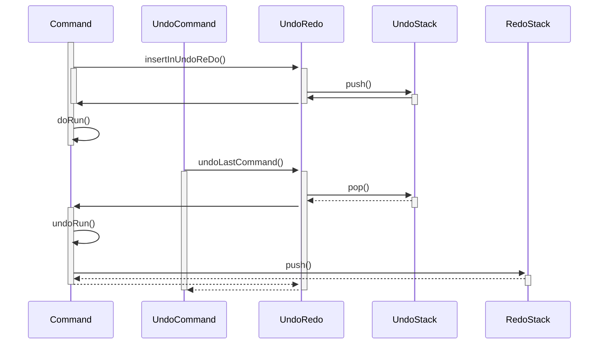

<!-- (c) https://github.com/MontiCore/monticore -->
# **Core Requirements** Design Entscheidungen Applikationskern 

Dieses Beispiel beinhaltet eine Reihe von Design Entscheidungen
für den Appliaktionskern (Serverseitig) incl. Persistenz,
Rechte, und Kommunikation (z.B. zur GUI),
die hier dokumentiert werden und damit das README.md ergänzen.
Als durchgängiges Beispiel wird das 
[Flensburg.umlp](./models/Flensburg.umlp) Modell verwendet.

```
package hardy;

umlp Flensburg {

    class Car;

    class Human {
        int age;
    }

    class Person extends Human {
        String nickname;
        / String clubname;  // wird als nickname +"@"+ mainResidence.city  realisiert
    }

    class Address {
       String city;
    }

    association owns [1] Person -> Car [*];
    association mainResidence [1] Person -> Address [1];

    association visits [*] Person (visitor) <-> (visited) Address [*];
    association parent [1] Person -> (children) Person [*];
}
```

## Kernklassen der Applikation

* am Beispiel der Klasse `Person`.
* es wird je eine Java Klasse (hier: `Person`) entsprechend jeder modellierten Domänenklasse generiert
* hierbei wird Vererbung auf Klassenebene von Java entsprechend der Vorgaben des Modells berücksichtigt.
  * hier `Person extends Human`: Resultiert darin, dass auch die generierte Klasse `Person` die generierte Klasse `Human` erweitert
* Für die modellierten Attribute (für Assoziationen: siehe unten) werden Member-Variablen generiert, welche die Sichtbarkeit `protected` (nicht `private`!) erhalten, um bei Vererbung noch erweiterbar zu sein
  * hier: Resultiert in Attributen `nickname` und `mainResidence`
  * Die Multiplizität wird aus dem Modell übernommen
    * unterstützt werden: default (1), optional (0..1) und many (*)
  * Standardmäßig werden für alle Attribute getter und setter Methoden generiert
    * Beispiel: `getNickname()` und `setNickname(String nickname)` für das Attribut `nickname`
    * Bei optionalen oder listenwertigen Attributen werden entsprechend Methoden generiert, welche der API von `java.util.Optional` bzw. `java.util.List` entsprechen
      * Beispiel:  `add` und `remove` Methoden für Collections
  * Weitere Modifier, wie `derived` (`\`) werden ebenfalls berücksichtigt
    * `clubname` ist beispielsweise als `derived` markiert, wodurch **kein** setter generiert wird, sondern nur ein getter, welcher `abstract` ist (also keinen Methodenrumpf implementiert) und manuell erweitert werden muss
  * Zur Validierung der gesetzten Variablen, werden entsprechende check-Methoden bereitgestellt 
    * z.B. beim builden eines Objektes relevant (keine `null`-Werte erlaubt)
    * Beispiel: für `nickname` wird eine Methode `checkNickname()` generiert, welche einen boolschen Wert zurückgibt, gemäß der Information, ob der Wert der Variable adäquat gesetzt wurde. 
    * Neben dem boolschen Rückgabewert, wird bei fehlergeschlagener Überprüfung zusätzlich ein Fehler geloggt.
* Beschluss: `init`-Methoden werden nicht mehr benötigt da Konstrukt aus Zeiten, als die Builder noch nicht die Domänenklassen erweitert haben

## Assoziationen

* aus Buch: Assoziation ist eine binäre Beziehung zwischen Klassen, die zur Realisierung struktureller Information verwendet wird. Eine Assoziation besitzt einen Assoziationsnamen, für jedes Ende einen Rollennamen, eine Kardinalität und eine Angabe über die Navigationsrichtungen.
* Für die modellierten Assoziationen und Kompositionen werden Member-Variablen generiert, welche die Sichtbarkeit `protected` (nicht `private`!) erhalten, um bei Vererbung noch erweiterbar zu sein
  * Beispiel `association owns [1] Person -> Car [*];` : Resultiert in Attribut `owns` in der Klasse `Person`
  * Der Name des Attributs ergibt sich gemäß folgender Konvention
    * 1. Rollenname falls vorhanden
    * 2. Attributname falls vorhanden
    * 3. klein geschriebener Name der Zielklasse
  * Die Multiplizität wird aus dem Modell übernommen
    * unterstützt werden: default (1), optional (0..1) und many (*)
  * Standardmäßig werden für alle Assoziationen Zugriffmethoden gemäß ihrer Multiplizität generiert
    * Beispiel: `getOwns(int i)` und `addOwns()` für das Attribut die `owns` Beziehung zwischen `Person` und `Car`
    * Bei optionalen oder listenwertigen Attributen werden entsprechend Methoden generiert, welche der API von `java.util.Optional` bzw. `java.util.List` entsprechen
* Für bi-direktionale Assoziationen wird entsprechend in beiden Klassen eine member-Variable angelegt
  * Beispiel `association visits [*] Person (visitor) <-> (visited) Address [*];` 
  * Da die bi-direktionale Verbindung einen Zusammenhang zwischen den gespeicherten Werten modelliert, müssen diese auch gemeinsam behandelt (z.B. hinzugefügt oder entfernt) werden
  * wird im Beispiel ein Objekt vom Type `Address` der `Person` hinzugefügt, so muss umgekehrt auch das entsprechende Objekt der `Person` für `Address` bekannt gemacht werden
  * Dafür müssen sich die Zugriffsmethoden sich gegenseitig aufrufen können (z.B. `addVisited` der Klasse `Person` muss der `visitor` Liste von `Address` die aktuelle Instanz mitteilen)
  * Da dies in beide Richtungen gilt, werden, um unendliche Rekursion zuu vermeiden _interne_ Methoden generiert, welche nur den Zweck erfüllen, von der jeweils anderen Zugriffsmethode der bi-direktionalen Assoziation aufgerufen zu werden
  * Somit werden beispielweise die Methoden `addVisited` und  `INTERNAL_addVisitedId` generiert

## `GemIdentifiable`

* Domänklassen wie beispielsweise `Person` implementieren das `GemIdentifiable` Interface.
* `GemIdentifiable` sind alle Klassen mit einer `gemId`, diese kann über `long GemIdentifiable::getGemId()` abgefragt werden.
  * Das Interface wird für manche generische Implementierungen (wie z.B. `Gem<.>`) benötigt.

## `Gem<.>`

* Für modellierte Assoziationen der Kardinalitäten (1) und (0..1) werden `Gem<.>` Attribute erstellt und diese dienen dazu, die entsprechend assoziierten Objekte lazy nachzuladen.
* Die `Gem<Person>` Klasse besitzt unter anderem die Attribute `Person object` und `long gemId` um ein Objekt von Klassen zu referenzieren, welche eine `gemID` besitzen (und somit das `GemIdentifiable` Interface implementieren).
  * Die `gemId` ist immer vorhanden.
  * Das `object` ist `null` genau dann, wenn das zur `gemId` gehörende Objekt noch nicht geladen wurde.
  * Das Attribut `loadingState` beschreibt, ob das `object` geladen wurde, und, falls nicht, gibt es weiterreichende Informationen zur Begründung des Nichtladens.
* Die Methoden der `Gem`-Klasse ähneln `java.util.Optional`.
  * `get()` gibt das assoziierte Objekt zurück, wenn es geladen werden kann. Falls noch nicht versucht worden ist, es zu laden, so wird beim Aufruf ein Versuch gestartet.
  * `isPresent()` gibt an, ob das assoziierte Objekt geladen werden konnte. Falls noch nicht versucht worden ist, es zu laden, so wird beim Aufruf ein Versuch gestartet.
  * `set(Person object)` setzt das `object`, `gemId` und `loadingState` werden entsprechend gesetzt, sodass das als geladen gilt.

## `GemList<.>`

* Für modellierte Assoziationen der Kardinalitäten (0..*) werden `GemList<.>` Attribute erstellt und diese dienen dazu, die entsprechend assoziierten Objekte lazy nachzuladen.
* Die `GemList<.>` Klasse implementiert das `java.util.List<.>` interface.
* Die Liste ist als `java.util.List<.>` per Methode der Domainklasse verfügbar, im Beispiel mit `Person::getOwns()`
(TODO: FDr, zurzeit wird `getOwnsGemList` verwendet, aber der Rückgabewert ist nicht richtig `GemList<.>` statt nur `java.util.List<.>`)
  * Die `java.util.AbstractList<.>` wird extended, wodurch in der `GemList<.>` Klasse nur die Methoden `size`, `get`, `set`, `add`, und `remove` implementiert werden.
* Die `GemList<.>` Klasse besitzt das Attribut `List<Long> ids`, welches die `gemId`s des assoziierten Objekte beinhaltet.
  * Die `gemId`s werden nicht lazy nachgeladen. Wir gehen davon aus, das eine Assoziation nicht übermäßig viele Objekte besitzt.
  * Die `gemId`s' korrespondierenden Objekte werden nicht in der GemList gespeichert, sondern bei Bedarf aus dem Manager geladen.
* Änderungen werden durch Commands synchronisiert.
  * Änderungen treten bei den Methoden `set`, `add`, und `remove` auf.
  * Die `GemList<.>` Klasse selbst besitzt keine Form von Synchronization, die internen Methoden `_internal_addAndSync`, etc. werden von Subklassen der `GemList<.>` Klasse implementiert. Diese nutzen die Synchronization vorhanden in den Domain Klassen wie `Person::_internal_addOwns`, damit es bei einer einzigen Implementierung zur Synchronization bleibt. Das tatsächlich Ändern der Liste wird dann in e.g. `Person::_internal_addOwns` durch Verwendung von `GemList<.>::_internal_add` getätigt, wodurch die interne Logik des Änderns einer Liste bei Verwendung des `java.util.List<.>` Interface der `GemList<.>` und der Domainklassenmethoden (z.B. `Person::addOwns`) dieselbe ist.
Die Subklassenhierachy der `GemList<.>` ist im Beispiel `Person_OwnsGemList` erbt von `GemListBuilder<Car>`, welche von `GemList<Car>` erbt. Entsprechend sind alle assoziationsspezifischen `GemList<.>` Subklassen Builder.
  * `GemListBuilder<.>` ist identisch zu einer GemList mit der Ausnahme, dass nicht synchronisiert wird, bis `build()` aufgerufen wird. Bei Aufruf von `build` werden alle Elemente der Liste synchronisiert und ab dann verhält sich das `GemListBuilder<.>` Objekt identisch zu einem korrespondierenden `GemList<.>` Objekt.
  * Die assoziationsspezifischen `GemList<.>` Klassen wie `Person_OwnsGemList` verhalten sich wie `GemListBuilder<.>`, sie haben intern die Logik zur Synchronization und zum Laden der assoziierten Objekte anhand von GemIds. Da sie jeweils zu einem Domain-Objekt gehören, wird deren Konstuktor die GemID des entsprechenden assoziierenden Objekts übergeben.

## Datenmanagement

### Manager
* `FlensburgManager` ist die Hauptklasse um Daten anzulegen und auf sie zuzugreifen
* Im Frontend und Backend verfügbar
* enthält entsprechende `get` Methoden für jede Klasse des CDs
* liefert `builder` für jede persistierte Klasse.

* Im Backend lädt der Manager die Daten aus der entsprechenden Datenquelle. In einer Produktionsumgebung kann dies eine
Datenbank sein, während eines Unittests kann dies eine lokale Datenstruktur sein(vgl. `FlensburgMock`).
* Der Manager abstrahiert diese Datenquellen weg, sodass die Nutzer nicht wissen müssen, wo und wie die Daten gespeichert
werden oder wie auf sie zugegriffen wird.
* Im Frontend soll ein Cache das Neuladen von Daten verhindern, welche sich nicht geändert haben.
Hierfür ist eine Konsistenzprüfung mit dem Backend notwendig.

* Der Manager erlaubt Zugriff auf die Liste je aller Elemente eines Typs (zu welchen Zugriffsrechte existieren).
Diese Listen sind nicht direkt über die `Java.util.List`-API modifizierbar
(z.B. können nur Elemente zugefügt werden, indem diese mit den `builder` des Managers erstellt werden,
die entsprechende Liste wird dann entsprechend synchronisiert).
Denn für das Hinzufügen von Elementen gibt es ohnehin nur die Option über `builder`
und aus Gründen der API-Konsistenz soll auch das Entfernen ausschließlich über den Manager geschehen.
Ein etwaiger Umbau um Modifizierbarkeit hinzuzufügen ist weiterhin möglich.

### Builder

TODO


### Datenbank

* Als Datenbankanbindung gibt es zurzeit eine Umsetzung für relationale Datenbanken, umgesetzt mit JDBC. 


* Die Datenbank wird ueber die `database.properties` konfiguriert, welche vom DatabaseAccessManager beim Initialisieren 
  der FlensburgManagerImpl eingelesen wird.

* Die konkrete Datenbank in `corerequirements` ist die Postgres Datenbank.

* Für Tests wird die [h2](http://h2database.com/html/main.html) Datenbank genutzt.
  Diese wird im TestDatabaseAccessManager initialisiert.
  Sie hat den Vorteil vollständig im Arbeitsspeicher laufen zu koennen und ist damit gut geeignet fuer schnelle
  Tests. Der Nachteil ist, dass der Speicher an einem JVM Prozess haengt und somit kein zweiter JVM Prozess darauf
  zugreifen kann, d.h. IntelliJs Database Connection kann nicht benutzt werden, um den Zustand der Datenbankinstanz in einem
  anzusehen. Ein Workaround dafuer ist die Methode `TestDatabaseAccessManager#openWebServer`, welche eine Webapp
  zum inspizieren der Datenbank öffnet und den aktuellen Thread blockt bis diese geschlossen wird.

#### SQL Schema
* Für jede Domainenklasse gibt es eine Tabelle.
* Jedes Attribut mit einem simplen Typ(Primitive Typen und String) wird zu einer Spalte
  * TODO: Erweiterungspunkt im Generator für weitere simple Typen
* Jede Liste von simplen Typen wird zu einer weiteren Tabelle mit zwei Spalten: `id` des Parent-Objekts und Wert `value`.
  * TODO: Dritte Spalte für Sortierung? 
  * TODO: Optionals mit simplem Typen
* Assoziationen einer Domainenklasse mit simplen Typen werden wie Listen von simplen Typen behandelt
* Jede Assoziation mit zwei Domainenklassen wird zu einer weiteren Tabelle, welche zwei Spalten enthält: Eine pro `id`
  der beteiligten Klassen
  * TODO: Weitere Spalte für die Sortierung bei «ordered»
  * TODO: Assoziation mit Vererbung, e.g. eine Assoziation mit Teilnehmern `Car` und `Human`, wobei die Subklasse
    `Person` von `Human` existiert

## Nicht-persistierte Elemente

### Nicht-persistierte Attribute

* Annahme: Wir sprechen über Objekt `Person p` mit Attribut `/ String bla` 
* `bla` wird nicht in der DB gespeichert
* Es wird nur eine get-Funktion(signatur) `getBla()` generiert und erwartet,
  dass Klasse `Person` mit TOP realisiert wird.
  
* Die Berechnung kann auf drei Arten stattfinden:
  1. Jedes Mal neu, wenn `getBla()` aufgerufen wird
  2. Die Berechnung kann in einem internen Attribut gespeichert sein (und damit veralten).
     Das ist aber eine Option (der manuellen Implementierung)
  3. Ändert sich der Wert von `bla`, so werden Observer informiert. 
  4. Hängt die Berechnung von `bla` 
     von Werten anderer Objekte ab und soll aktualisiert 
     werden, so kann sich das aktuelle Objekt `p` als Observer an die anderen Objekte
     einklinken.
     Das ist insbesondere sinnvoll, wenn `p` selbst Observierbar ist.
  5. Ist dieses Aktualisierung rechenintensiv, dann muss `bla` nicht synchronisiert werden,
     sondern kann auf `NOT_Loaded` gestellt werden.
  6. Lokale Berechnung möglich: Berechnungen von `bar` kann in C und S separat stattfinden,
  7. Zentrale Berechnung: nur in Server wird gerechnet, die Ergebnisse werden 
     zum Client synchronisiert 

### Nicht-persistierte Klassen (Rechnungsobjekte)

* Dies sind typischerweise Daten, die im Server existieren und
  deren Attribute weitgehend berechnet werden.
* zum Teil sind diese auch in den Clients relevant, und werden 
  bei der Kommunikation Server/Client wie alle anderen objekte auch behandelt
* Rechnungsobjekte haben wohl keine gemId.
* Diese Daten müssen immer im Kontext eines Objektes der Datenbank oder einer ganzen
  Klasse modelliert werden. D.h. `\ class Berechnet` hängt immer bei z.B. Person.


## Commands

* Commands haben die Aufgabe Änderungen an Datenobjekten (auch nicht 
  persistierten) zwischen C/S zu transportieren
* Wir nutzen Commands, weil in kollaborativen Arbeitsumgebungen es sich gezeigt
  hat, dass parallele ausgeführte Änderungen dann zu wesenlich weniger Konflikten
  führen (Case: Google)
* Rechte zum Ändern werden ebenfalls per Commands geklärt
* Kommandos regeln das interaktive do/undo/redo einzelner Nutzer im Bereich der 
  GUI-Clients (mit Impact zum Server)

* Kommandos existieren auf mehreren Ebenen:
  1. Basiskommandos (setzen eines Attributs, eines Links)
  2. Erzeugen / Löschen eines Objekts im Server (egal ob persistiert)
  3. Ausführen einer (komplexen) (handgeschriebenen) Operation

* Das Lesen eines Objektes oder einer Gruppe von Objekten wird
  über Requests geregelt, welche von Commands erben
  
* Kommandos werden vom Client zum Server gesandt. Eine 
  Aktualisierungssendung vom Client zu den Clients kann/sollte 
  anders aussehen. (TODO) 
  * In der aktuellen Implementierung werden Kommandos vom Client an den Server gesandt,
    dort verarbeitet und zurück an die anderen Clients gesendet

* Konkretes Beispiel `Person` hat diese vollständig generierbaren Kommandos 
  * `Person_create(...)` 
  * `Person_delete(long gemId)`
  * `Person_setAge(long gemId, int age)`
  * `Person_setNickname(long gemId, String nickname)`
  * `Person_addCar(long gemIdPerson, long gemIdCar)` ??? 
  * `Person__...__Car(long gemIdPerson ... )` etc...? 

* Ein `Person_update` existiert nicht, weil dies ja alle Attribute updaten müsste

* Kommandos, welche zusammen verarbeitet werden sollen 
  (z.B. um invalide Zwischenstände zu überspringen)
  werden in Aggregate-Kommandos gesammelt versandt. (TODO)
  
## Kommando-Infrastruktur

### Server-seitige Kommando-Infrastruktur

TODO

### Client-seitige Kommando-Infrastruktur

TODO
(i.W. keine Callbacks, Promises, keine Results/Responses, kein GetAllCommand)

AHe, bitte Diskutieren:
* Wird im Frontend ein Attribut geändert, wie z.B. `age` einer `Person`, so 
  wird die Änderung automatisch mit dem Command `Person_setAge` mit dem Backend
  synchronisiert.
* Die entsprechende Methode `Person#setAge` muss blockieren, bis die 
  Statusmeldung des Backends zurückkommt. Ansonsten wird im Fehlerfall 
  im Frontend mit falschen Daten weitergerechnet.
* Dies könnte zu einer schlechten Nutzererfahrung führen, da die GUI 
  unresponsive wird, solange die Methode blockt
  * Dies ist der Typescript/Javascript Verarbeitung via Event-Loop geschuldet, 
    bei der es nur einen Thread gibt. Blockiert eine Methode diesen Thread, 
    so kann die Website nicht mehr reagieren.
  * Abhilfe können Promises, async/await, oder Webworker schaffen. Diese 
    könnten aber zu einem abweichenden Interface des `FlensburgManager` im 
    Frontend führen. 


**TODO**  
MH zu diskutieren!
* In Javascript gibt es keine blockierenden Funktionen, niemals.
* Der Manager muss nun auch `Promises` zurückgeben, was das Interface
  verändert.

### Undo / Redo
* UnDo/ Redo setzt auf dem Command Pattern auf
* Je Seite und User wird jeweils ein Undo und ein Redo Stack im Commandmanager im Client angelegt.
* Zu Jedem Kommando, git es ein `doRun()` und die inverse Funktion `undoRun()`
* Kommandos werden als ganzes (zusamen mit denen für das undo notwendigen daten) im undo bzw. redo stack gespeichert:




### (De)serialisierung
- Zum Senden der Commands und Results zwischen dem Server und Clients müssen diese serialisiert und deserialisiert werden
- Nutzt die Klasse `de.monticore.symboltable.serialization.json.JsonElement` aus der MontiCore-Runtime
- Umgesetzt durch Klasse `CommandObjectMapper`
  - Static delegate zu einer generierten Klasse, hier `FlensburgCommandObjectMapper`, da pro Modell unterschiedliche
    Klassen unterstützt werden müssen.
  - Die Funktionalität ist für `Commands` und `Results` getrennt in den `FlensburgCommandDeSer` und den
    `FlensburgCommandResultDeSer`
- Für jede Domänenklasse wird eine zusätzliche `DeSer` Klasse generiert
  - Serialisierung: nutzt die generierten Getter der Domänenklasse und den `JsonPrinter`
    - Sollte ein Attribut nicht von außen sichtbar sein, so muss eine zusätzlicher interner Getter hinzugefügt werden
    - Für jedes Attribut `X` wird eine eigene Methode `serializeA(T t, JsonPrinter p)` generiert, was die Anpassbarkeit
      per TOP-Mechanismus erhöht
    - Es wird ein leerer Hookpoint `serialize_Addons` generiert
  - Deserialisierung: nutzt `JsonObject` und den Builder der Domänenklasse
    - Der Builder muss angepasst werden, damit das gebaute Element nicht direkt in die Datenquelle übergeben wird.
    Andernfalls kann die Validierung und Rechteüberprüfung nicht rechtzeitig durchgeführt werden.
    - Es wird ein leerer Hookpoint `deserialize_Addons` generiert
- Für jedes Commando wird eine zusätzliche `DeSer` Klasse generiert
  - Welche intern ggf. einen Domänenklassen-DeSer nutzt, wie z.B. `Person_createDeSer` nutzt `PersonDeSer`
  - Da die Commando-Objekte sehr simpel sind, werden hier keine Builder genutzt.
- Commands, CommandResult, und Domänenklassen können Felder und Assoziationen von Basisklassen haben
  - z.B. String, Integer, Boolean, ...
  - (De)serialisierung dieser Klassen wird vom `BaseClassObjectMapper` übernommen
    - Static delegate durch die Klasse `FlensburgBaseClassObjectMapper`, was das Hinzufügen von Basisklassen erlaubt
      - z.B. `java.util.Date`
    - Falls die Basisklasse das Interface `Serializable` implementiert, so kann der `SerializableDeSer` genutzt werden,
      wie in coreRequirements für die Klassen `Instant`, `Duration`, und `InetAddress`. `Date` wäre auch möglich, wird
      aber zu Demonstrationszwecken händisch implementiert.
      Nachteil: Das entstehende Json ist nicht mehr Human-readable.
    - TODO AHe: Funktioniert Serializable auch mit JSweet?


## Rechte / Rollen-Konzept

### Rechte (Permissions) 
* Permissions definieren in den Sicherheitsrichtlinen der Anwendung die Aktion die durchgeführt werden soll.
* Die Grundlegenden Permissions sind `create`, `read`, `update` und `delete`. Je nach Anwendungsfall macht es hier Sinn 
die Rechte zu präzisieren z.B.: `sendPersonToCity` statt einem `update` auf die Person.
* Ein Recht hat immer einen Bezug zu einer Domäne, bzw. Kategorie von Objekten und kann ein bestimmtes Objekt 
referenzieren: <br>
   * `domain : permission : instance` Schema nach dem Permissions strukturiert sind. 
   * `person : update : 32` Permission Objekte die zu Kategorie 'Person' gehören mit der id 32 zu updaten
   * `auto : delete : *` Permission beliebige Objekte der Kategorie 'Auto' zu löschen.
* Domänen werden verwendet damit ein Recht nicht an einen Typ gebunden ist, sondern eher an eine 
  Gruppe von Objekten: Ein Konto mit seinen Budgets und Buchungen kann so mit `konto : update : *` bearbeitet 
  werden, ohne dass drei Permissions vergeben werden müssen. 
* Generierte Datenklassen implementieren hierzu eine Methode, die die Domäne für die Permission zurückgibt: 
  `getPermissionDomain()` und welche überschrieben wird um hier Kategorien zu bilden.

### Rollen (Roles)
* Eine Rolle kann mehrere Rechte zusammen fassen: 
  * `Roles.KONTOBEARBEITER`:
    * `konto : read : *`
    * `konto : update : *`
    * `konto : create : *`
    * `konto : delete : *`
* Einem Nutzer werden Rollen zugewiesen
* Beim Überprüfen der Permission wird jedoch geprüft ob der Nutzer (durch seine Rollen) das notwendige Recht hat. 

### Konzept

* Lesen wird auf Objektebene erlaubt (aber nicht auf einzelnen Attributen)
* Create / Delete wird ebenfalls auf Objektebene geregelt
* Die Persistierung der vergebenen Rechte und Rollen findet wie bei allen
  anderen Objektdaten statt. Konsequenz: Neben den Klassen aus dem 
  Applikations-CD gibt es Klassen und Assoziationen zu den Rechten, die in
  der Generierungspipeline dazu gemischt werden:
  * `Permission` einzelne Rechte (`create`,`update`....)
  * `PermissionDomains` domänen/ kategorien innerhalb der datenklassen: (`personal`, `finanzen`...)
  * `Roles` Rollen die den Nutzern zugeordnet werden können (`admin`, `personalBearbeiter`...)
  * `RoleAssignments` Verknüpfung von Nutzer zu Rollen
 
  
TODO
LN zu diskutieren
* Ändern wird ggf. auf einzelnen Attributen erlaubt (?)


## Konfigurationsdaten

* Konfigurierbarkeit ist für viele Zwecke relevant und will persistiert werden
* Beispiele: Ansicht einzelner GUI-Anzeigeelemente,
  Start-Dashboard, oder auch Konfigurations-Elemente für interne Algorithmen
  (die dann allerdings sowieso im CD stehen)
* Konfigurationsklassen werden vom Server wie normale Klassen behandelt.
  Konsequenz: Es gibt Klassen und Assoziationen zur Konfiguration, die in
  der Generierungspipeline dazu gemischt werden.
  
TODO

## Initiale Konfiguration

* Die initiale Konfiguration wird entweder zentral an einem Ort 
  (oder in einer Datei) gespeichert oder getrennt (zentral) für Server und Client.
* Aktuelle Konfiguration ist unter `src/main/resources` zu finden.


## Dummy-Daten

* Aus dem CD heraus werden systematisch Dummies generiert und diese mit
  generierten (zufällig, aber ohne Random), halbwegs sinnvollen Daten gefüllt.
  * Der generierte `FlensburgDummyProvider` enthält `invent` methoden für jede Klasse des CD. Jede dieser Methoden ruft eine `invent` Methode für jedes Feld auf.
    * Erweiterung: Assoziationen mit korrekten Kardinalitäten erfinden
  * Standardmäßig Felder mit zufälligen(aber reproduzierbaren Daten gefüllt).
    * int: 0 - 1000, Änderbar über die Attribute `minInt` und `maxInt`.  
    * String: Länge 10 bis 100, Zeichen aus `a-zA-Z0-9' '`, Änderbar über die Attribute `stringMinLength`, `stringMaxLength`, und `possibleCharacters` 
* HWC-Ergänzungen zu den Dummies sind vorgesehen.
  * Alle `invent` Methoden können via TOP überschrieben werden. Damit ist es z.B. möglich eine Liste an vorgegebenen Namen für Person#nickname zu benutzten, indem `inventPersonNickname` überschrieben wird.


## Fehlerbehandlung Strategie

TODO: wie gehen wir mit unerwarteten Systemfehlern (= Programmierfehler 
oder Technikfehler) um vs. Nutzerfehler?

vgl auch Log.error, Exceptions, Warnungen, ...

