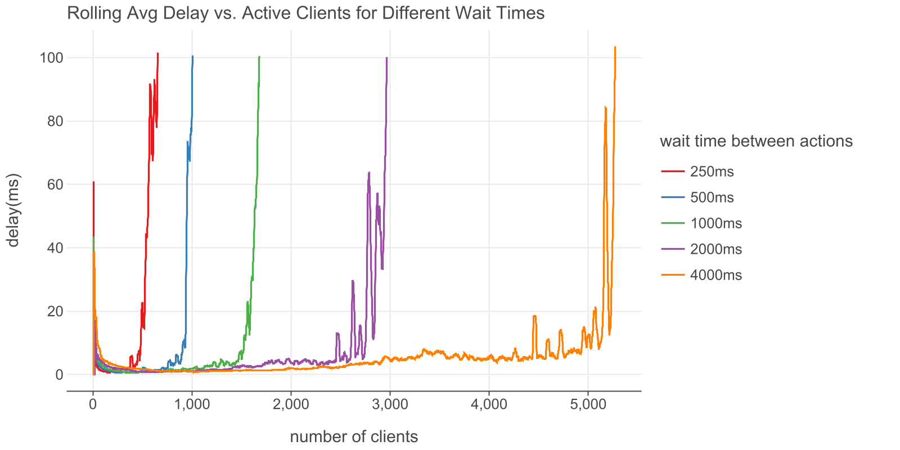
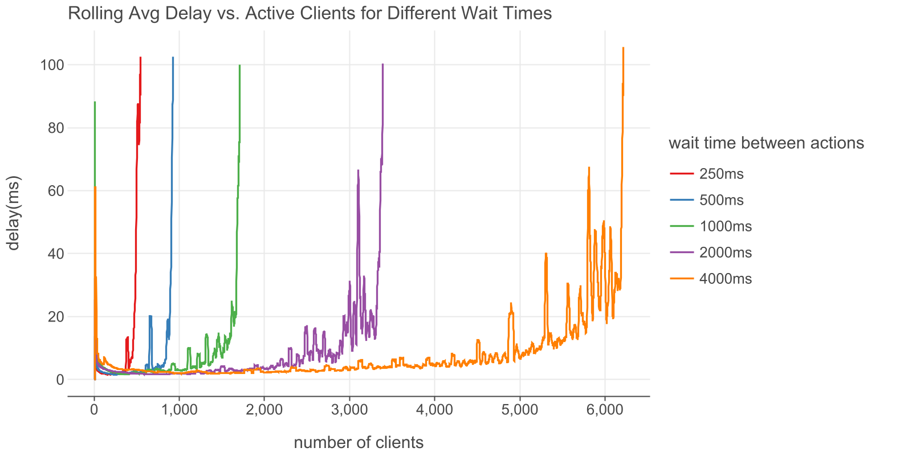

# Project to test the server performance

This benchmark measures the MontiGem server performance by simulating an increasing number of concurrent Java clients connecting via WebSockets.
Each client repeatedly executes random actions, such as creating, loading, and modifying objects and their links.
The system continuously adds new clients and monitors the rolling average roundtrip delay for all actions across all clients.
The benchmark concludes and reports the server's load capacity when this average delay exceeds a predefined acceptable threshold.

# Results
## Local
Machine with i7 12700k and 64gb ram.

## Server
Server VM(node10) with 12 cores and 24 gb ram.

