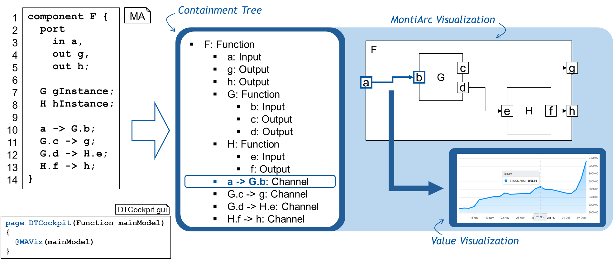
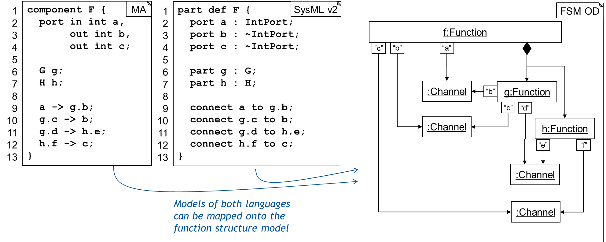

# Function Structure Model (FuStruM)

## Purpose
FunctionStructure describes the functionally decomposed structure of products, which includes various forms of machines and also pure software, but is specifically interesting for Cyber-Physical Systems, which typically consist of both kinds of components.

The function of a system (and more generally each component of a system) is described
- in the form of input and out channels, where all interactions occur,
- with a concrete typed signature of these channels,
- a definition of whether the chanel is transmitting energy, physical objects or fluids, or data; either of these channels can be modeled by continuous or discrete flows, understanding the elements flowing as discrete events (e.g. a button press event, a data set, a screw, a motor) or continuous flows (oil, electricity, heat, electrical signal, video/audio stream).

A *function* can be atomic or
- is decomposed into a substructure (architecture) of subfunctions, 
  which in interact via internally connected channels,
- can have an internal state (and change it through interactions with 
  the environment)
- can have complex properties.

Ultimately a complex function is decomposed over several hierarchical levels 
to atomic functions, which are pure software, sensors, actuators, or elementary 
physical functions, as the Koller catalog knows them in the form of about 300 pieces.

## Explanation
A detailed explanation is given in [this PPT](products/syse_functions/doc/FunctionStructure.Explanation.pptx)

## The model
- primarily defined by a [class diagram](products/syse_functions/doc/models/FunctionStructure.umlp)
- and [ocl constraints](products/syse_functions/doc/models/FunctionStructure.ocl)
- incarnated with a [class diagram for implementation purposes](products/syse_functions/src/models/FunctionStructure4Fenix.umlp) in Fenix
  (this is a current workaround to be removed, because of a deficiency of Fenix)
- and corresponding [ocl constraints](products/syse_functions/src/models/FunctionStructure4Fenix.ocl)

## Application
We collect possible use cases for which our function structure model will be
applied. In most cases, it acts as an intermediate structure to capture the
structural elements of a functional composition of a system, and then 
transform it further. In other cases, it acts as the source for analysis
or data structure directly.

Many of these concepts are also collected [here](products/syse_functions/doc/FunctionStructure.UseCases.pptx).

### Basic Structure for the Digital Product Record (Resp: BR, JM)

- Highly Important: The Excellence Cluster IoSP needs a "Digital Product Record" and our FuStruM shall be a perfect core for that.

### Bill Of Material (NN)

- We explore how the Bill of Material can be embedded in the FuStruM. Thus getting a connection to the production domains.
- But not only physical components, but also software components are part of our BOM.

### Product Information Modelling (~ Primo) 

- Informaton about Products, such as cars and their development status can be collected and stored centrally based on the FuStruM. In particular is it possible to attach any kind of "links" to modelling documents on each of the functions to be able to quickly navigate and collect data about the development status of a product.

### Verification Platform (MontiBelle) 

- FuStruM can manage (store) information about the current validation and verification status of a complex product and its parts, in particular can it store: prooven refinement and decomposition informations between components and their proofs and lemmata.

### Digital Twin Cockpit
- We can use the functional structure of a system to derive visualizations of incoming data
  available in a digital twin cockpit.
- We store all information in a database, conforming to the function
  structure model, in Fenix, our generator framework for information systems.
- We define standard GUI components which visualize
  - all components of the system (functions, subfunctions, ports, and channels)
    in a hierarchical composed containment tree
  - a graphical notion of component \& connector diagrams
  - values on channels

### Abstraction of component \& connector languages
- There are different languages which contain similar concepts regarding
  the functional structure of systems as connectors and components
  - E.g., MontiArc, SysMLv1, SysMLv2, Simulink, LabView
- The funtion structure model can act as an abstraction from these languages
  and store information in a common data structure

### Extension 1: Variant Management / Product-Lining with FuStruM

### Extension 2: Understanding Evolution (in Development) with FuStruM
- How has the product evolved over time?
- Which this changed/ were new/ etc.

### Extension 3: Connecting FuStruM with the Artifact Model
because both are very similar in their concepts and use cases.

