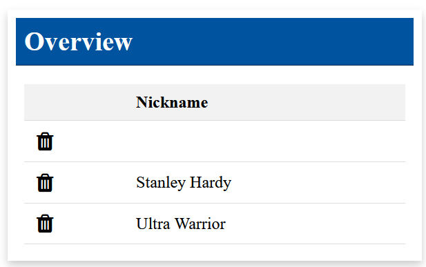

# GemCard

---

## Overview

- [GemCard](#GemCard)
- [GUI Model](#gui-model)

## GemCard

Gem-Card is a simple container which consists of a header and a body


---

## GUI Model

```
package arrange.src.lib.gemcard;

// some imports...

component GemCard(GUIViewElement component) {

}
```

Usage example:

```
page ColumnsTester(String text) {
  //other components...
  @GemCard(
    title = "Info Text",
    component = @GemText(
      value = text)
    )
}
```

Here `ColumnsTester` uses `GemCard` to display a text inside a card.
`GemCard` takes a component as an input and displays it inside its body.
In the example text is given as the input component.


