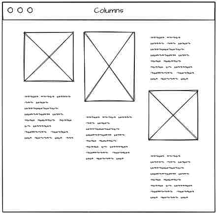
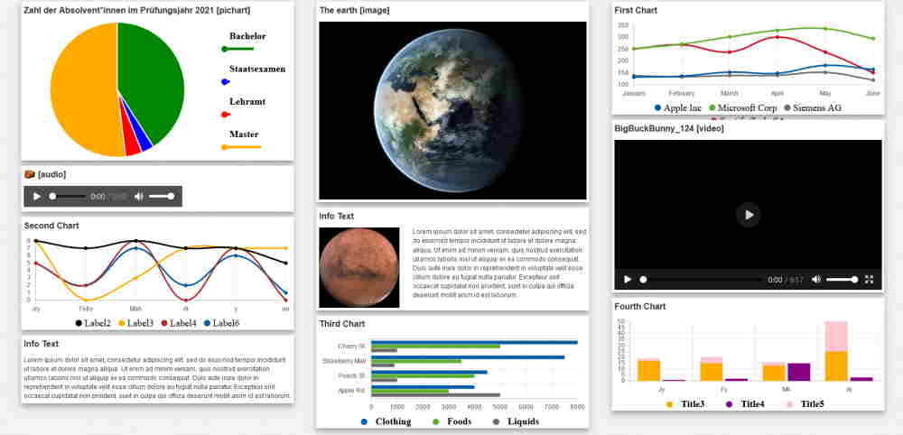

# GemColumns

---

## Overview

- [GemColumns](#gemcolumns-1)
- [GUI Model](#gui-model)
- [Implementation](#implementation)

## GemColumns

Gem-Columns aligns components in three equally sized columns which sit next to each other. The components inside an column will be placed from top to bottom and can be of different heights but their width will be limited by the column width which is a third of the screen on each column.



_Layout example of Coulmns_

---

## GUI Model

`GemColumns.gui` ([open](../GemColumns.gui))

```
package arrange.src.lib.gemcolumns;

//some imports...

component GemColumns(List<GUIViewElement> column1, List<GUIViewElement> column2, List<GUIViewElement> column3) {
  @GemRow(hAlign = "spaceEvenly", components = [
    @GemColumn(width = "30%", component =
      @iterate (GUIViewElement c : column1) {
        @GemColumn(style="gem-column-item", component = c);
      }
    ),
    @GemColumn(width = "30%", component =
      @iterate (GUIViewElement c : column2) {
        @GemColumn(style="gem-column-item", component = c);
      }
    ),
    @GemColumn(width = "30%", component =
      @iterate (GUIViewElement c : column3) {
        @GemColumn(style="gem-column-item", component = c);
      }
    )
  ]);
}
```

_Listing 3.1: GUI model of GemCoulmns._

Listing 3.1 shows an example GUI model for the _Columns_ layout with three input parameters _column1_, _column2_, _column3_ of type _List`<GUIViewElement>`_. The first container _row_ is used to align all three columns next to each other. `hAlign = "spaceEvenly"` is used to get some distance between the columns while keeping it symetric to the center.

The three children are _column_ container which will align all the components above each other to create the desired column layout. The Columns have `width="30%"` to fill the whole width of the page. Keep in mind to change the number accordingly when adding new columns.

`iterate(a : b){}` repeats the content inside `{}` for each item `a` of array `b`. This way the components get filled in as children of the `column` container. Each component gets placed into another `:column` container to fix alignment issues as well as the ability to add a style class to this element:

`style="stylename"` will add the `stylename` css class to the html element the styles of which can be specified inside the `gem-columns-component.scss` file. In this case the css is used to give the components a vertical distance to their silbings.

Moreover, a Java-like package with the corresponding name and path is stated before the component is declared.

---

## Implementation

In this section, tester application implementation details are described and examples are given.

### Exporting GemColumns

To be able to use GemColumns, the classes of the component need to be publicly available. To achieve this, a file named _index.ts_ is created inside the GemColumns folder and the generated files are exported.

`index.ts` ([open](../index.ts))

```ts
export * from "./gem-columns/gem-columns.component-gen";
export * from "./gemcolumns.module-gen";
```

_Listing 4.1: index.ts file of gemcolumns folder._

Moreover, the _index.ts_ file in the parent folder needs to be adjusted as well.

`index.ts` ([open](../../../index.ts))

```ts
// ... other exports
export * from "./lib/gemcolumns";
```

_Listing 4.2: index.ts file of the parent folder._

### Tester Application

To be able to test the GUI model _GemColumns_, a tester application is needed. For that, the files _columns-tester.component.html_ for structure and use of components, _columns-tester.component.ts_ for dummy data, _columns-tester.module.ts_ for component imports and _columnstester.routing_ for navigation from one view to another have to be created.
For that, a folder _columns-tester_ is created.

The first step is to import all needed components for the tester application, for instance _GemImage_ or _GemLineChart_.

```ts
// ... other imports
import { GemlinechartModule } from "@monticore/montigem-charts";
import { GemtextModule } from "@monticore/montigem-inout";
import { GemimageModule } from "@monticore/montigem-inout";

@NgModule({
  declarations: [ColumnsTester],
  imports: [
    // ... other imports
    GemimageModule,
    GemvideoModule,
    GemaudioModule,
    GemtextModule,
    GemlinechartModule,
    GembarchartModule,
    GempiechartModule,
    GemcardModule,
    GemcolumnsModule,
    GemrowModule,
  ],
})
export class ColumnstesterModule {}
```

_Listing 4.3: Importing components for GemColumns._

Then, dummy data for components, such as charts have to be made in order to use them. An example can be found in _columns-tester.component.ts_.

The next step is to create the hand-written HTML file in order to test the layout. For that, _components_ is given a list of six elements, where each element represents one component. To do that, `<ng-template>` is used.

```html
<gem-columns [column1]="[one, two]" [column2]="[three, four]" [column3]="[five, six]"> </gem-columns>

<!-- ... other components -->

<ng-template #two>
  <gem-line-chart [maxValue]="lineChartMaxValue" ...> </gem-line-chart>
</ng-template>

<ng-template #three> First text of second column </ng-template>

<!-- ... other components -->
```

_Listing 4.4: HTML file for tester application._

To finalize _columnstester_ folder, _app-routing.module.ts_ is added for tester navigation.

```ts
const routes: Routes = [
  {
    path: "my",
    loadChildren: () => import("./columnstester/columnstester.module-gen").then((m) => m.ColumnstesterModule),
  },
  // ... other routes
];
```

_Listing 4.5: Routing module of ColumnsTester._

```ts
  {
  label: "My Columns",icon:"subdirectory_arrow_right",
  link: ["/", "my", "columns-tester"],
  },
// ...
```

_Listing 4.7 : Module file of parent folder._

As the final step a custom scss file is created to give each child of each column a vertical distance to its sibling. Notice that the className we used in the gui as `style="gem-column-item"` is referenced:

`gem-columns.component.scss` ([open](../gem-columns.component.scss))

```css
.gem-column-item {
  width: 30%;
  margin: 5px 0;
}
```

_Listing 4.8: CSS for GemColumns._

Now, _GemColumn_ can be tested.



_The result of GemColumns layout with CSS._
