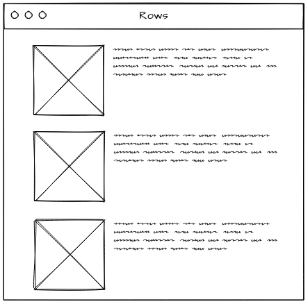
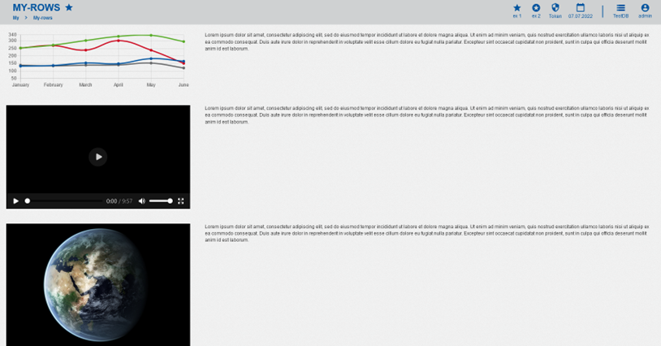

# GemRows

---

## Overview

- [GemRows](#gemrows-1)
- [GUI Model](#gui-model)
- [Implementation](#implementation)

## Goal

The goal of this project was to implement and test the GUI model of a layout, in this case a layout involving rows. The layout should be able to align an unlimited number of components in a desired way. To test the layout, a tester application needs to be implemented as well.

---

## GemRows

Gem-Rows aligns two components next to each other, with one component being roughly 30%, and the other 70% of the space. This is repeated for all components. An example of the layout can be seen in the following Figure.



_Layout example of Rows_

---

## GUI Model

GUI components are used to describe a graphical user interface and its building blocks.
In this section, GUI model declaration details are described and an example is given.

First of all, an empty folder for the GUI model is needed, in this case _myrows_.

A component is located in a package with a qualified name corresponding to its location.

```
package arrange.src.lib.gemrows;

component GemRows(List<GUIViewElement> components, String height) {
  @GemRow(hAlign = "left",  component =
    @iterate(GUIViewElement comp : components) {
      @GemColumn(style="gem-rows-item",
      height=height, component = comp);
    }
  );
}
```

_Listing 3.1: GUI model of GemRows._

Listing 3.1 shows an example GUI model for the _Rows_ layout with an input parameter _components_ of type _`List<GUIViewElement>`_.

By default components are placed top-to-bottom, without any spaces inbetween. To combat this behavior, one can define the layout
configuration within the component.

GemRows utilizes two kinds of containers to achieve the desired goal, namely _row_ and _column_. The container _row_ aligns components next to each other, i.e. in a row. Respectively, _column_ aligns components below each other. Furthermore, with the key-word _hAlign_ or _vAlign_, the alignment of the components can be manipulated. Examples for alignments would be _left_, _right_, _top_, _bottom_ or _spaceBetween, spaceAround_ and _spaceEvenly_.

If _row_ and _column_ is not enough to achieve the desired layout, styles can be added as well. In this example, the style of _gem-rows-item_ is used.

---

## Implementation

In this section, tester application implementation details are described and examples are given.

### Exporting GemRows

To be able to use _GemRows_, the classes of the component need to be publicly available. To achieve this, a file named _index.ts_ is created inside the _gemrows_ folder and the generated files are exported.

```ts
export * from "./gem-rows/gem-rows.component-gen";
export * from "./gemrows.module-gen";
```

_Listing 4.1: index.ts file of gemrows folder._

Moreover, the _index.ts_ file in the parent folder needs to be adjusted as well.

```ts
// ... other exports
export * from "./lib/gemrows";
```

_Listing 4.2: index.ts file of the parent folder._

### Tester Application

To be able to test the GUI model _GemRows_, a tester application is needed. For that, the files _rows-tester.component.html_ for structure and use of components, _rows-tester.component.ts_ for dummy data, _rows-tester.module.ts_ for component imports and _rows-tester.routing_ for navigation from one view to another have to be created.
For that, a folder _rows-tester_ is created.

The first step is to import all needed components for the tester application, for instance _GemImage_ or _GemLineChart_.

```ts
// ... other imports
import { GemlinechartModule } from "@monticore/montigem-charts";
import { GemtextModule } from "@monticore/montigem-inout";
import { GemimageModule } from "@monticore/montigem-inout";

@NgModule({
  declarations: [RowsTester],
  imports: [
    // ... other imports
    GemrowsModule,
    GemtextModule,
    GemimageModule,
    GemlinechartModule,
  ],
})
export class RowstesterModule {}
```

_Listing 4.3: Importing components for GemRows._

Then, dummy data for components, such as charts have to be made in order to use them. An example can be found in _rows-tester.component.ts_.

The next step is to create the hand-written HTML file in order to test the layout. For that, _components_ is given a list of six elements, where each element represents one component. To do that, `<ng-template>` is used.

```html
<gem-rows
  [components]="[   
    gemNode2,
    gemNode3,
    gemNode5,
    gemNode6,
    gemNode8,
    gemNode9,
    gemNode11,
    gemNode12,
    gemNode14,
    gemNode15,
    gemNode17,
    gemNode18]"
>
</gem-rows>

<ng-template #gemNode2>
  <gem-line-chart [data]="data" [enableBackgroundColor]="false"> </gem-line-chart>
</ng-template>

<!-- ... other components -->
```

_Listing 4.4: HTML file for tester application._

To finalize _rowstester_ folder, _rowtester.routing-gen.ts_ is generated for tester navigation.

```ts
import { RouterModule, Routes } from "@angular/router";
import { RowsTester } from "./rows-tester.component";

export const routes: Routes = [
  {
    path: "",
    pathMatch: "full",
    redirectTo: "rows-tester",
  },
  {
    path: "rows-tester",
    component: RowsTester,
  },
];
```

_Listing 4.5: Routing module of rowstester._

Lastly, in the parent folder _app-routing.module.ts_ and _app.module.ts_ have to be adjusted.

```ts
const routes: Routes = [
  {
    path: "my",
    loadChildren: () => import("/rowstester/rowstester.module-gen").then((m) => m.RowstesterModule),
  },
  // ... other routes
];
```

_Lisitng 4.6: Routing module of parent folder._

```ts
{
  label: "My Rows",
  icon: "subdirectory_arrow_right",
  link: ["/", "my", "rows-tester"],
},
// ...
```

_Listing 4.7 : Module file of parent folder._

Now, _GemRows_ can be tested, however an optional step is to make use of SCSS for better visuals. An example is given in the following Listing.

```css
.gem-rows-item:nth-of-type(2n) {
  width: 70%;
}
.gem-rows-item:nth-of-type(2n + 1) {
  width: 30%;
}
.gem-rows-item {
  padding: 0.5cm;
}
```

_Listing 4.8: CSS for GemRows._



_The result of GemRows layout with SCSS._
