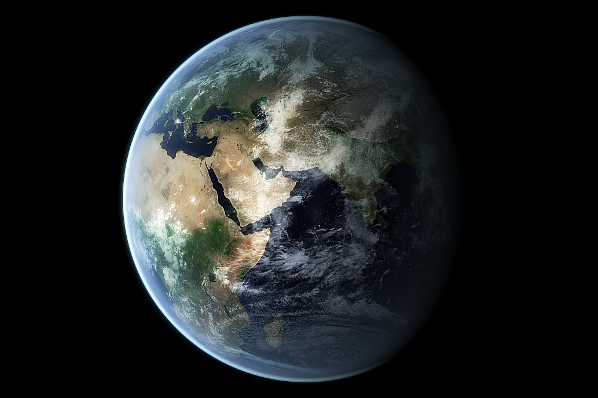

# Image Embed Element

----------------------------------------------------------------------

## Overview
- [Goal](#goal)
- [Image Component](#image-component)
- [GUI Model](#gui-model)
- [Implementation](#implementation)
- [How to use GemImage](#how-to-use-gemimage)
- [References](#references)

----------------------------------------------------------------------

## Goal

The goal of this project was to implement and test the GUI model of the `` atomic component.
The image should be customizable using styles such as height or width, and is tested using unit-tests.

----------------------------------------------------------------------

## Image Component

The image component embeds an image using the required ***src*** attribute, which contains the path to the image you want to embed. Moreover, the non-required, but recommended ***alt*** attribute represents a textual description of the image, and is shown if the image cannot be loaded. Additionally, the embedded image can be altered using SCSS.

More details can be found in [1].




_On the left an embedded image and on the right the result of an embedded image with SCSS._

----------------------------------------------------------------------

## GUI Model

GUI components are used to describe a graphical user interface and its building blocks.
In this section, GUI model declaration details are described and an example is given.

First of all, an empty folder for the GUI model is needed. By name convention, the folder should be named with a ***gem*** prefix to avoid name collisions.  Inside of the new folder, a file named ***GemImage.gui*** is created.

Inside of _GemImage.gui_ we declare our GUI model.

```
package basic.src.lib.gemimage;

component GemImage(
  String source,
  String alt,
  String style
)
```
_Listing 3.1: GUI model of GemImage._

Listing 3.1 shows an example GUI model for the image embed element. The component declaration starts with the _component_ keyword followed by the component name with input parameters ***source***, ***alt*** and ***style***. The input parameters represent the described atrributes in the [Image Component](#image-component) section.

Furthermore, a Java-like _package_ with the corresponding name and path is stated before the component is declared.

However, the GUI model only specifies the interface of the _GemImage_ component and not the implementation itself, so an HTML file is needed in order to use the HTML as the template for the generated Angular component files.

----------------------------------------------------------------------

## Implementation

In this section, implementation details are explained and examples are shown.

```html

```
_Listing 4.1: GemImage component implementation._

Using Angular's _interpolation binding syntax_, the property values of the input parameters ***source*** and ***alt*** are given to the corresponding `````` attributes.
 Moreover, the style attribute is set to a height and width of 100%, so that it fills the entirety of an HTML body, such as the ```<div>```-element. This is needed for better stylization.

Note however, that renaming the GUI model may break the code, since generated files will remain untouched.


### Exporting GemImage

To be able to use the image component, the classes of the component need to be publicly available. To achieve this, a file named _index.ts_ is created inside the _gemimage_ folder and the generated files are exported.

```ts
export * from './gemimage.module-gen';
export * from './gem-image/gem-image.component-gen';
```
_Listing 4.2: index.ts file of gemimage folder._

Moreover, the _index.ts_ file in the parent folder needs to be adjusted as well. 

```ts
// other exports ...
export * from "./lib/gemimage";
```
_Listing 4.3: index.ts file of the parent folder._

----------------------------------------------------------------------

## How to use GemImage

In this section the possible inputs will be explained, as well as an example with its result will be shown.

Images are displayed _inline_ by default, so it is highly recommended to put the image inside of a ```<div>```-element. Since the component already uses 100% of _height_ and _width_ , the image fills the whole ```<div>``` in its entirety, 

### Input Parameters

The input parameter ***source*** is either the directory of an image, or the _URL_ of an image. It is required so that an image can be embedded. The input parameter ***alt*** however, is optional and represents a textual description of the image, in case the image cannot be loaded. The `<div>`-element itself can be used for stylization, as seen in Listing 5.2.

```html
<div>
  <gem-image
  source="assets\images\World.png"
  alt="The World"
  ></gem-image>
</div>
```

_Listing 5.1: Example for source and alt input._

```html
<div style="width: 420px; height: auto;  border: 5px solid rgb(199, 32, 74)">
  <gem-image
  source="assets\images\World.png"
  alt="The World"
  ></gem-image>
</div>
```

_Listing 5.3: Example for an altered image using style._

## References

[1] MDN Web Docs - The Image Embed element. https://developer.mozilla.org/en-US/docs/Web/HTML/Element/img. Accessed: 2022-06-02.
