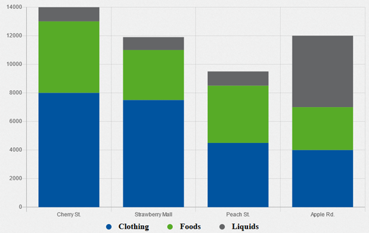
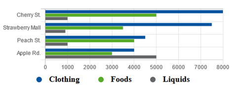

# Bar-Chart for MontiGem

----------------------------------------------------------------------

[[_TOC_]]

----------------------------------------------------------------------

## Description 

A Bar-Chart present a set of two dimensional data with a number of rectangular bars that can go *horizontally* or *vertically*, with their values being proportional to what they represent. 
The chart itself visualizes categories (given as Strings) on one axis and a discrete integer value on the other as height or size. Additionally, the bars can be *stacked* or *aligned* to visualizes multiple sub-categories of a second data dimension.

Two visualizations of bar-charts can be seen in the following Figure, with detailed information of bar-charts in [1].




_On the left a vertical bar-chart, and on the right a horizontal bar-chart with the same information._

----------------------------------------------------------------------

## Data Structure

The data structure is defined in _gem-bar-chart-types.types-gen.ts_, and the used data structure is `GemBarChartData`:

### GemBarChartData

```
// Model (Class diagram?) of the GemBarChartData better here
```


### GemBarChartData as TypeScript example

GemBarChartData consists of parameters ***labels***, an array of strings, which labels the x axis in a vertical bar-chart and respectively the y axis in a horizontal bar-chart  and ***entries***, an array of type ***DataGroup***. DataGroup itself consists of four input parameters, i.e. a String ***label***, which represents the label of a rectangular bar, a String ***stack*** to stack information, a String ***backgroundColor***, to color a bar and lastly ***data***, which is an array of type Integer for numerical values.

An example of a definition of GemBarChartData can be found in the following Listing.

```ts
const entries: GemBarChartEntry[] = [
  {
    label: "Clothing",
    data: [8000, 7500, 4500, 4000],
  },
  {
    label: "Foods",
    data: [5000, 3500, 4000, 3000],
  },
  {
    label: "Liquids",
    data: [1000, 900, 1000, 5000],
  },
];

const labels: string[] = ["Cherry St.", "Strawberry Mall", "Peach St.", "Apple Rd."];

const data: GemBarChartData = {
  labels,
  entries,
}
```
_Listing 3.1: Example of GemBarChartData._

----------------------------------------------------------------------

## GUI Model and Class Diagram

GUI components are used to describe a graphical user interface and its building blocks. 
In this section, GUI model and class diagram implementation details are described and examples are given.

A component is located in a package with a qualified name corresponding to its location.

```
package charts.src.lib.gembarchart;

import charts.src.lib.gembarchart.GemBarChartTypes.GemBarChartData;

component GemBarChart(
  GemBarChartData data,
  Object displayValue,
  Boolean stacked,
  Integer maxValue,
  Integer minValue
)
```
_Listing 4.1: GUI model of Bar-chart._

Listing 4.1 shows an example GUI model for bar-charts. The component declaration starts with the _component_ keyword followed by the component name with input parameters ***data***, ***displayValue***, ***stacked***, ***maxValue*** and ***minValue***

The input parameters and what they represent are described in section [How to use the Chart and Inputs](#how-to-use-the-chart-and-inputs).

In addition to a GUI model, a _class diagram_ is needed to allow describing GUI and its
connection to the underlying data structure, such as charts.  Again, a Java-like import is done in this case. 

An example of a class diagram model can be seen in Listing 4.2.

```
package charts.src.lib.gembarchart;

classdiagram GemBarChartTypes {

  class GemBarChartData {
    List<GemBarChartEntry> entries;
    List<String> labels;
  }
 
  class GemBarChartEntry {
    String label;
    String stack;
    List<Integer> data;
    String backgroundColor;
  }

}
```
_Listing 4.2: Class diagram of bar-chart GUI model._

The input parameters of GemBarChartData and what they mean are described in section [Data Structure](#data-structure).

An additional file with interfaces is generated from the class diagram, which can be imported and used in other components, as seen in Listing 4.1. The generated file  _gem-bar-chart-types.types-gen.ts_ can be seen in Listing 4.3.

```ts
  export interface GemBarChartData {
       entries?: GemBarChartEntry[];
       labels?: string[];
  }
  export interface GemBarChartEntry {
       label?: string;
       stack?: string;
       data?: number[];
       backgroundColor?: string;
  }
```
_Listing 4.3: Generated interfaces of bar-chart._

----------------------------------------------------------------------

## Implementation

In this section, implementation details and how hand-written files are handled are described.

### Hand-written Code Extension

To make use of our GUI model, the generated code in _gem-bar-chart.component.ts_ has to be extended with the hand-written code. To achieve this, the generated file _gem-bar-chart.component-gen.ts_ must be imported into the hand-written _gem-bar-chart.component.ts_ and the generated class _GemBarChart_ is used as a parent class for the hand-written one, as seen in the following Listing.

```ts
import { GemBarChartData } from './gem-bar-chart-types/gem-bar-chart-types.types-gen';
import { GemBarChart as GemBarChartTOP } from './gem-bar-chart/gem-bar-chart.component-gen';
// ... other imports

@Component({
  // ... config
})
export class GemBarChart extends GemBarChartTOP {
  // ... implementation
}
```
_Listing 5.1: Extending generated code with hand-written one._

### Exporting GemBarChart

To be able to use the bar-chart component, the classes of the component need to be publicly available. To achieve this, a file named _index.ts_ is created inside the _gembarchart_ folder and the generated files are exported.

```ts
export * from "./gembarchart.module-gen";
export * from "./gem-bar-chart.component";
export * from "./gem-bar-chart-types/gem-bar-chart-types.types-gen";
```
_Listing 5.2: index.ts file of gembarchart folder._

Moreover, the _index.ts_ file in the parent folder needs to be adjusted as well. 

```ts
// other exports ...
export * from "./lib/gembarchart";
```
_Listing 5.3: index.ts file of the parent folder._

----------------------------------------------------------------------

## How to use the Chart and Inputs

Note that it is highly recommended to put the whole bar-chart into a `<div>`-element, because the default width of the bar-chart element is calculated in respect to the parent `<div>`’s width.

Next, the possible inputs will be explained in detail and examples for these inputs are given.

### Data

Data in form of GemBarChartData.

Data is the most important input, since it contains all information that will be used to plot the bar-chart. When leaving a chart without data input the corresponding montigem-chart will be empty.

```html
<div class="example">
  <gem-bar-chart 
    [data]="data">
  </gem-bar-chart>
</div>
```
_Listing 6.1: Example for data input, when data is defined as in the [Data Structure](#data-structure) section._ 

### MinValue

MinValue in form of _numeric value_.

The minimum value defines at which numeric value the data will begin to be displayed. If none is given, the default is undefined. No restrictions will be made.

```html
<div class="example">
  <gem-bar-chart 
    [data]="data" [minValue]="20">
  </gem-bar-chart>
</div>
``` 
_Listing 6.2: Example for minValue input, when data is defined as in the [Data Structure](#data-structure) section._  

### MaxValue

MaxValue in form of _numeric value_.

The maximum value defines at which numeric value the data will stop to be displayed. If none is given, the default is undefined. No restrictions will be made.

```html
<div class="example">
  <gem-bar-chart 
    [data]="data" [maxValue]="50">
  </gem-bar-chart>
</div>
```  
_Listing 6.3: Example for maxValue input, when data is defined as in the [Data Structure](#data-structure) section._

### DisplayValue

DisplayValue in form of _string_.

DisplayValue adds by the desire of the user additional symbols to the values, if the value is of _numerical_ type.

```html
<div class="example">
  <gem-bar-chart 
    [data]="data" [displayValue]="displayValue">
  </gem-bar-chart>
</div>
```  
_Listing 6.4: Example for displayValue input, when data is defined as in the [Data Structure](#data-structure) section._

### Stacked

Stacked in form of _boolean value_.

Bar-charts can be stacked, which means they can extend the standard bar chart from a comparison of one category and numeric value, to two categories and more. 
The variable stacked shows if the data will be stacked or not.

This input option is false by default.

```html
<div class="example">
  <gem-bar-chart 
    [data]="data" [stacked]="true">
  </gem-bar-chart>
</div>
```  
_Listing 6.5: Example for stacked input, when data is defined as in the [Data Structure](#data-structure) section._

----------------------------------------------------------------------

## Source

These chart has been developed as project including implementation and thorough tests based on the GUI model of an Angular library which contains a bar-chart. The chart itself should be customizable using multiple inputs and a data structure. 

The functions used in the component were tested with unit-tests, available for further evolution.

// should??? Has it been tested, then we know what customizations are?
// Are the tests good? Statement about testing quality. (Coverage, for evolution usable?)

----------------------------------------------------------------------
## References

[1] _The Data Visualisation Catalogue - Bar Chart. https://datavizcatalogue.com/methods/heatmap.html. Accessed: 2022-08-12.
