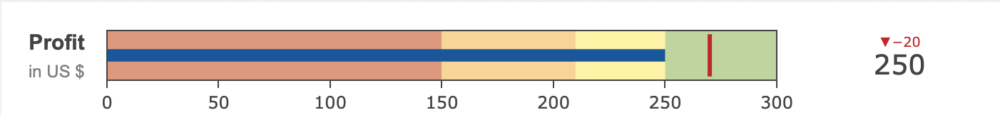

# Bullet-Chart

----------------------------------------------------------------------

## Overview

- [Goal](#goal)
- [Bullet Charts](#Bullet-Charts)
- [Data Structure](#data-structure)
- [Implementation](#implementation)
- [How to use the Chart and Inputs](#how-to-use-the-chart-and-inputs)
- [References](#references)

----------------------------------------------------------------------
## Goal

The goal of this project is to add Bullet chart in the library, the chart can be customized with multiple input parameters and different data structure. Also, the functions used in the component were tested with unit-tests.

----------------------------------------------------------------------

## Bullet-Charts

Bullet chart is the variation of the bar chart, it features a single, primary measure, compares that measure to one or more other measures to enrich its meaning (for example, compared to a target), and displays it in the context of qualitative ranges of performance, such as poor, satisfactory, and good. It is developed to overcome the fundamental issues of gauges and meters, they display too little information but required too much space.[1]




_The left picture is the bullet chart of year-to-date sales revenue. The right is bullet chart in chart app._

## Data Structure

The component GemBulletChart consists of _value_, whose type is integer.

Here is the definition of _value_.
```typescript
export class GemBulletChartExampleComponent {
  value = 200;
  // some implementation
}
```

## GUI Model and Class Diagram

In this section, the GUI Model and class diagram should be demonstrated.


```
package charts.src.lib.gembulletchart;
component GemBulletChart(
   Integer value,
   Integer reference,
   Integer thresholdvalue,
   String title,
   String subtitle,
   List<Integer> range,
   List<Integer> steps

)
```

As usual, Java-like package with the corresponding name should be declared at the top of the page. 
List shows the GUI Model of bullet chart with input parameters _value_, _reference_, _thresholdvalue_, _title_, _subtitle_, _range_, _steps_. 


## Implementation


### Hand-written Code Extension

Hand-written code _gem-bullet-chart.component.ts_ has to be extended by generated code, import _gem-bullet-chart.component-gen.ts_ in the _gem-bullet-chart.component.ts_ as following:

```typescript
//other imports
import { GemBulletChart as GemBulletChartTOP } from './gem-bullet-chart/gem-bullet-chart.component-gen';

@Component({
  // ... config
})

export class GemBulletChart extends GemBulletChartTOP {
    //implementations
}
```

### Exporting GemBulletChart

To make the bullet-chart be visible by other component, export _gem-bullet-chart.component_ and _gembulletchart.module-gen_ in _index.ts_ file in the folder:

```
export * from "./gem-bullet-chart.component";
export * from "./gembulletchart.module-gen";
```

As usual, the outer _index.ts_ should also be adjusted.

```typescript
//other imports
export * from "./lib/gembulletchart";
```


## How to use the Chart and Inputs

Note that it is highly recommended to put the whole montigem-bullet-chart into a div-element, because the default width of the bullet-chart element is calculated in respect to the parent div’s width.

Next, the possible inputs will be discussed in detail.

### Value

Value in form of numeric value.

Value is the most important input, it gives the information of the current value.

```html
<div class="example">
  <gem-bullet-chart
    [value]="value"
  >
  </gem-bullet-chart>
</div>
```

### Reference

Reference in form of numeric value.

A reference line is used to compare with the current value.

```html
<div class="example">
  <gem-bullet-chart
    [reference]="270"
  >
  </gem-bullet-chart>
</div>
```

### Thresholdvalue

Thresholdvalue in form of numeric value.

Threshold value is set perpendicular to the bar on the axis with the quantitative scale. 

```html
<div class="example">
  <gem-bullet-chart
    [thresholdvalue]="270"
  >
  </gem-bullet-chart>
</div>
```

### Title

Title in form of text value.

The title displays the information of the data.

```html
<div class="example">
  <gem-bullet-chart
    [title]="'Profit'"
  >
  </gem-bullet-chart>
</div>
```
### Subtitle

Subtitle in form of text value.

To show additional information about the plotted data, such as the unit of the value in this case.

```html
<div class="example">
  <gem-bullet-chart
    [subtitle]="'in US $'"
  >
  </gem-bullet-chart>
</div>

```
  
### Range

Range is the list of the integers.

Range is scope of the data, the values cannot beyond the range.

```html
<div class="example">
  <gem-bullet-chart
    [range]="[0, 300]"
  >
  </gem-bullet-chart>
</div>

```

### Steps

Steps is the list of the integers.

Steps are colored bands that represent threshold ranges, such as poor, average, and good. 

```html
<div class="example">
  <gem-bullet-chart
    [steps]="[0, 150, 210, 250]"
  >
  </gem-bullet-chart>
</div>

```

## References
[1] In _Wikipedia, the free encyclopedia - bullet graph. https://en.wikipedia.org/wiki/Bullet_graph Accessed: 2022-08-12.


