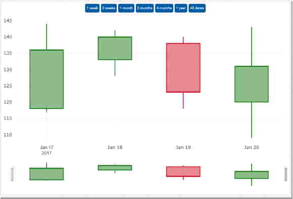

# Candlestick-Chart

----------------------------------------------------------------------

## Overview
- [Goal](#goal)
- [Candlestick-Charts](#candlestick-charts)
- [Data Structure](#data-structure)
- [GUI Model and Class Diagram](#gui-model-and-class-diagram)
- [Implementation](#implementation)
- [How to use the Chart and Inputs](#how-to-use-the-chart-and-inputs)

----------------------------------------------------------------------

## Goal

The goal of this project was to implement and test the GUI model of a new Angular library which contains a chart, in this case a candlestick-chart. The chart itself should be customizable using multiple inputs and a data structure. The functions used in the component were tested with unit-tests.

----------------------------------------------------------------------

## Candlestick-Charts

A Candlestick chart displays a few important datapoints for a (short) period of time. It is often used to display how stock prices changed over said short periods.

The data of a candlestick is displayed by its horizontal position (time), vertical position of: **start** and **end** of the **bar** *and* **start** and **end** of the **line** that crosses through the bar (price of stock). The **color** of the candlestick indicates if the price got higher (green) or lower (red), which is an important information because it dictates if the upper bar end shows the first price traded during that time period (if the price got lower) or the last price traded (if the price got higher). and the other way around for the bottom end position of the bar.



_Three candlesticks that indicate that the price got higher and one (the third) that indiacates a decline in the price._

----------------------------------------------------------------------

## Data Structure

The data structure is defined in _GemCandlestickChartTypes.cd_, and the used data structure is an array of *GemData2CandlestickChart*.

### ChartData

*GemData2CandlestickChart* represents one candlestick and consists of parameters _label_, a string, which labels the x axis (time period) and _value_, an array of four numbers which are used to set the four vertical values described in [section Candlestick Charts](#candlestick-charts). The Candlestick color is calculated on those values and does not need to be set manually. 

An example of a definition of *`<List>GemData2CandlestickChart`* can be found in the following Listing.

```ts
  data1 = [
    { label: '2017-01-17', value: [118, 144, 117, 136] },
    { label: '2017-01-18', value: [133, 142, 128, 140] },
    { label: '2017-01-19', value: [138, 140, 118, 123] },
    { label: '2017-01-20', value: [120, 143, 109, 131] }
  ];
```
_Listing 3.1: Example of candlestick data._

----------------------------------------------------------------------

## GUI Model and Class Diagram

In this section, GUI model and class diagram implementation details are described and examples are given.

`GemCandlestickChart.gui` ([open](../GemCandlestickChart.gui))
```
import charts.src.lib.gemcandlestickchart.GemCandlestickChartTypes.GemData2CandlestickChart;

component GemCandlestickChart(
  List<GemData2CandlestickChart> data
)
 
```
_Listing 4.1: GUI model of Candlestick-chart._

Listing 4.1 shows an example GUI model for candlestick-charts with the input parameter ***data***. Furthermore, a Java-like package with the corresponding name and path is stated before the component is declared. 

The input parameter and what they mean are described in section [How to use the Chart and Inputs](#how-to-use-the-chart-and-inputs).

In addition to a GUI model, a _class diagram_ is needed to describe additional types of more complex components, such as charts. Again, a Java-like import is done in this case. An example of a class diagram model can be seen in Listing 4.2.

`GemCandlestickChartTypes.cd` ([open](../GemCandlestickChartTypes.cd))
```
package charts.src.lib.gemcandlestickchart;

classdiagram GemCandlestickChartTypes {

  class GemData2CandlestickChart {
    String label;
    List<Integer> value;
  }

}
```
_Listing 4.2: Class diagram of candlestick-chart GUI model._

The input parameters of _GemData2CandlestickChart_ and what they mean are described in section [Data Structure](#data-structure).

An additional file with interfaces is generated from the class diagram, which can be imported and used in other components, as seen in Listing 4.1. The generated file can be seen in Listing 4.3.

`gem-candlestick-chart-types.types-gen.ts`
```ts
  export interface GemData2CandlestickChart {
       label: String;
       value?: Number[];
  }
```
_Listing 4.3: Generated interfaces of candlestick-chart._

----------------------------------------------------------------------

## Implementation

In this section, implementation details and how hand-written files are handled are described.

### Hand-written Code Extension

To make use of our GUI model, the hand-written code  in _gem-candlestick-chart.component.ts_ has to be extended with the generated code. To achieve this, the generated file _gem-candlestick-chart.component-gen.ts_ must be imported into the hand-written _gem-candlestick-chart.component.ts_ and the generated class _GemCandlestickChart_ is used as a parent class for the hand-written one, as seen in the following Listing.


`gem-candlestick-chart.component.ts`([open](../gem-candlestick-chart.component.ts))
```ts
import { GemCandlestickChart as GemCandlestickChartTOP} from './gem-candlestick-chart/gem-candlestick-chart.component-gen';
import { GemData2CandlestickChart } from './gem-candlestick-chart-types/gem-candlestick-chart-types.types-gen'; 
// ... other imports

@Component({
  // ... config
})
export class GemCandlestickChart extends GemCandlestickChartTOP {
  // ... implementation
}
```
_Listing 5.1: Extending generated code with hand-written one._

### Exporting GemCandlestickChart

To be able to use the candlestick-chart component, the classes of the component need to be publicly available. To achieve this, a file named _index.ts_ is created inside the _gemcandlestickchart_ folder and the generated files are exported.

`index.ts`([open](../index.ts))
```ts
export * from "./gem-candlestick-chart.component";
export * from "./gemcandlestickchart.module-gen";
export * from "./gem-candlestick-chart-legend/gem-candlestick-chart-legend.component";
export * from "./gem-candlestick-chart-types/gem-candlestick-chart-types.types-gen";
```
_Listing 5.2: index.ts file of gemcandlestickchart folder._

Moreover, the _index.ts_ file in the parent folder needs to be adjusted as well. 

`index.ts`([open](../../../index.ts))
```ts
// other exports ...
export * from "./lib/gemcandlestickchart";
```
_Listing 5.3: index.ts file of the parent folder._

### Generate

Now the chart is ready to be generated. First `mvn clean` can be used to clear the old generated files which can fix some errors. ***Note*** however that this will stop any active running tester. The second mvn `install` command however won't stop any running tester and will generate the files. 

```console
> mvn clean
> mvn install -Pgui
```
_Listing 6.1: mvn generate._

Note: This only generated the component files needed for usage in tester or as an component in other gui files. To actually see the result this component needs to be referenced in a tester.

After executing the `mvn install -Pgui` command a new directory `gem-candlestick-chart` is generated. It contains `gem-candlestick-chart.component-gen.html` which will be empty since we are going to use a handwritten html file and the `gem-candlestick-chart.component-gen.ts` file which is the basic typescript code needed to import the data by using a HTML attribute (angular directive) and which we need to extend from in our custom ts File. See [Hand-written Code Extension](#hand-written-code-extension)

The other generated directory is `gem-candlestick-chart-types`. For more on that see listing 4.3

----------------------------------------------------------------------

## How to use the Chart and Inputs

Note that it is highly recommended to put the whole candlestick-chart into a `<div>`-element, because the default width of the candlestick-chart element is calculated in respect to the parent `<div>`’s width.

### Data

Data in form of `<List>GemData2CandlestickChart`.

Data is the most important input, since it contains all information that will be used to plot the candlestick-chart. When leaving a chart without data input the corresponding montigem-chart will be empty.

```html
<div class="example">
  <gem-candlestick-chart 
    [data]="data">
  </gem-candlestick-chart>
</div>
```
_Listing 7.1: Example for data input, when data is defined as in the [Data Structure](#data-structure) section._