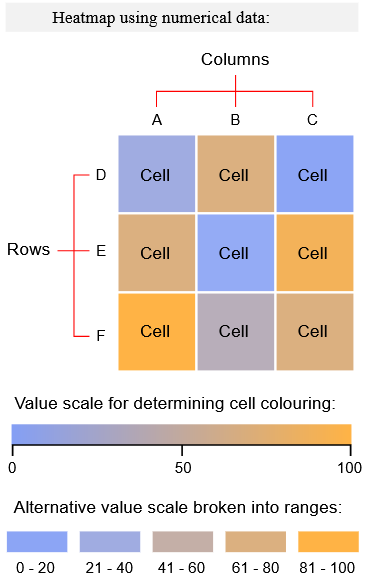
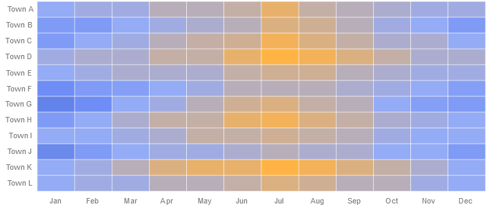

# Heatmap-Chart

----------------------------------------------------------------------

## Overview

- [Goal](#goal)
- [Heatmap-Charts](#bar-charts)
- [Data Structure](#data-structure)
- [GUI Model and Class Diagram](#gui-model-and-class-diagram)
- [Implementation](#implementation)
- [How to use the Chart and Inputs](#how-to-use-the-chart-and-inputs)

----------------------------------------------------------------------


## Goal

The goal of this project was to implement and test a new Angular library which contains a chart, in this case a heatmap-chart, using the ng2-charts library. The chart should be customizable using multiple inputs and different data structures. The functions used in the component were tested with unit-tests.

----------------------------------------------------------------------

## Heatmap-Charts

Heatmap-charts visualize different kinds of data, for instance temperature, in a tabular-like format. They are helpful for finding patterns, relationships between data or other kind of information.




_On the left a heatmap-chart using numerical data and on the right a heatmap using categorical data. Source: [1]_

In a heatmap-chart, a row represent one category of information and a column another. The cells on the other hand, represent information through a color-code. This code can be either through direct coloring , or through numerical values on a color-scale. An additional feature of a heatmap is that information can be analyzed through time, i.e. if a row or column is set to time.

An example of a heatmap-chart can be seen in the following Figure, with detailed information of Heatmap-charts in [1].



_An example heatmap-chart. Source: [1]_

----------------------------------------------------------------------

## Data Structure

The data structure is defined in gem-heatmap-chart-types.types-gen.ts, and the used data structure is GemHeatmapChartData.

### GemHeatmapChartData

GemHeatmapChartData consists of a parameter ***entries***, an array of type ***GemHeatmapChartEntry***. ***GemHeatmapChartEntry*** elements consist of two parameters, that are ***name*** of type string and ***timestamp*** of type number.

An example of a definition of _GemHeatmapChartData_ can be found in the following Listing.

```ts
const entries: GemHeatmapChartEntry[] = [
    {
      name: "Test 4",
      timestamp: 1659001060790
    },
    {
      name: "Test 3",
      timestamp: 1659001080790
    },
    {
      name: "Test 2",
      timestamp: 1659001081090
    },
    {
      name: "Test 1",
      timestamp: 1659001080790
    },
  ];

const dummy : GemHeatmapChartData = {
  entries
}

```
_Listing 3.1: Example of GemHeatmapChartData._

----------------------------------------------------------------------

## GUI Model and Class Diagram

GUI components are used to describe a graphical user interface and its building blocks. 
In this section, GUI model and class diagram implementation details are described and examples are given.

A component is located in a package with a qualified name corresponding to its location.

```
package charts.src.lib.gemheatmapchart;

import charts.src.lib.gemheatmapchart.GemHeatmapChartTypes.GemHeatmapChartData;

component GemHeatmapChart (
  GemHeatmapChartData data,
  String xLabel,
  String yLabel,
  Boolean timestampdata
)
```
_Listing 4.1: GUI model of heatmap-chart._

Listing 4.1 shows an example GUI model for heatmap-charts with input parameters ***data***, ***xLabel***, ***yLabel*** and ***timestampdata***. 

The input parameters and what they mean are described in section [How to use the Chart and Inputs](#how-to-use-the-chart-and-inputs).

In addition to a GUI model, a _class diagram_ is needed to allow describing GUI and its connection to the underlying data structure, such as charts.  Again, a Java-like import is done in this case. An example of a class diagram model can be seen in Listing 4.2.

```
package charts.src.lib.gemheatmapchart;

classdiagram GemHeatmapChartTypes {
  class GemHeatmapChartData {
    List<GemHeatmapChartEntry> entries;
  }

  class GemHeatmapChartEntry {
    String name;
    Integer timestamp;
  }

}
```
_Listing 4.2: Class diagram of heatmap-chart GUI model._

An additional file with interfaces is generated  from the class diagram, which can be imported and used in other components, as seen in Listing 4.1. The generated file  _gem-heatmap-chart-types.types-gen.ts_ can be seen in Listing 4.3.

```ts
  export interface GemHeatmapChartData {
       entries?: GemHeatmapChartEntry[];
  }
  export interface GemHeatmapChartEntry {
       name?: string;
       timestamp?: number;
  }
```
_Listing 4.3: Generated interfaces of heatmap-chart._


----------------------------------------------------------------------

## Implementation

In this section, implementation details and how hand-written files are handled are described.


### Hand-written Code Extension

To make use of our GUI model, the generated code  in _gem-heatmap-chart.component.ts_ has to be extended with the hand-written code. To achieve this, the generated file _gem-heatmap-chart.component-gen.ts_ must be imported into the hand-written _gem-heatmap-chart.component.ts_ and the generated class _GemHeatmapChart_ is used as a parent class for the hand-written one, as seen in the following Listing.

```ts
import { GemHeatmapChart as GemHeatmapChartTOP } from './gem-heatmap-chart/gem-heatmap-chart.component-gen';
import { GemHeatmapChartData } from './gem-heatmap-chart-types/gem-heatmap-chart-types.types-gen';


@Component({
  // ... config
})
export class GemHeatmapChart extends GemHeatmapChartTOP {

  // ... implementation
}
```

_Listing 5.1: Extending generated code with hand-written one._

----------------------------------------------------------------------

## How to use the Chart and Inputs

Note that it is highly recommended to put the whole bar-chart into a `<div>`-element, because the default width of the bar-chart element is calculated in respect to the parent `<div>`’s width.

Next, the possible inputs will be explained in detail and examples for these inputs are given.

### Data

Data in form of _GemHeatmapChartData_.

Data is the most important input, since it contains all information that will be used to plot the heatmap-chart. The elements should have a field _name_ (and _value_ or _timestamp_), other fields will be ignored. When leaving a chart without data input the corresponding montigem-chart will be empty.

```html
<div class="example">
  <gem-heatmap-chart
    [data]="data"
    [xLabel]="''"
    [yLabel]="''"
    [timestampdata]="true"
  >
  </gem-heatmap-chart>
</div>
```
_Listing 6.1: Example for data input, when data is defined as in the [Data Structure](#data-structure) section._
_

### xLabel

xLabel in form of _string._

The input parameter xLabel defines the label for the X-Axis. If none is given, the default is none.

```html
<div class="example">
  <gem-heatmap-chart
    [data]="data"
    [xLabel]="''"
  >
  </gem-heatmap-chart>
</div>
```
_Listing 6.2: Example for xLabel input, when data is defined as in the [Data Structure](#data-structure) section._
_

### yLabel

yLabel in form of _string._

The input parameter yLabel defines the label for the Y-Axis. If none is given, the default is none.

```html
<div class="example">
  <gem-heatmap-chart
    [data]="data"
    [yLabel]="''"
  >
  </gem-heatmap-chart>
</div>
```
_Listing 6._

### Timestampdata

Timestampdata in form of _boolean._

Timestampdata decide wether the second relevant field for input parameter _data_ is "value" (if false) or "timestamp" (if true). The default is false.

```html
<div class="example">
  <gem-heatmap-chart
    [data]="data"
    [timestampdata]="true"
  >
  </gem-heatmap-chart>
</div>
```
_Listing 6._

----------------------------------------------------------------------

## References

[1] _The Data Visualisation Catalogue - Heatmap. https://datavizcatalogue.com/methods/heatmap.html. Accessed: 2022-08-04.