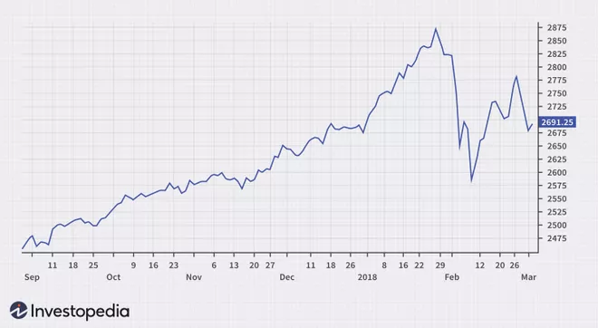

# Line-Chart

----------------------------------------------------------------------

## Overview

- [Goal](#goal)
- [Line-Charts](#line-charts)
- [Data Structure](#data-structure)
- [GUI Model and Class Diagram](#gui-model-and-class-diagram)
- [Implementation](#implementation)
- [How to use the Chart and Inputs](#how-to-use-the-chart-and-inputs)

----------------------------------------------------------------------


## Goal

The goal of this project was to implement and test a new Angular library which contains a chart, in this case a line-chart, using the ng2-charts library. The chart should be customizable using multiple inputs and different data structures. The functions used in the component were tested with unit-tests.

----------------------------------------------------------------------

## Line Charts

Line chart is a graphical representation to describe the data changes over a given period. It is connected by straight line segments. The horizontal axis is usually a time scale; for example, minutes, hours, days, months, or years, while the vertical axis would have the values. 


_A line chart_



_An line chart provides traders with a visualization of where the price of a security has traveled over a given period.  Source: [1]_

----------------------------------------------------------------------

## Data Structure

The data structure is defined in gem-line-chart-types.types-gen.ts, and the used data structure is GemLineChartData.

### GemLineChartData

GemLineChartData consists of the parameters ***entries*** and ***labels***, where ***entries*** is an array of type ***GemLineChartEntry***. ***GemLineChartEntry*** elements consist of four parameters, that are ***label*** of type string, ***data*** of type number array, ***borderColor*** and ***backgroundColor***  are types of string.
***labels*** is the list of string.

An example of a definition of _GemLineChartEntry_ can be found in the following Listing.

```ts
const entries2: GemLineChartEntry[] = [
  { data: [8, 7, 8, 7, 7, 5], label: 'Label2', borderColor: 'black', backgroundColor: "rgba(246, 168, 0, 0.2)" },
  { data: [8, 0, 3, 7, 7, 7], label: 'Label3', borderColor: 'orange', backgroundColor: "rgba(246, 168, 0, 0.2)" },
  { data: [5, 2, 8, 0, 7, 0], label: 'Label4', borderColor: 'brown', backgroundColor: "rgba(246, 168, 0, 0.2)" },
  { data: [5, 2, 7, 2, 6, 1], label: 'Label6', backgroundColor: "rgba(246, 168, 0, 0.2)" },
];


```
_Listing 3.1: Example of GemLineChartEntry._

----------------------------------------------------------------------

## GUI Model and Class Diagram

GUI components are used to describe a graphical user interface and its building blocks. 
In this section, GUI model and class diagram implementation details are described and examples are given.

A component is located in a package with a qualified name corresponding to its location.

```
package charts.src.lib.gemlinechart;

import charts.src.lib.gemlinechart.GemLineChartTypes.GemLineChartData;

component GemLineChart(
  GemLineChartData data,
  Object displayValue,
  Boolean enableBackgroundColor,
  Integer maxValue,
  Integer minValue
)
```
_Listing 4.1: GUI model of line-chart._

Listing 4.1 shows an example GUI model for line-charts with input parameters ***data***, ***displayValue***, ***enableBackgroundColor***, ***maxValue*** and ***minValue***.

The input parameters and what they mean are described in section [How to use the Chart and Inputs](#how-to-use-the-chart-and-inputs).

In addition to a GUI model, a _class diagram_ is needed to allow describing GUI and its connection to the underlying data structure, such as charts.  Again, a Java-like import is done in this case. An example of a class diagram model can be seen in Listing 4.2.

```
package charts.src.lib.gemlinechart;

classdiagram GemLineChartTypes {

  class GemLineChartData {
    List<GemLineChartEntry> entries;
    List<String> labels;
  }
 
  class GemLineChartEntry {
    String label;
    List<Integer> data;
    String borderColor;
    String backgroundColor;
  }

}
```
_Listing 4.2: Class diagram of line-chart GUI model._

An additional file with interfaces is generated from the class diagram, which can be imported and used in other components, as seen in Listing 4.1. The generated file  _gem-line-chart-types.types-gen.ts_ can be seen in Listing 4.3.

```ts
  export interface GemLineChartData {
       entries?: GemLineChartEntry[];
       labels?: string[];
  }
  export interface GemLineChartEntry {
       label?: string;
       data?: number[];
       borderColor?: string;
       backgroundColor?: string;
  }
```
_Listing 4.3: Generated interfaces of line-chart._


----------------------------------------------------------------------

## Implementation

In this section, implementation details and how hand-written files are handled are described.


### Hand-written Code Extension

To make use of our GUI model, the generated code  in _gem-line-chart.component.ts_ has to be extended with the hand-written code. To achieve this, the generated file _gem-line-chart.component-gen.ts_ must be imported into the hand-written _gem-line-chart.component.ts_ and the generated class _GemLineChart_ is used as a parent class for the hand-written one, as seen in the following Listing.

```ts
import { GemLineChartData } from './gem-line-chart-types/gem-line-chart-types.types-gen';
import { GemLineChart as GemLineChartTOP } from './gem-line-chart/gem-line-chart.component-gen';


@Component({
  // ... config
})
export class GemLineChart extends GemLineChartTOP {

  // ... implementation
}
```

_Listing 5.1: Extending generated code with hand-written one._

----------------------------------------------------------------------

## How to use the Chart and Inputs

Note that it is highly recommended to put the whole bar-chart into a `<div>`-element, because the default width of the bar-chart element is calculated in respect to the parent `<div>`’s width.

Next, the possible inputs will be explained in detail and examples for these inputs are given.

### Data

Data in form of _GemLineChartData_.

Data is the most important input, since it contains all information that will be used to plot the line-chart. When leaving a chart without data input the corresponding montigem-chart will be empty.

```html
<div class="example">
  <gem-line-chart 
    [data]="data"
    [maxValue]="maxValue"
    [minValue]="minValue"
    [displayValue]="displayValue"
    [enableBackgroundColor]="enableBackgroundColor"
    >
  </gem-line-chart>
</div>
```
_Listing 6.1: Example for data input, when data is defined as in the [Data Structure](#data-structure) section._
_

### maxValue

maxValue in form of _Integer_.

The input parameter maxValue defines the max value of the data. If none is given, the default is none.

```html
<div class="example">
  <gem-line-chart
    [maxValue]="maxValue"
  >
  </gem-line-chart>
</div>
```
_Listing 6.2: Example for maxValue input, when data is defined as in the [Data Structure](#data-structure) section._
_

### minValue

minValue in form of _Integer_.

The input parameter yLabel defines the label for the min value. If none is given, the default is none.

```html
<div class="example">
  <gem-line-chart
    [minValue]="minValue"

  >
  </gem-line-chart>
</div>
```
_Listing 6.3: Example for minValue input, when data is defined as in the [Data Structure](#data-structure) section._

### displayValue

displayValue in form of _Integer_.

displayValue is ths displayed value. 

```html
<div class="example">
  <gem-line-chart
    [displayValue]="displayValue"
    
  >
  </gem-line-chart>
</div>
```
_Listing 6.4: Example for displayValue input, when data is defined as in the [Data Structure](#data-structure) section._


### enableBackgroundColor

enableBackgroundColor in form of _Boolean_.

enableBackgroundColor is to decide whether the background color is rendered.
```html
<div class="example">
  <gem-line-chart 
    [enableBackgroundColor]="enableBackgroundColor"
  >
  </gem-line-chart>
</div>
```
_Listing 6.5: Example for enableBackgroundColor input, when data is defined as in the [Data Structure](#data-structure) section._

----------------------------------------------------------------------

## References

[1] _investopedia - LineChart. https://www.investopedia.com/terms/l/linechart.asp Accessed: 2022-10-12.