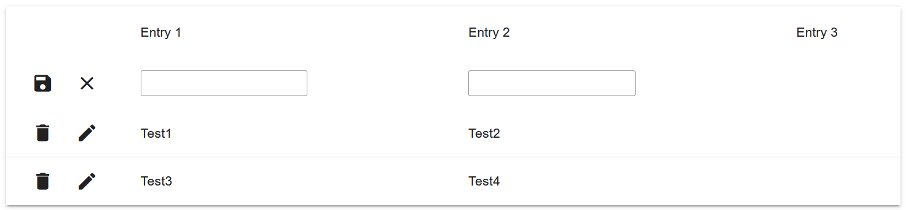

# GemTable

----------------------------------------------------------------------

[[_TOC_]]

----------------------------------------------------------------------

## Description 

A table organizes and displays data in rows and columns. Data tables allow users to input, edit, and manipulate data easily, perform calculations and analyses, sort and filter data.

A visualization of a table can be seen in the following Figure.



----------------------------------------------------------------------

## GUI Model and Class Diagram

GUI components are used to describe a graphical user interface and its building blocks. 
In this section, GUI model and class diagram implementation details are described and examples are given.

A component is located in a package with a qualified name corresponding to its location.

```
package table.src.lib.gemtable;

import table.src.lib.gemtable.TableTypes.TableColumn;

component GemTable(
  List rows,
  List columns,
  Event edit,
  Event update,
  Event cancelUpdate,
  boolean canDelete,
  Event delete,
  boolean canCreate,
  Event create,
  Event cancelCreate,

  Object cellStyle,
  Object tableContainerStyle,
  boolean compactStyle,
  boolean hasColumnFooter,
  GUIViewElement footerTemplate,
  Object activeRow,
  Object inactiveRowStyle,
  boolean isFilterable,
  Object sortDirection,
  List selection,
  Event batchModeToggle,
  Event rowsSelect,
  Object selectionType,
  boolean batchMode,
  Object staticRow,
  Object extendableRow,
  Object groupClass,
  Object groupTooltip,
  Object rowClass,
  GUIViewElement filterTemplate,
  boolean canHideColumns,
  boolean isGroupable,
  boolean hasShowInactiveBtn,
  boolean alwaysEdit
)
```
_GUI model of GemTable-chart._

The component has many input properties, the most important are:
* `rows` - define the data displayed in a table
* `columns` - define the table header, what properties of rows are shown in each column, etc.

The CRUD properties define how objects displayed in the row are managed:
* `edit` - event emitted when a row is activated for an edit action (click on edit button)
* `update` - event emitted when the save button is clicked in a row 
* `cancelUpdate` - event emitted when the save is cancelled (click on cancel button for edited row)
* `canDelete` - whenever user should be able to delete a row, automatically set to true if an action for `delete` is defined
* `delete` - event emitted when the delete button is clicked in a row
* `canCreate` - whenever user should be able to create a new row, automatically set to true if an action for `create` is defined.
* `create` - event emitted when the save button is clicked in a create-row
* `cancelCreate` - event emitted when the cancel button is clicked in a create-row
